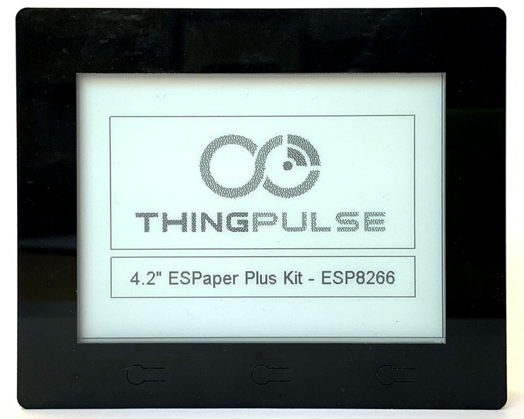

# 4.2″ ESPaper Plus Kit {#42-espaper-plus-kit}

So richtest du das [ThingPulse 4.2″ ESPaper Plus Kit](https://thingpulse.com/product/4-2″-espaper-plus-kit-wifi-epaper-display/) ein.

---

Das ThingPulse-ESPaper-Gerät mit 4,2-Zoll-Display wird mit einer Firmware ausgeliefert, die direkt mit unserer Webanwendung unter [https://www.espaper.com](https://www.espaper.com) verwendet werden kann. Dort kannst du die Bildschirminhalte bequem im Browser mit einem Editor oder vordefinierten Vorlagen gestalten. Nach deinem Zeitplan wacht das Gerät auf, verbindet sich mit dem WLAN und lädt den neuesten Bildschirminhalt vom ESPaper-Server herunter.

Die folgende Anleitung führt dich durch die Einrichtung.

Öffne zunächst [https://www.espaper.com](https://www.espaper.com) und erstelle ein Konto. Du kannst dich mit E-Mail-Adresse und Passwort oder über eine der angebotenen Anmeldemöglichkeiten für soziale Netzwerke anmelden.

## Gerät mit dem Internet verbinden {#connecting-device-to-the-internet}

- Lade das Gerät auf.
- Halte die linke Taste gedrückt, während du das Gerät mit dem Ein-/Ausschalter einschaltest.
- Das Gerät wechselt in den Konfigurationsmodus. Folge den Anweisungen auf dem Display:
    - Verbinde dein Smartphone oder deinen Laptop mit dem WLAN „ESPaperConfig“ und öffne http://192.168.4.1 im Browser.
    - Gib im Formular die Zugangsdaten deines lokalen WLANs (SSID und Passwort) ein. Lege auch das Aufwachintervall und die Zeitzone fest.
    - Klicke auf „Save“.
- Drücke die rechte Taste (Reset), um das Gerät neu zu starten.

## Gerät mit dem espaper.com-Konto verknüpfen {#pairing-device-with-espapercom-account}

Falls du noch kein Konto unter https://www.espaper.com erstellt hast, hole das jetzt nach.

- Nach dem Neustart zeigt das Gerät einen Bildschirm zur Verknüpfung mit einem Einmalpasswort an.
- Öffne [https://www.espaper.com](https://www.espaper.com) im Browser und melde dich an.
- Klicke auf „Register Device“.
- Gib das auf dem Gerät angezeigte Einmalpasswort ein.
- Ordne das Gerät deinem Konto zu, wenn die angezeigten Informationen stimmen.

## Bildschirminhalt gestalten {#defining-device-content}

- Klicke beim gerade verknüpften Gerät auf „Screen“.
- Gestalte den Bildschirminhalt:
    - Füge statische Elemente wie Linien, Rechtecke, Kreise, Symbole oder Text hinzu.
    - Verwende eine vordefinierte Vorlage aus dem Reiter „Widgets“. Du kannst die verfügbaren Vorlagen durch zusätzliche Anwendungen erweitern, beispielsweise für iCal-Kalender oder Wetterinformationen.
- Speichere den Inhalt im Editor. Das Gerät zeigt ihn bei der nächsten Aktualisierung an. Warte dazu bis zum nächsten Aktualisierungsintervall oder drücke die Reset-Taste am Gerät.

## Video {#video}

Das folgende Video zeigt die oben beschriebenen Schritte und dient als visuelle Orientierung.

<iframe src="https://www.youtube.com/embed/4Ei7pPDt_iY" width="560" height="315" frameborder="0" allowfullscreen="allowfullscreen"></iframe>
