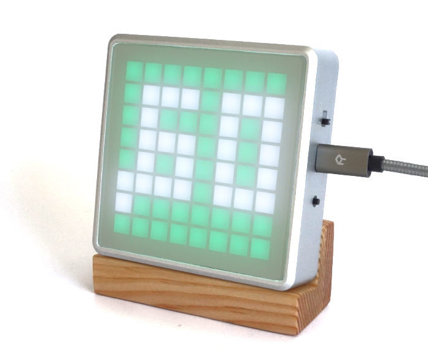
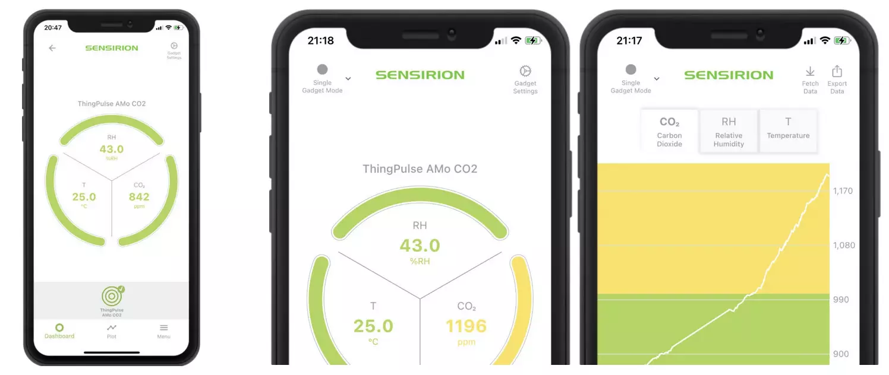

# AMo – CO2-Monitor {#amo-co2-monitor}

So verwendest und konfigurierst du den CO2-Monitor [ThingPulse AMo](https://thingpulse.com/product/amo-co2-monitor/).

## AMo verwenden {#using-the-amo}

Der AMo ist ein echtes Plug-and-play-Gerät. Verbinde ihn über den Micro-USB-Anschluss mit einer Stromquelle und schalte ihn ein. Der hochwertige CO2-Sensor kalibriert sich innerhalb weniger Minuten selbst.

**Die 10-Sekunden-Anleitung:** Mit der Taste auf der rechten Seite schaltest du die akustische Warnung aus und wieder ein.

Die vollständige Anleitung folgt unten.

### CO2-Messwerte auf dem Display {#co2-readings-on-display}

Die Darstellung der CO2-Messwerte ist auf das 8×8-LED-Display abgestimmt. Der AMo zeigt ein Tausendstel des tatsächlichen Messwerts an, gerundet auf eine oder zwei Nachkommastellen und ohne führende Null. Dadurch werden immer insgesamt zwei Ziffern angezeigt, wie die Beispiele unten zeigen.

CO2 wird in „ppm“ gemessen, also [parts per million](https://en.wikipedia.org/wiki/Parts-per_notation) (Teile pro Million). Seit Beginn der industriellen Revolution ist die CO2-Konzentration in der Atmosphäre auf über 400 ppm gestiegen und nimmt weiter zu, was zur globalen Erwärmung beiträgt. Im normalen Betrieb wirst du deshalb keine Werte unter 400 ppm sehen.

**Beispiele:**

- 603 ppm → .60
- 613 ppm → .61
- 615 ppm → .62
- 994 ppm → .99
- 995 ppm → 1.0
- 1249 ppm → 1.2
- 1250 ppm → 1.3

### CO2-Werte überwachen und Warnungen ausgeben {#monitoring-co2-levels-alerting}

Der AMo verwendet ein Ampelsystem. Je nach CO2-Konzentration wechselt die Hintergrundfarbe des Displays von Grün über Gelb zu Rot. In der gelben Stufe blinkt das Display langsam, in der roten schnell. In der roten Stufe gibt der eingebaute Lautsprecher zusätzlich alle 10 Sekunden einen Signalton aus. Die folgende Tabelle zeigt die Einstellungen.

Welcher CO2-Bereich in Innenräumen als „gesund“ gilt und ab welchem Wert Büros, Klassenzimmer, Restaurants usw. gelüftet werden sollten, ist Gegenstand wissenschaftlicher Diskussionen. Solange eindeutige Richtlinien fehlen, verwendet ThingPulse für den AMo vorsichtige Standardwerte.

Hinweis: Zu viel CO2 beziehungsweise zu wenig Sauerstoff kann unter anderem zu Müdigkeit und Kopfschmerzen führen.

| CO2 | Farbe | Blinkverhalten | Akustische Warnung |
|---------------|-------|----------------|--------------------|
| <850 ppm | Grün | – | – |
| 850–1000 ppm | Gelb | langsam | – |
| >1000 ppm | Rot | schnell | alle 10 Sekunden |

### Akustische Warnung ausschalten {#turning-off-acoustic-alerting}

In manchen Umgebungen sind akustische Warnungen störend. Mit der Taste auf der rechten Seite kannst du sie ausschalten und wieder einschalten. Nach dem Drücken zeigt der AMo kurz eines der beiden Lautsprechersymbole an, damit du erkennst, ob die akustische Warnung aus- oder eingeschaltet ist.

## Mobile Apps {#mobile-apps}

AMo ist vollständig mit Sensirion Smart Gadget kompatibel. Installiere die App MyAmbience für iOS oder Android, um Sensordaten auf deinem Mobilgerät darzustellen und zu überwachen.

## AMo konfigurieren {#configuring-the-amo}

Wenn du die Warnschwellen, die LED-Helligkeit oder die Lautstärke ändern möchtest, lade [ThingPulse App Fairy](https://github.com/ThingPulse/app-fairy) herunter und starte die Anwendung. Sie ersetzt die vorhandene Firmware vollständig durch die Version, die du in App Fairy konfiguriert hast.

!!! warning "Warnung"
    Gehe sorgfältig vor! Der Vorgang ist zwar einfach und robust, Fehlfunktionen lassen sich jedoch nicht ausschliessen. Melde dich bei uns, wenn du nicht weiterkommst.

- [Installiere](../how-tos/install-drivers.md) zunächst den Silicon-Labs-USB-Seriell-Treiber auf deinem Computer oder Mac.
- Verbinde den AMo über USB mit deinem Computer oder Mac und schalte ihn ein.
- Starte App Fairy.
- Wähle „Icon64“ als Gerätetyp und „CO2 Monitor“ als Anwendung.
- Gib im Konfigurationsdialog `scd4x` als Sensortyp ein.
