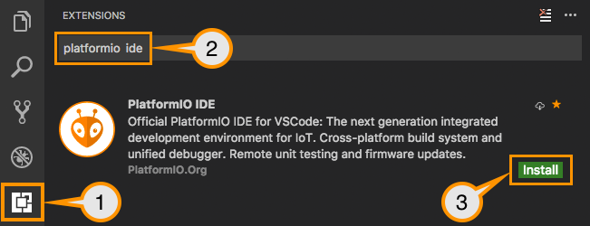

# Entwicklungsumgebung

!!! tip "Möchtest du dein Kit ohne Programmieren nutzen?"

    [Installiere Gadget OS direkt im Browser](gadget-os.md) und richte es auf dem Touchscreen ein. Die Entwicklungswerkzeuge unten brauchst du nur für den Wetterstations-Programmierweg.

Auf dieser Seite richtest du deinen Computer ein, um das [Wetterstationsprojekt](weather-station.md) zu konfigurieren und auf das Gerät zu übertragen. Diese Einrichtung ist nur einmal nötig.

Du installierst drei Werkzeuge: **Visual Studio Code** (VS Code) als Editor, **Git** zum Herunterladen einer benötigten Projektbibliothek und **PlatformIO IDE**, die VS-Code-Erweiterung zum Kompilieren und Übertragen der Firmware. Dein Computer benötigt während der Einrichtung eine Internetverbindung.

## Installation

### 1. Visual Studio Code installieren

1. Lade die Desktopversion von [Visual Studio Code](https://code.visualstudio.com/) für dein Betriebssystem herunter.
2. Installiere und öffne sie.

### 2. Git installieren {#git-installieren}

Git ist auch dann erforderlich, wenn du das Wetterstationsprojekt als ZIP-Datei herunterlädst. PlatformIO lädt damit eine Bibliothek herunter, die das Projekt benötigt.

1. Folge der [Git-Installationsanleitung](https://git-scm.com/install/) für dein Betriebssystem. Ist Git bereits installiert, gehe direkt zur Prüfung unten.
2. Beende VS Code nach der Installation vollständig und öffne es erneut.
3. Wähle in VS Code **Terminal > New Terminal**. Gib im geöffneten Terminalbereich den folgenden Befehl ein und drücke Enter:

    ```text
    git --version
    ```

Die Antwort sollte mit `git version` beginnen, gefolgt von einer Versionsnummer. Wird der Befehl nicht gefunden oder nicht erkannt, schliesse die Git-Installation ab und starte VS Code neu, bevor du fortfährst. Bei Bedarf hilft die [Git-Fehlerbehebung](troubleshooting.md#softwareprobleme).

### 3. PlatformIO IDE installieren

1. Öffne in VS Code **View > Extensions**. Alternativ kannst du unter Windows/Linux **Ctrl+Shift+X** und unter macOS **Cmd+Shift+X** verwenden.
2. Suche nach **PlatformIO IDE** und wähle die Erweiterung des Herausgebers **PlatformIO**.
3. Klicke auf **Install**. Warte, bis die Erweiterung und ihre Ersteinrichtung abgeschlossen sind; das kann einige Minuten dauern. Folge einer allfälligen Aufforderung, VS Code neu zu starten oder neu zu laden.
4. Klicke auf das **PlatformIO**-Symbol in der linken Seitenleiste und öffne **Home** unter **Quick Access**.



!!! note "Einrichtung unter Linux"

    Unter Linux benötigt PlatformIO zusätzlich das Paket `python3-venv`. Hinweise dazu und weitere Hilfe findest du in der [offiziellen Installationsanleitung](https://docs.platformio.org/en/latest/integration/ide/vscode.html#installation).

## Bereit für den nächsten Schritt?

Du bist bereit, wenn:

- `git --version` im VS-Code-Terminal eine Versionsnummer ausgibt.
- PlatformIO Home ohne Installationsfehler geöffnet wird.

Fahre mit dem **[Wetterstationsprojekt](weather-station.md#quellcode-herunterladen)** fort, um das bestehende Projekt herunterzuladen und zu öffnen. Du musst kein neues PlatformIO-Projekt erstellen und das Blink-Tutorial nicht durcharbeiten.

## Wenn die Einrichtung nicht klappt

- **PlatformIO fehlt in der Seitenleiste:** Öffne **View > Extensions** und prüfe, ob PlatformIO IDE installiert und aktiviert ist. Lass die Einrichtung abschliessen und starte VS Code anschliessend neu.
- **PlatformIO meldet einen Installationsfehler:** Notiere die genaue Meldung und sieh in der [PlatformIO-Installationsanleitung](https://docs.platformio.org/en/latest/integration/ide/vscode.html#installation) nach. Kommst du nicht weiter, [kontaktiere den Support](troubleshooting.md#support-kontaktieren) mit deinem Betriebssystem und der Fehlermeldung oder einem Screenshot.
- **PlatformIO fordert dich auf, Git zu installieren:** Folge oben dem Abschnitt [Git installieren](#git-installieren) und prüfe den Befehl in einem neu geöffneten VS-Code-Terminal.

## Videoanleitung

Wenn du lieber ein Video ansiehst, findest du auf der Seite [Videoanleitungen](video-tutorials.md) eine Einführung zur Einrichtung der Entwicklungsumgebung.
