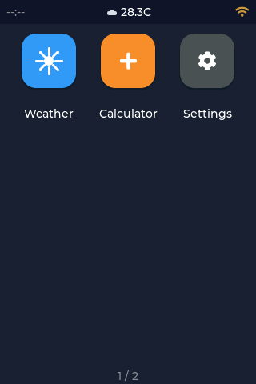
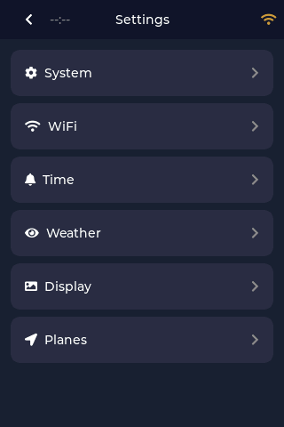
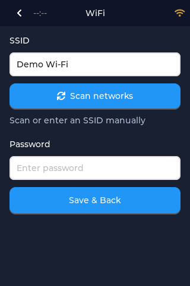
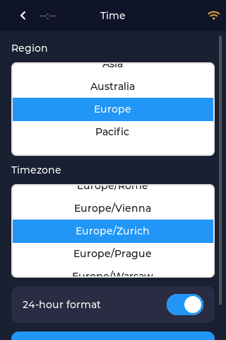
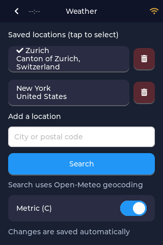
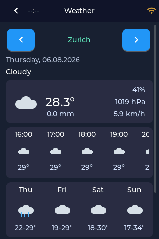

# Gadget OS Setup

Install Gadget OS directly from your browser and configure your Color Kit Grande on its touchscreen. **No coding or development environment is required.** This is the recommended starting point if you want to start using your kit without editing code.

Gadget OS includes a Weather app and other touchscreen tools. Its weather service does not require a personal API key.

The screenshots below come from the [Gadget OS user guide](https://github.com/ThingPulse/esp32-gadget-os/blob/master/USER_GUIDE.md) and show example data. Your locations, readings, and connection status will differ. Click an image to enlarge it.

## Before you start

- Complete the [assembly instructions](assembly.md), including the display and touch test, before installing Gadget OS.
- Have a USB data cable and a computer with **Google Chrome or Microsoft Edge** ready.
- Connect your computer to the internet and have your Wi-Fi network name and password available.

## Install from the browser

1. Connect the Color Kit Grande to your computer with the USB data cable and turn its power switch on.
2. Open the [ThingPulse App Market](https://app-market.thingpulse.com/) in Chrome or Edge.
3. Select **Color Kit Grande**, then **Gadget OS**.
4. Click **Connect & Install** and select the serial device belonging to your kit.
5. Follow the installer’s prompts. Keep the kit connected until the installer reports that flashing has completed successfully.
6. Wait for Gadget OS to start. You should see its touchscreen home screen with app icons.

{ width="240" }

Installing Gadget OS replaces the application currently running on the kit, including the assembly test program.

!!! tip "This completes the browser installation"

    Continue with touchscreen setup below. The **Development Environment** and **Weather Station Project** pages describe the alternative coding path; their separate filesystem and firmware uploads are not additional Gadget OS setup steps.

## Set up on the touchscreen

Open **Settings** from the Gadget OS home screen. Use the back arrow at the upper left to return to the previous screen.

{ width="240" }

### 1. Connect to Wi-Fi

1. Open **Settings > Wi-Fi** and tap **Scan networks**.
2. Select your network and enter its password using the on-screen keyboard.
3. Tap **Save & Back** and allow a few seconds for the connection.

The Wi-Fi symbol becomes steady white when connected. For a hidden network, enter its name manually in **SSID**.

{ width="240" }

### 2. Set your time zone

1. Open **Settings > Time**.
2. Select your region and time zone, then choose the clock format you prefer.
3. Save the settings and return.

The clock sets itself over the internet after Wi-Fi connects.

{ width="240" }

### 3. Choose a weather location

1. Open **Settings > Weather**.
2. Under **Add a location**, enter a city or postal code and tap **Search**.
3. Select the correct result, then tap the saved location to make it active. A check mark identifies the active location.

Locations are saved automatically. Use the metric switch to choose your preferred units.

{ width="240" }

## Check the result

Return to the home screen and open **Weather**. Check that the correct location, weather readings, and icons appear, and that the clock shows your local time. Your settings are saved for the next restart.

{ width="240" }

**Your kit is ready to use.** You can stay with Gadget OS; you do not need to follow the coding pages next.

## If something does not work

| Problem | What to try |
|---------|-------------|
| The browser does not offer your kit as a serial device | Use Chrome or Edge and a USB data cable. Follow [USB connection troubleshooting](troubleshooting.md#usb-not-detected), including the driver check. |
| Installation fails | Keep the error message and follow the [hardware and connection checks](troubleshooting.md#hardware-problems). If you contact support, mention that you are installing Gadget OS through the App Market. |
| The screen is blank or touch does not respond | Follow the [display](troubleshooting.md#dark-display) or [touch](troubleshooting.md#touch-not-working) checks. |
| Wi-Fi does not connect | Reopen **Settings > Wi-Fi** and check the network name and password. |
| The clock is not set or shows the wrong time | Check the Wi-Fi connection and **Settings > Time**, then allow time for synchronization. |
| Weather does not load | Check Wi-Fi and the active location under **Settings > Weather**. Pull down on the Weather screen to retry. |

If the problem remains, [contact support](troubleshooting.md#contact-support) with your Gadget OS version from **Settings > System**, the symptom, and any error message or photo.

## Update Gadget OS

With Wi-Fi connected, open **Settings > Software Update** to check for updates and follow the on-screen prompts. Updates can be installed over Wi-Fi without using VS Code or reconnecting to the browser installer.

## Learn more

- [Gadget OS introduction and setup video](https://thingpulse.com/blog/gadget-os-color-kit-grande/)
- [Gadget OS user guide](https://github.com/ThingPulse/esp32-gadget-os/blob/master/USER_GUIDE.md)
- Want to customize the separate Weather Station sample instead? Start with [Development Environment](development-environment.md), then follow [Weather Station Project](weather-station.md). Installing that project replaces Gadget OS.
