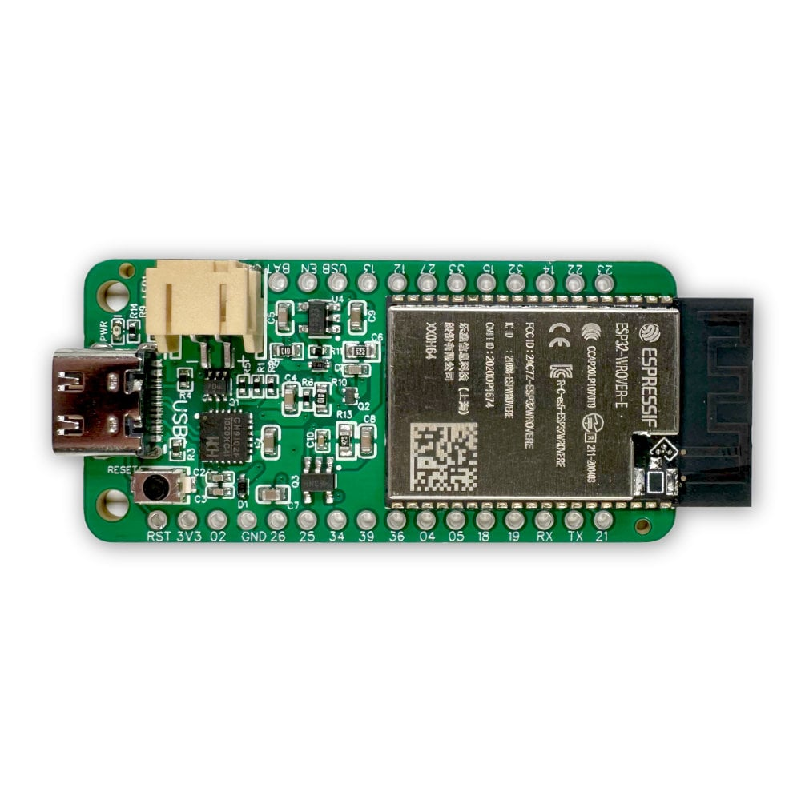
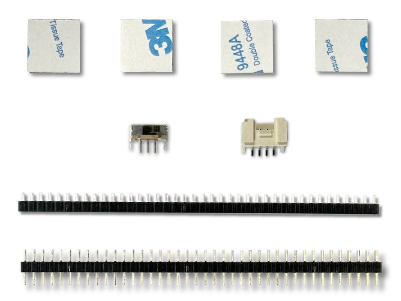
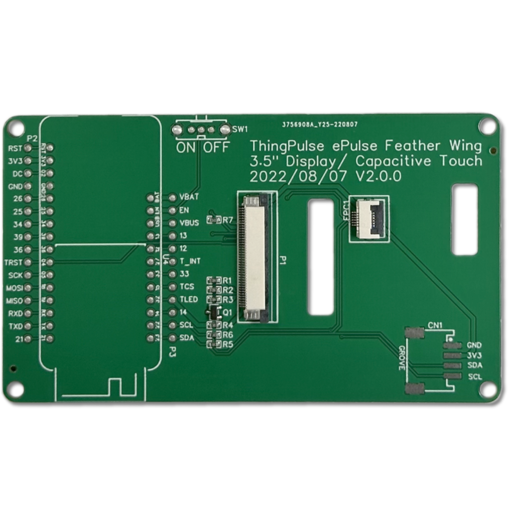
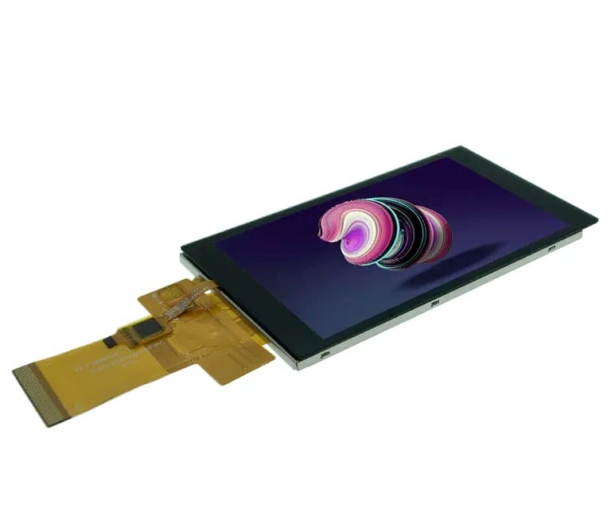
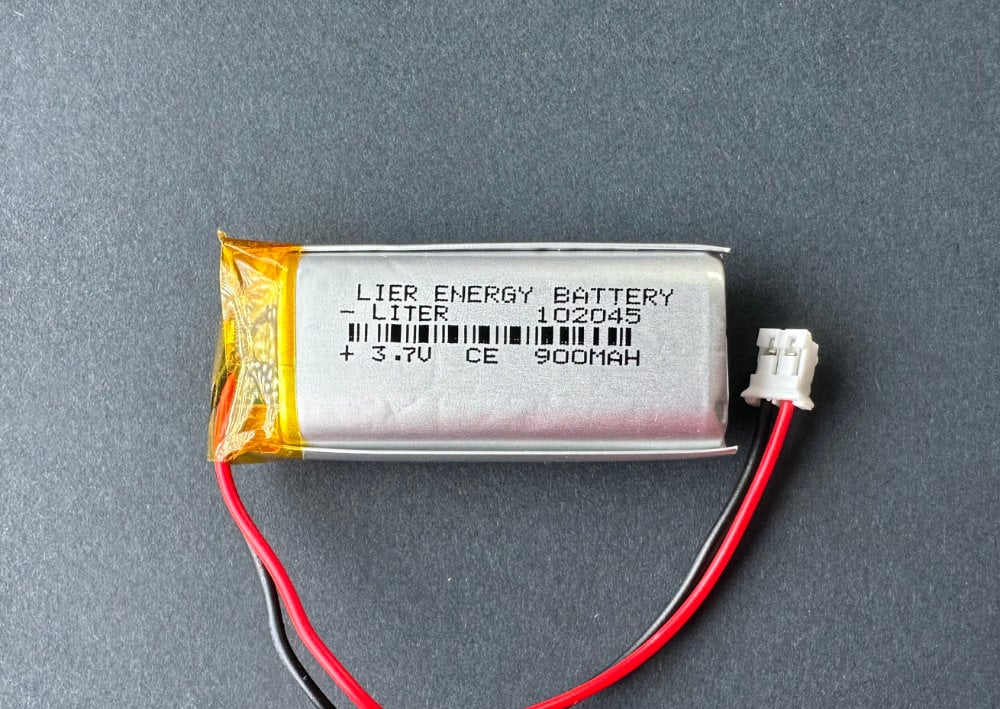
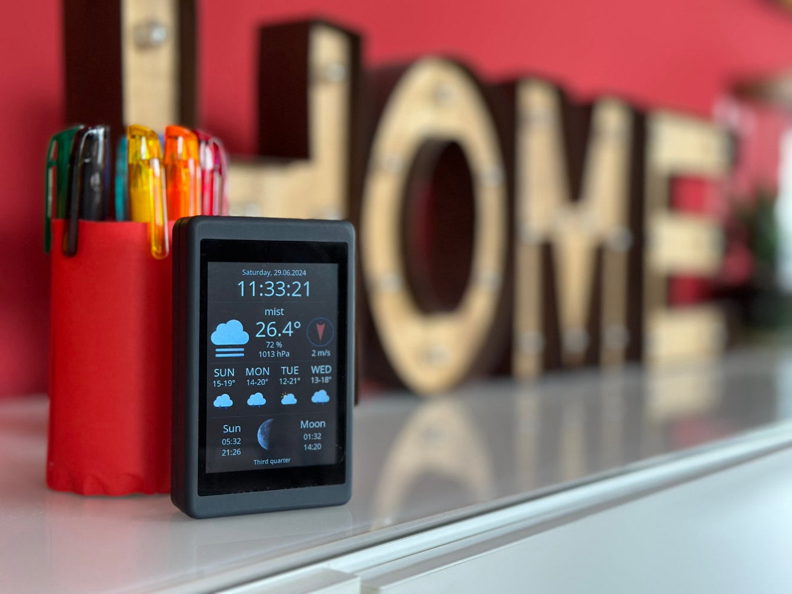

# Ersatzteile

Benötigst du ein Ersatzteil oder eine Erweiterung für dein Color Kit Grande? Diese Teile findest du im ThingPulse-Shop.

!!! note "Hinweis"

    Akku und Gehäuse sind optionales Zubehör und nicht im Color-Kit-Grande-Bausatz enthalten.

| Bauteil | Produkt | Wann du es benötigst |
|------|---------|-------------|
| [{ width="120" }](https://thingpulse.com/product/epulse-feather-low-power-esp32-development-board/?utm_source=docs&utm_medium=color-kit-grande-guide&utm_campaign=replacement-parts&utm_content=epulse-feather) | [ESP32 ePulse Feather – stromsparende Entwicklungsplatine](https://thingpulse.com/product/epulse-feather-low-power-esp32-development-board/?utm_source=docs&utm_medium=color-kit-grande-guide&utm_campaign=replacement-parts&utm_content=epulse-feather) | Ersetze die ESP32-Hauptplatine, wenn sie nicht mehr startet, sich auch einzeln nicht flashen lässt oder der USB-C-Anschluss bzw. die Pins beschädigt sind. |
| [{ width="120" }](https://thingpulse.com/product/color-kit-grande-spare-parts/?utm_source=docs&utm_medium=color-kit-grande-guide&utm_campaign=replacement-parts&utm_content=spare-parts) | [Color Kit Grande – Ersatzteile](https://thingpulse.com/product/color-kit-grande-spare-parts/?utm_source=docs&utm_medium=color-kit-grande-guide&utm_campaign=replacement-parts&utm_content=spare-parts) | Verwende dieses Set, wenn Stift- oder Buchsenleisten, der Ein-/Ausschalter, die Grove-Buchse oder Schaumstoff-Klebepads beim Zusammenbau verloren gegangen oder beschädigt worden sind. |
| [{ width="120" }](https://thingpulse.com/product/color-kit-grande-connector-board/?utm_source=docs&utm_medium=color-kit-grande-guide&utm_campaign=replacement-parts&utm_content=connector-board) | [Color Kit Grande – Anschlussplatine](https://thingpulse.com/product/color-kit-grande-connector-board/?utm_source=docs&utm_medium=color-kit-grande-guide&utm_campaign=replacement-parts&utm_content=connector-board) | Ersetze die Anschlussplatine, wenn Lötpads, Leiterbahnen, FPC-Steckverbinder oder Lötstellen irreparabel beschädigt sind. |
| [{ width="120" }](https://thingpulse.com/product/3-5%E2%80%B3-320x480-color-tft-ili9488-with-capacitive-touch-interface-ft6236/?utm_source=docs&utm_medium=color-kit-grande-guide&utm_campaign=replacement-parts&utm_content=display-ili9488-ft6236) | [3,5-Zoll-Farb-TFT ILI9488 mit 320 × 480 Pixeln und kapazitiver Touch-Schnittstelle FT6236](https://thingpulse.com/product/3-5%E2%80%B3-320x480-color-tft-ili9488-with-capacitive-touch-interface-ft6236/?utm_source=docs&utm_medium=color-kit-grande-guide&utm_campaign=replacement-parts&utm_content=display-ili9488-ft6236) | Ersetze das Display, wenn das Panel, die Touch-Schnittstelle oder der FPC-Flachbandanschluss beschädigt ist. |
| [{ width="120" }](https://thingpulse.com/product/color-kit-grande-battery-lipo-900mah/?utm_source=docs&utm_medium=color-kit-grande-guide&utm_campaign=replacement-parts&utm_content=battery-lipo-900mah) | [Color Kit Grande – LiPo-Akku mit 900 mAh](https://thingpulse.com/product/color-kit-grande-battery-lipo-900mah/?utm_source=docs&utm_medium=color-kit-grande-guide&utm_campaign=replacement-parts&utm_content=battery-lipo-900mah) | Ergänze oder ersetze den LiPo-Akku, wenn du das Gerät mobil betreiben möchtest oder die Kapazität des vorhandenen Akkus nicht mehr ausreicht. |
| [{ width="120" }](https://thingpulse.com/product/color-kit-grande-enclosure/?utm_source=docs&utm_medium=color-kit-grande-guide&utm_campaign=replacement-parts&utm_content=enclosure) | [Color Kit Grande – Gehäuse](https://thingpulse.com/product/color-kit-grande-enclosure/?utm_source=docs&utm_medium=color-kit-grande-guide&utm_campaign=replacement-parts&utm_content=enclosure) | Das Gehäuse schützt den zusammengebauten Bausatz und eignet sich für den täglichen Einsatz auf dem Schreibtisch oder an der Wand. |
