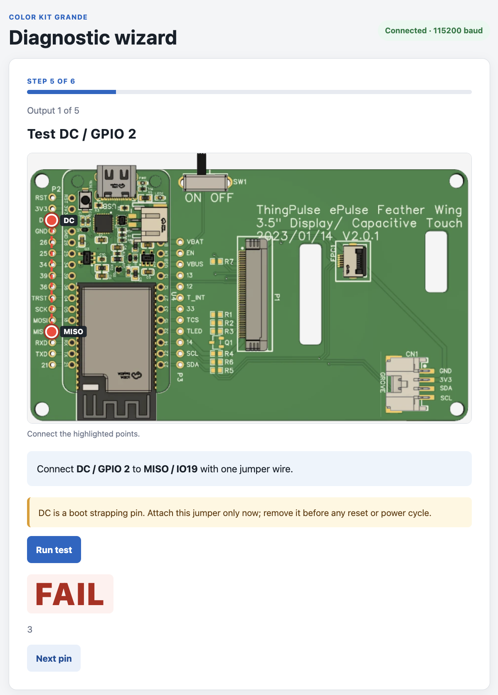

# Fehlerbehebung

## Hier beginnen

Wähle das Symptom, das zu deinem Problem passt:

- **Firmware lässt sich nicht installieren:** [Computer erkennt die Platine nicht](#usb-not-detected) oder [TestBed-Installation bleibt bei 0 %](#flashing-stuck).
- **Display oder Touch funktioniert nicht:** [Dunkles Display](#dark-display), [weisser Bildschirm](#white-screen) oder [Touch reagiert nicht](#touch-not-working).
- **Probleme mit der Wetterstation:** [Fehlende Symbole](#missing-icons) oder [PlatformIO verlangt Git](#softwareprobleme).

Beginne mit den Prüfungen für dein Symptom. Bleibt ein Display- oder Verbindungsproblem bestehen, hilft der [Selbsttest-Assistent](#selbsttest) bei der weiteren Suche. Lässt sich die Platine nicht flashen, behebe zuerst dieses Problem oder [kontaktiere den Support](#support-kontaktieren).

!!! warning "Vor Arbeiten an der Hardware"

    Trenne USB sowie einen allfälligen Akku oder andere Stromquellen, bevor du Flachbandkabel oder Platinen entfernst oder anschliesst, den Durchgang prüfst oder lötest. Lies vor dem Lösen eines Flachbandkabels die bebilderte [Anleitung zu den FPC-Steckverbindern](assembly.md#operating-the-fpc-connectors); ziehe das Kabel nicht bei geschlossenem Verschluss heraus. Schliesse die Stromversorgung erst wieder an, wenn die Hardware für den nächsten Test bereit ist. Bringe beim Selbsttest Überbrückungskabel nur an, wenn der Assistent dich dazu auffordert.

## Hardwareprobleme

| Symptom | Lösungsvorschlag | Bild |
|---------|-----------------|------|
| <span id="dark-display"></span>Das Display flackert oder bleibt nach dem Flashen dunkel | Trenne zuerst die Stromversorgung und prüfe, ob das Display-Flachbandkabel vollständig eingesteckt und der Verschluss geschlossen ist; siehe [Steckverbinder-Anleitung](assembly.md#operating-the-fpc-connectors). Schliesse die Stromversorgung wieder an und wiederhole den Displaytest. Schlägt er weiterhin fehl, trenne die Stromversorgung und prüfe die Lötstellen zwischen ePulse Feather und Anschlussplatine. Nutze den [Selbsttest-Assistenten](#selbsttest), um Verbindungsprobleme einzugrenzen, oder die [Durchgangsprüfung](#checking-continuity), falls du ein Multimeter hast. | [](../../img/guides/color-kit-grande/trouble1.jpg) |
| <span id="missing-icons"></span>Wetterstation: Das Display zeigt Text, aber keine Symbole | Dies betrifft die Wetterstationsanwendung, nicht den TestBed-Test beim Zusammenbau. Wahrscheinlich wurde das Dateisystem nicht erfolgreich übertragen, aus dem die Symbole geladen werden. Stelle sicher, dass du den Schritt [Dateisystem auf das Gerät übertragen](weather-station.md#upload-the-file-system-to-device) ausgeführt hast. | [](../../img/guides/color-kit-grande/trouble2_ckg_no_icons.jpeg) |
| <span id="white-screen"></span>Das Display bleibt weiss | Trenne die Stromversorgung und prüfe zuerst das Display-Flachbandkabel anhand der [Steckverbinder-Anleitung](assembly.md#operating-the-fpc-connectors). Auch eine schlechte Lötverbindung kann dieses Symptom verursachen. Prüfe diese Pins auf kalte Lötstellen:<br><ul><li>TFT_DC (IO02)</li><li>TFT_RESET (IO04)</li><li>TFT_SCK (IO05)</li><li>TFT_MOSI (IO18)</li><li>TFT_MISO (IO19)</li><li>TFT_CS (IO15)</li></ul>Prüfe auch die folgenden Anschlüsse, die ebenfalls beteiligt sein können:<ul><li>TFT_LED (IO32)</li><li>3V3</li><li>GND</li></ul> | [](../../img/guides/color-kit-grande/trouble3_ckg_white_screen.png) |
| <span id="usb-not-detected"></span>Die Platine ist eingeschaltet (LEDs leuchten), aber der Computer erkennt sie nicht | Führe diese Prüfungen der Reihe nach aus:<br><ol><li>Verwende ein nachweislich funktionierendes **USB-Datenkabel** und probiere einen anderen USB-Anschluss aus. Ein reines Ladekabel versorgt die Platine mit Strom, überträgt aber keine Daten.</li><li>Prüfe, ob der CH9102F-USB-Seriell-Treiber installiert ist. Folge der [Treiberanleitung von Adafruit](https://learn.adafruit.com/how-to-install-drivers-for-wch-usb-to-serial-chips-ch9102f-ch9102) und schliesse die Platine erneut an.</li><li>Trenne alle Stromquellen, nimm den ePulse Feather von der Anschlussplatine ab, schliesse USB wieder an und versuche, ihn einzeln zu flashen. Funktioniert das, liegt das Problem wahrscheinlich bei der Anschlussplatine oder angeschlossenen Hardware; ein Kurzschluss ist damit noch nicht bewiesen.</li><li>Trenne die Stromversorgung erneut und prüfe beide Seiten beider Platinen auf Lötbrücken, besonders an TX/RX und benachbarten Pins. Bessere verdächtige Lötstellen nach, wenn du dir das zutraust; andernfalls [kontaktiere den Support](#support-kontaktieren).</li></ol> | |
| <span id="flashing-stuck"></span>Die TestBed-Installation bleibt bei 0 % stehen und die serielle Konsole zeigt wiederholt Punkte, Striche oder Verbindungsfehler | Das Installationsprogramm erkennt den USB-Seriell-Adapter, kann aber keine Verbindung zum ePulse Feather herstellen. Führe die folgenden Schritte der Reihe nach aus:<br><ol><li>**Probiere ein anderes USB-Kabel und einen anderen USB-Anschluss aus.** Manche USB-Kabel liefern nur Strom und übertragen keine Daten. Beschädigte oder unzuverlässige Kabel können beim Flashen ausfallen. Prüfe das Ersatzkabel nach Möglichkeit durch eine Datenübertragung zu einem anderen Gerät, beispielsweise einem Smartphone.</li><li>**Prüfe den CH9102F-Treiber.** Installiere den passenden Treiber gemäss der [CH9102F-Treiberanleitung von Adafruit](https://learn.adafruit.com/how-to-install-drivers-for-wch-usb-to-serial-chips-ch9102f-ch9102) neu bzw. erneut und schliesse die Platine wieder an. Tritt derselbe Fehler auf einem anderen Computer mit funktionierendem Treiber auf, ist der Treiber als Ursache weniger wahrscheinlich.</li><li>**Trenne alle Stromquellen, nimm den ePulse Feather von der Anschlussplatine ab, schliesse USB wieder an und versuche, ihn einzeln zu flashen.** Gelingt das Flashen jetzt, prüfe die Anschlussplatine und angeschlossene Hardware auf Verbindungsprobleme oder Kurzschlüsse. Das Ergebnis bestimmt die genaue Fehlerursache noch nicht.</li><li>**Trenne die Stromversorgung und kontrolliere die Lötstellen.** Prüfe beide Platinen sorgfältig auf Lötbrücken, besonders an den seriellen und benachbarten Pins, und bessere verdächtige Stellen nach. Ein Kurzschluss kann auch auf dem ePulse Feather selbst vorliegen. Ein Fehlschlag beim separaten Flashen schliesst einen Lötfehler daher nicht vollständig aus.</li><li>Lässt sich die Platine auch einzeln mit einem nachweislich funktionierenden Datenkabel und Treiber nicht flashen, ist der **ePulse Feather möglicherweise beschädigt**. Wende dich an den Support und füge scharfe, gut erkennbare Fotos aller Lötstellen auf beiden Platinen bei.</li></ol> | [](../../img/guides/color-kit-grande/trouble4_testbed-serial-connection.png) |
| <span id="touch-not-working"></span>Das Display funktioniert, aber Berühren zeichnet in TestBed keine Linie | Trenne alle Stromquellen. Prüfe, ob das kleinere Touch-Flachbandkabel vollständig eingesteckt und sein schwarzer Verschluss geschlossen ist; folge der bebilderten [Steckverbinder-Anleitung](assembly.md#operating-the-fpc-connectors). Schliesse die Stromversorgung wieder an und wiederhole den TestBed-Touchtest. Funktioniert Touch weiterhin nicht, trenne die Stromversorgung und prüfe den Touch-Steckverbinder und die Lötstellen auf lose Verbindungen oder Brücken. Nutze den [Selbsttest-Assistenten](#selbsttest) für weitere Verbindungsprüfungen. Bleibt das Problem bestehen, [kontaktiere den Support](#support-kontaktieren) mit Ergebnissen und Fotos. | |

### Durchgang prüfen {#checking-continuity}

Trenne **alle Stromquellen**, stelle dein Multimeter auf Durchgangsprüfung und halte die Messspitzen aneinander, um die Anzeige für eine Verbindung zu prüfen. Für eine Lötverbindung zwischen den Platinen setzt du eine Messspitze auf den Metallpin auf der ePulse-Feather-Seite und die andere auf das zugehörige Lötpad auf der Anschlussplatine. Prüfe beide Enden derselben Verbindung, nicht zwei benachbarte Pins. Eine Verbindung sollte Durchgang anzeigen (meist ein Signalton oder niedriger Widerstand). Eine Unterbrechung deutet auf eine zu prüfende Lötstelle hin. Wenn du die zusammengehörigen Punkte nicht bestimmen kannst, nutze den Assistenten oder frage den Support, bevor du nachlötest.

## Softwareprobleme

| Symptom | Lösungsvorschlag | Bild |
|---------|-----------------|------|
| Im PlatformIO-Protokoll erscheint `Please install git client from https://git-scm.com/download` | Das Wetterstationsprojekt verwendet eine Bibliothek aus einem Git-Repository. PlatformIO benötigt deshalb einen funktionsfähigen Git-Client, auch wenn du das Projekt selbst als ZIP-Datei heruntergeladen hast. Installiere Git von [git-scm.com/install](https://git-scm.com/install/) und starte Visual Studio Code vollständig neu. Öffne ein Terminal und führe `git --version` aus, um zu prüfen, ob Git installiert und über den System-`PATH` erreichbar ist. Starte danach den Build erneut. | [](../../img/guides/color-kit-grande/trouble5_platformio-git-client.png) |

## Selbsttest

Unser [Online-Selbsttest-Assistent](https://ckg-self-test.thingpulse.com/) hilft dir, Probleme mit deinem Color Kit Grande zu diagnostizieren.

[](https://ckg-self-test.thingpulse.com/)

### Selbsttest durchführen

1. Öffne zuerst den [Selbsttest-Assistenten](https://ckg-self-test.thingpulse.com/) und lies seine Vorbereitungsanweisungen. Halte ein Überbrückungskabel bereit, **schliesse es aber noch nicht an**.
2. **Trenne USB und alle anderen Stromquellen**, bevor du die Display- und Touch-Flachbandkabel von der Anschlussplatine entfernst. Öffne ihre Verschlüsse wie in der [FPC-Steckverbinder-Anleitung](assembly.md#operating-the-fpc-connectors) gezeigt.
3. Folge den Einrichtungs- und Verbindungsanweisungen des Assistenten der Reihe nach. Bringe das Überbrückungskabel **nur nach Aufforderung** an oder versetze es dann zwischen die für den aktuellen Test markierten Punkte. Das Bild oben zeigt einen einzelnen Test im laufenden Ablauf, keine dauerhafte Überbrückung.
4. Beachte die Hinweise des Assistenten zu Reset und Aus-/Einschalten. Insbesondere muss die abgebildete Überbrückung an DC / GPIO 2 vor jedem Reset oder Aus-/Einschalten entfernt werden.
5. Notiere fehlgeschlagene Tests und die angezeigten Pinnamen. Trenne nach Abschluss die Stromversorgung, entferne das Überbrückungskabel und stecke beide Flachbandkabel wieder ein und verriegle sie, bevor du das Kit erneut mit Strom versorgst. Kehre nach Behebung des Problems zum [Display- und Touchtest beim Zusammenbau](assembly.md) zurück oder sende deine Ergebnisse an den [Support](#support-kontaktieren).

### Qualitätssicherung

Vor dem Versand werden die Platinen mit einer Selbsttest-Firmware programmiert und die Displays in einer Testvorrichtung geprüft. Diese Prüfungen helfen bei der Fehlersuche, schliessen aber Schäden oder einen späteren Bauteilausfall nicht aus.

Schlechte Lötstellen können nach dem Zusammenbau Probleme verursachen. Wenn eine Sichtprüfung oder ein Test eine verdächtige Lötstelle zeigt, trenne vor der Reparatur alle Stromquellen. Je nach Fehler kommen folgende Arbeiten infrage:

- Problematische Lötstellen mit dem Lötkolben **erneut erhitzen**.
- Überschüssiges Lötzinn mit **Entlötlitze** entfernen.
- Lötbrücken oder Kurzschlüsse mit einer **Entlötpumpe** beseitigen.

Prüfe beide Seiten der Platinen auf Lötbrücken, Lücken oder lose Pins. Das Aussehen allein beweist keinen Fehler. Wenn du dir bei einer Reparatur unsicher bist, kontaktiere den Support mit Fotos, bevor du nachlötest.

!!! tip "Tipp"

    Ist ein Teil irreparabel beschädigt, sieh auf der Seite [Ersatzteile](replacement-parts.md) nach, bevor du einen vollständigen neuen Bausatz kaufst.

## Support kontaktieren

Falls keine der oben genannten Massnahmen dein Problem behebt, kontaktiere uns unter **info AT thingpulse.com**.

Damit wir das Problem schnell eingrenzen können, gib in deiner E-Mail bitte folgende Informationen an:

```text
Betreff: Color Kit Grande – Hilfe bei der Fehlerbehebung

Hallo ThingPulse-Support,

ich habe Probleme mit meinem Color Kit Grande und benötige Unterstützung.

**Symptom:**
[Beschreibe, was passiert, z. B. Display bleibt dunkel, weisser Bildschirm, keine USB-Verbindung usw.]

**Was ich bereits versucht habe:**
- [ ] Lötstellen geprüft und nachgelötet
- [ ] TX/RX-Pins auf Lötbrücken geprüft
- [ ] Verschiedene USB-Kabel getestet
- [ ] ePulse Feather von der Anschlussplatine getrennt
- [ ] Selbsttest-Assistenten ausgeführt
- [ ] Sonstiges: ___

**Angehängte Fotos:**
Im Anhang befinden sich scharfe Fotos von:
- Oberseite der Anschlussplatine (alle Lötstellen sichtbar)
- Unterseite der Anschlussplatine
- Oberseite der ePulse-Feather-Platine
- Unterseite der ePulse-Feather-Platine

Vielen Dank für eure Hilfe!
```

!!! tip "Tipps für Fotos"
    Gute Beleuchtung und scharf abgebildete Lötstellen helfen uns, Fehler schnell zu erkennen. Auf Fotos können wir problematische Pins oft erkennen, die bei direkter Betrachtung leicht übersehen werden.
