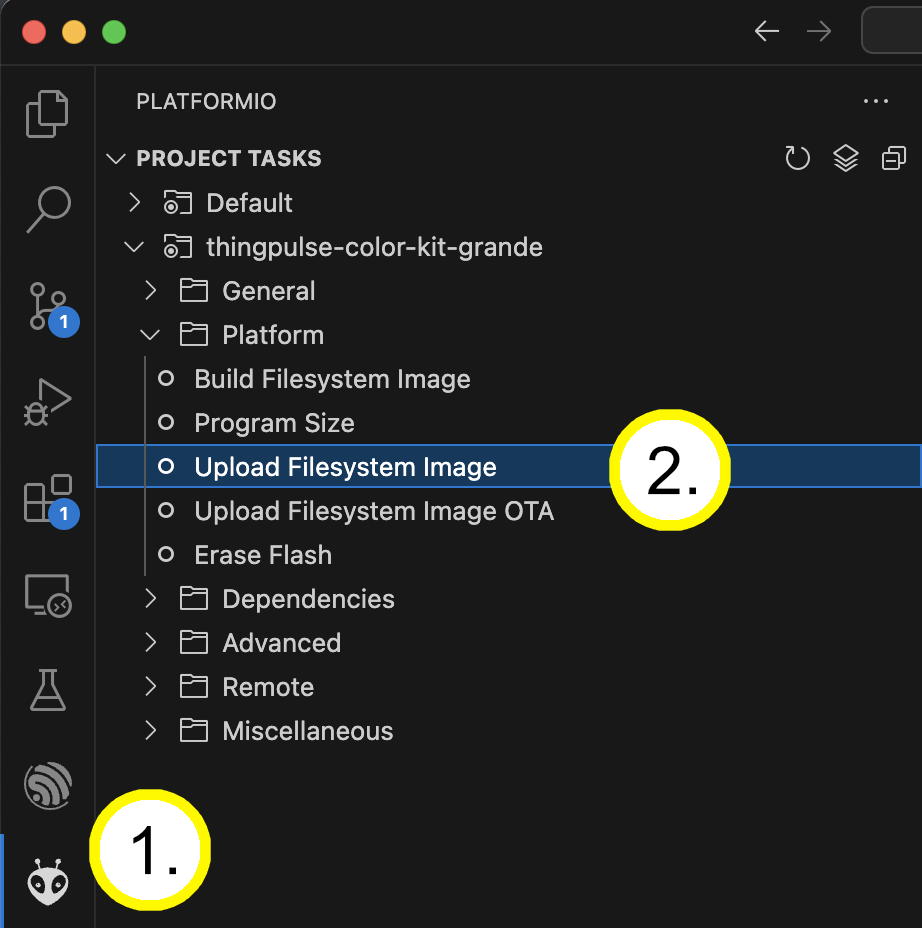
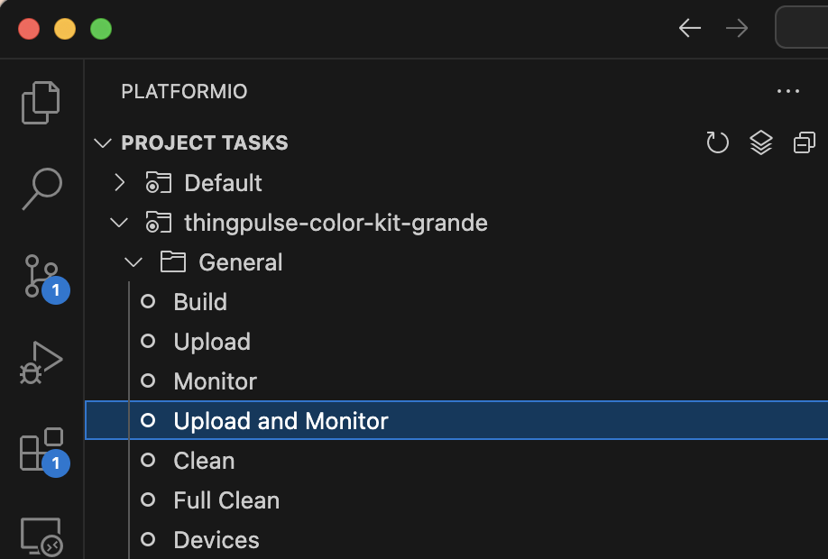
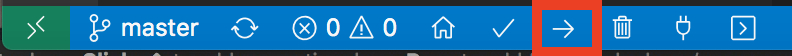
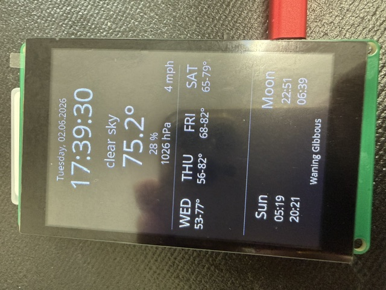

# Wetterstationsprojekt

Nach dem [Montagetest](assembly.md) und der [Einrichtung der Entwicklungsumgebung](development-environment.md) kannst du das Projekt Weather Station Touch installieren.

!!! important "Zwei Übertragungen sind erforderlich"

    Die Wetterstation benötigt **sowohl** das Dateisystem (mit den Symbolen) **als auch** die Firmware (das Programm). Führe zuerst [Übertragung 1 von 2](#upload-the-file-system-to-device) und danach [Übertragung 2 von 2](#programm-auf-das-gerat-ubertragen) aus. Die Firmware allein installiert die Symbole nicht.

## Quellcode herunterladen

Wie alle Open-Source-Projekte von ThingPulse ist auch das Wetterstationsbeispiel öffentlich auf GitHub verfügbar.
Du hast zwei Möglichkeiten, den Quellcode herunterzuladen:

- Klone das Repository mit Git: `git clone https://github.com/ThingPulse/esp32-weather-station-touch`
- Lade den Quellcode von https://github.com/ThingPulse/esp32-weather-station-touch/archive/master.zip herunter und entpacke ihn in einen Ordner auf deinem Computer.

## Projekt in Visual Studio Code öffnen

- Starte VS Code.
- Wähle ==File== > ==Open Folder...==.
- Suche den Ordner `esp32-weather-station-touch` aus dem vorherigen Schritt und wähle ihn aus.

## Konfiguration und Anpassung

Öffne `src/settings.h` und folge den Kommentaren im Abschnitt „User settings“ am Anfang der Datei, um deine Station zu konfigurieren. Trage deinen OpenWeatherMap-API-Schlüssel ein ([Anleitung zum Erstellen eines Schlüssels](../../how-tos/openweathermap-key.md)) und speichere deine Änderungen vor der Übertragung.

## Übertragung 1 von 2: Dateisystem und Symbole {#upload-the-file-system-to-device}

**Bei der ersten Installation erforderlich.** Diese Übertragung installiert die Dateien der Wetterstation, einschliesslich der Wettersymbole.

1. Verbinde das Kit über ein USB-Datenkabel mit deinem Computer.
2. Klicke auf das **PlatformIO**-Symbol in der linken Seitenleiste.
3. Wähle in den Projektaufgaben ==Platform== > ==Upload Filesystem Image==.
4. Warte, bis die Aufgabe abgeschlossen ist, und prüfe die Terminalausgabe auf **SUCCESS**. Schlägt die Übertragung fehl, folge der [Fehlerbehebung für Übertragungsprobleme](troubleshooting.md#hardwareprobleme) und versuche es erneut. Fahre erst fort, wenn diese Übertragung erfolgreich ist.

Fahre nach erfolgreicher Übertragung **mit Übertragung 2 von 2 unten fort**. Die Übertragung des Dateisystems installiert das Wetterstationsprogramm noch nicht.

Normalerweise musst du diesen Schritt nur wiederholen, wenn sich die Dateien im Dateisystem ändern, der Flash-Speicher gelöscht wird oder die Symbole fehlen.

## Übertragung 2 von 2: Firmware {#programm-auf-das-gerat-ubertragen}

**Bei der ersten Installation und nach jeder Änderung am Code oder an der Konfiguration erforderlich.** Diese Übertragung installiert das Wetterstationsprogramm und deine gespeicherten Einstellungen.

1. Prüfe, ob [Übertragung 1 von 2: Dateisystem und Symbole](#upload-the-file-system-to-device) erfolgreich abgeschlossen wurde.
2. Wähle in den PlatformIO-Projektaufgaben ==General== > ==Upload and Monitor==.
3. Warte, bis die Übertragung abgeschlossen ist, und prüfe die Terminalausgabe auf **SUCCESS**. Danach öffnet sich der serielle Monitor und zeigt Meldungen des Geräts an. Schlägt die Übertragung fehl, nutze vor einem erneuten Versuch die [Fehlerbehebung](troubleshooting.md#hardwareprobleme).

Die Upload-Schaltfläche in der unteren Statusleiste überträgt **nur die Firmware**. Sie ersetzt **Upload Filesystem Image** aus Schritt 1 nicht.

!!! note "USB-Treiber"

    Kann dein Computer nicht mit dem Kit kommunizieren, prüfe, ob der CH9102-USB-Seriell-Treiber installiert ist. Siehe die [Treiberanleitung von Adafruit](https://learn.adafruit.com/how-to-install-drivers-for-wch-usb-to-serial-chips-ch9102f-ch9102) und die [Fehlerbehebung für Übertragungsprobleme](troubleshooting.md#hardwareprobleme).

## Ergebnis prüfen

Lass die Station nach beiden erfolgreichen Übertragungen starten und ihre Wetterdaten laden. Prüfe, ob sie Wetterinformationen **und Symbole** anzeigt.

!!! warning "Text erscheint, aber die Wettersymbole fehlen?"

    Die Symbole liegen im Dateisystem, getrennt von der Firmware. Kehre zu [Übertragung 1 von 2: Dateisystem und Symbole](#upload-the-file-system-to-device) zurück und stelle sicher, dass **Upload Filesystem Image** erfolgreich abgeschlossen wird. Nur die Firmware erneut zu übertragen installiert die fehlenden Symbole nicht. Bleibt das Problem bestehen, siehe [Fehlerbehebung: fehlende Symbole](troubleshooting.md#missing-icons).

    { width="240" }

    *Beispiel: Wetterdaten sind sichtbar, aber die Symbole fehlen. Klicke auf das Bild, um es zu vergrössern.*
