# ESP32 Color Kit Grande {#esp32-color-kit-grande}

So baust du das [ThingPulse ESP32 WiFi Color Display Kit Grande](https://thingpulse.com/product/esp32-wifi-color-display-kit-grande/) zusammen und programmierst es.

!!! note "Hinweis"

    Lies diese Anleitung sorgfältig durch, *bevor* du mit dem Löten beginnst.
    Stelle insbesondere sicher, dass du alle Bauteile und Werkzeuge bereithältst.

Zusätzlich zu den Bauteilen im Bausatz benötigst du:

- einen [Lötkolben](https://thingpulse.com/product/portable-mini-soldering-kit-with-usb-charging/)
- Lötzinn
- eine Pinzette

## Hardware zusammenbauen {#assembling-the-hardware}

Es gibt verschiedene Möglichkeiten, den Bausatz zusammenzubauen.
Die folgende Vorgehensweise halten wir für die meisten Anwender für sinnvoll.
Lies sie in Ruhe durch und prüfe anschliessend noch einmal, ob sie auch für dich passt.
Bei Bedarf kannst du die Vorgehensweise anpassen.

Wie auf unserer Produktseite im Shop gezeigt, ist vorgesehen, die ESP32-Mikrocontrollerplatine steckbar mit der Anschlussplatine zu verbinden.
Wenn dich die dadurch etwas grössere Bauhöhe stört, kannst du die ESP32-Platine mit den Stiftleisten auch direkt an die Anschlussplatine löten.
Möglicherweise musst du dann die überstehenden Stifte auf der anderen Seite der Anschlussplatine kürzen, damit sie das Displaymodul nicht berühren.

!!! note "Hinweis"

    Im [Abschnitt weiter unten](#operating-the-fpc-connectors) erfährst du, wie du die FPC-Steckverbinder öffnest und schliesst.

!!! danger "Achtung"

    Behandle das empfindliche Display und seine FPC-Flachbandkabel besonders vorsichtig.
    Knicke oder falte die Flachbandkabel NICHT, ziehe nicht daran und belaste weder die Kabel noch ihre Verbindung zum Display auf andere Weise.

<iframe width="480" height="300" src="https://www.youtube.com/embed/AL6-BsUyV6k" title="YouTube-Videoplayer" frameborder="0" allow="accelerometer; autoplay; clipboard-write; encrypted-media; gyroscope; picture-in-picture; web-share" allowfullscreen></iframe>

=== "Mit Stift- und Buchsenleisten arbeiten"
    Allgemeine Einführung in die Verwendung und das Einlöten von Stift- und Buchsenleisten.
    <iframe width="560" height="315" src="https://www.youtube.com/embed/qz9Ryos1_GY" title="YouTube-Videoplayer" frameborder="0" allow="accelerometer; autoplay; clipboard-write; encrypted-media; gyroscope; picture-in-picture; web-share" allowfullscreen></iframe>

=== "SMD-Bauteile löten"
    Ausführliche Anleitung zum Löten von SMD-Bauteilen.
    Empfohlen für das Einlöten der Grove-Buchse, falls du noch nie SMD-Bauteile gelötet hast.
    <iframe width="560" height="315" src="https://www.youtube.com/embed/EW9Y8rDm4kE" title="YouTube-Videoplayer" frameborder="0" allow="accelerometer; autoplay; clipboard-write; encrypted-media; gyroscope; picture-in-picture; web-share" allowfullscreen></iframe>

Vielen Dank an Edy von DevHackMod für diese Videoanleitung:

<iframe width="480" height="300" src="https://www.youtube.com/embed/QGqHcjWsM20?si=5oXgXDdsvQEBNOX7" title="YouTube-Videoplayer" frameborder="0" allow="accelerometer; autoplay; clipboard-write; encrypted-media; gyroscope; picture-in-picture; web-share" allowfullscreen></iframe>

| [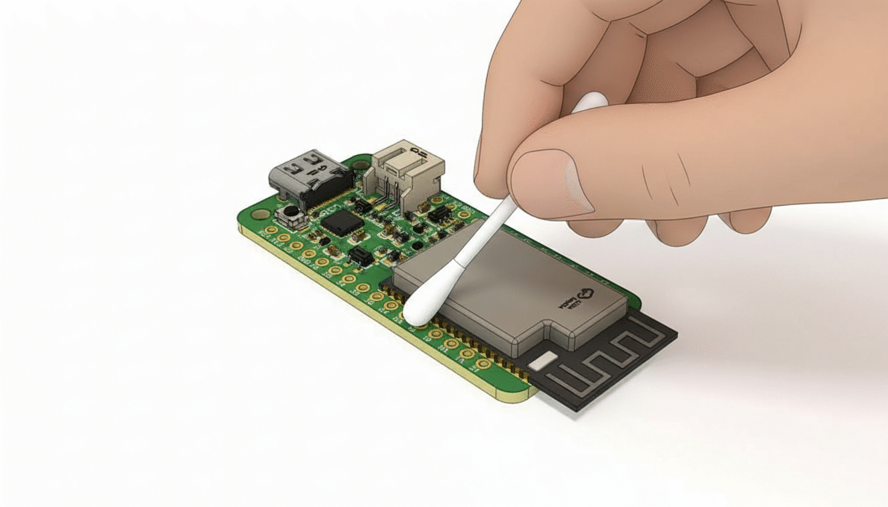](../img/guides/color-kit-grande/0_clean_pads.png) | Reinige zuerst alle Lötpads mit Alkohol und einem Wattestäbchen. |
|-----------------------------------------------------------------------------------------------------------------------------------|---------------------------------------------------------------------------------------------------------------------------------------|
| [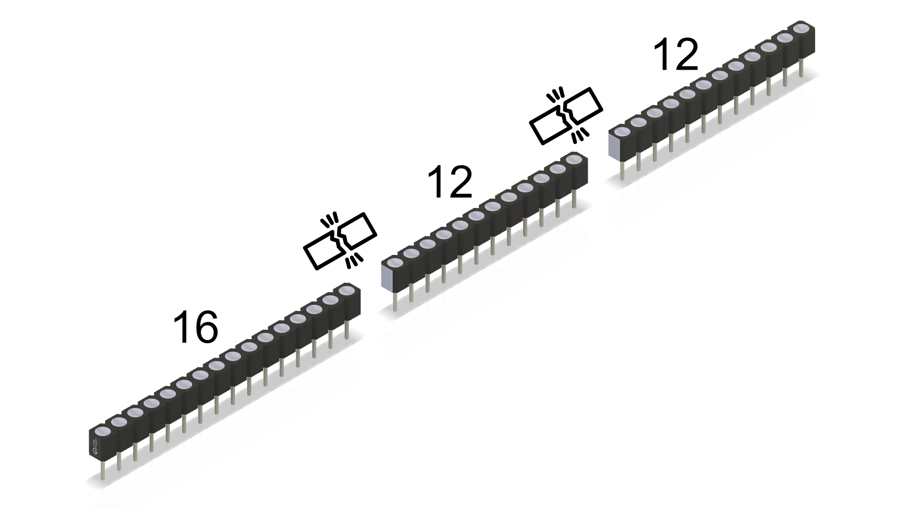](../img/guides/color-kit-grande/1_40female_split.png) | Kürze die Buchsenleisten auf die benötigte Länge (12 und 16 Kontakte) und löte sie an die Anschlussplatine. |
| [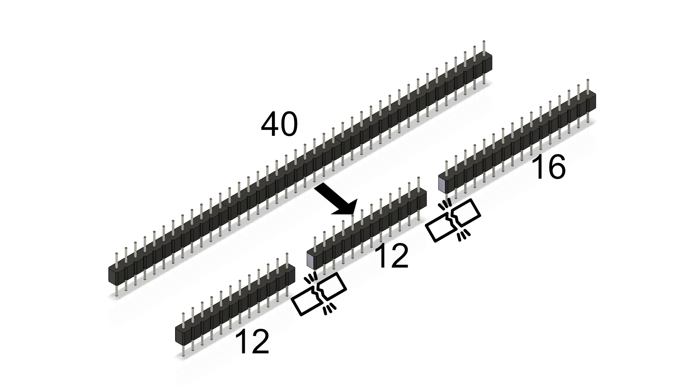](../img/guides/color-kit-grande/4_male_pin_1.png) | Kürze die Stiftleisten auf die benötigte Länge (12 und 16 Stifte). |
|[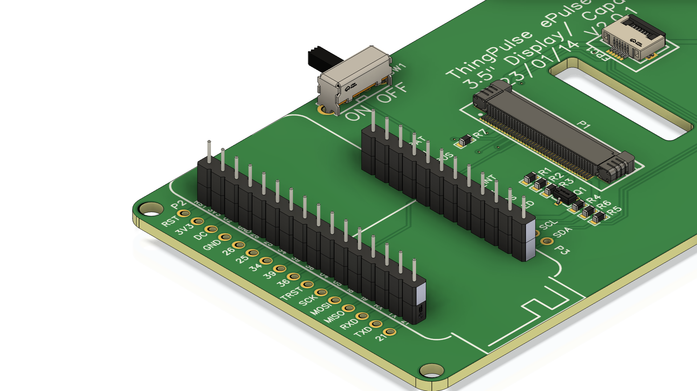](../img/guides/color-kit-grande/4_male_pins_in_pos.png) | Stecke die Stiftleisten für einen stabilen Halt in die bereits eingelöteten Buchsenleisten. |
| | Gute Löttechnik: Erhitze mit dem Lötkolben sowohl den Stift als auch das Lötpad. Führe dann Lötzinn zu, während du die Lötstelle weiter erhitzt. Das Bild zeigt Beispiele für problematische Lötstellen. Entferne überschüssiges Lötzinn mit einer Entlötpumpe oder Entlötlitze. |
|[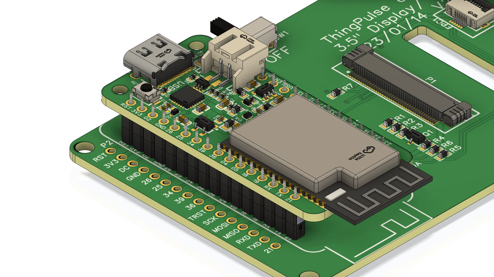](../img/guides/color-kit-grande/4_male_pin_esp32_epulse.png) | Löte die Stiftleisten an die ESP32-Platine. |
| [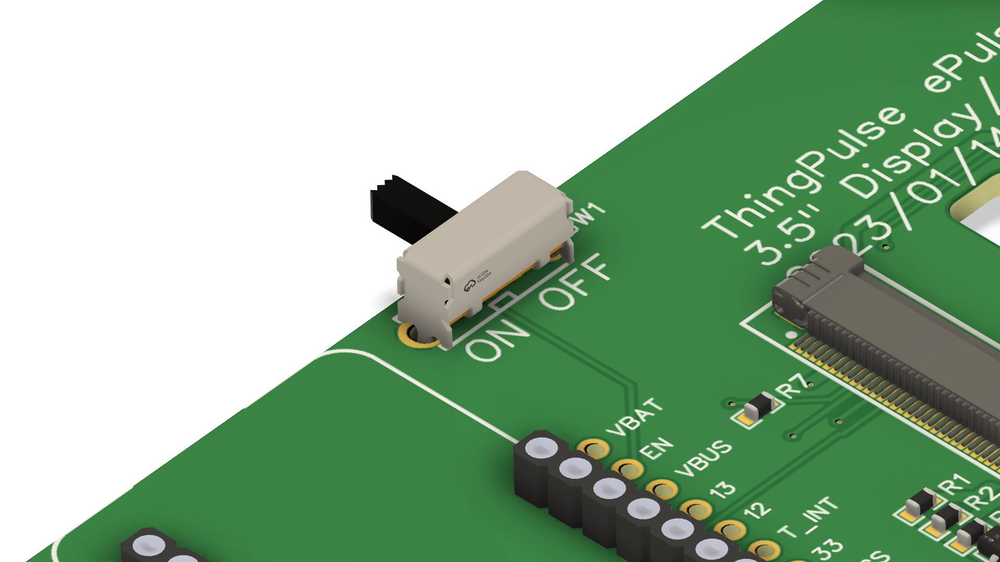](../img/guides/color-kit-grande/2_power_switch_1.png) | OPTIONAL, aber empfohlen: Löte den Ein-/Ausschalter an die Platine. Das Gerät funktioniert auch ohne Schalter, dieser ist später jedoch praktisch. |
| [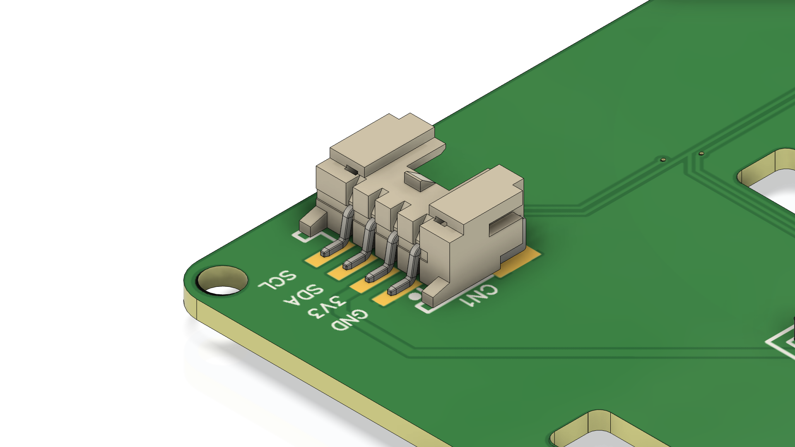](../img/guides/color-kit-grande/3_grove_connector.png) | OPTIONAL: Löte die Grove-Buchse an die Platine. Sieh dir dazu das Video zum Löten von SMD-Bauteilen auf der Seite [Videoanleitungen](color-kit-grande/video-tutorials.md) an. Du kannst die Buchse auch später jederzeit problemlos ergänzen. |
| [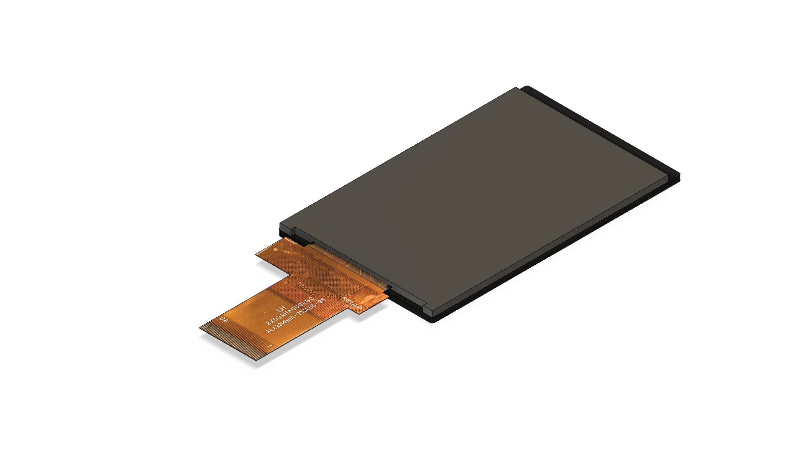](../img/guides/color-kit-grande/6_display.png) | Lege das Display mit der Vorderseite nach unten auf eine saubere Oberfläche, damit es nicht zerkratzt. **Klebe das Display noch NICHT an die Platine! Dieser Schritt folgt erst nach dem Hardwaretest.** |
| [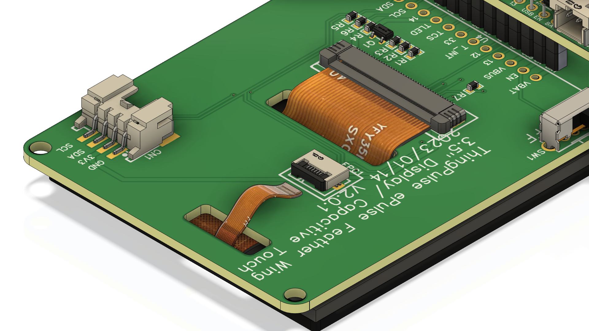](../img/guides/color-kit-grande/7_FPC.png)  | Führe die beiden FPC-Kabel des Displaymoduls durch die Aussparungen der Platine und stecke sie in die Steckverbinder. Im [Abschnitt weiter unten](#operating-the-fpc-connectors) erfährst du, wie du diese richtig öffnest und schliesst. Klappe das Display vorsichtig (!) um, sodass es auf den Schaumstoff-Klebepads liegt, deren Schutzfolie noch angebracht ist. Drehe beide Teile gemeinsam um und prüfe, ob alles passt. |
| [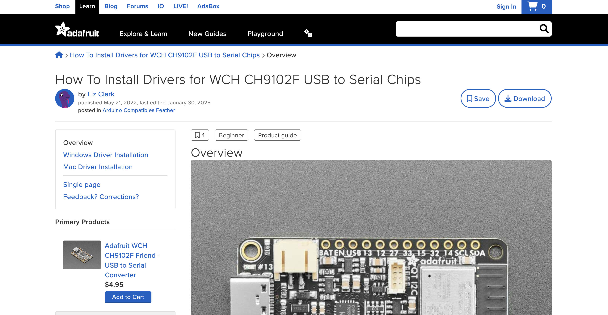](../img/guides/color-kit-grande/CH9102F-driver.png) | Teste die Hardware jetzt mit einem einfachen Programm. So stellst du sicher, dass alles funktioniert, *bevor* du das Display dauerhaft mit den Klebepads an der Anschlussplatine befestigst. Einmal angeklebt, lässt es sich nur schwer wieder lösen. Wenn du auf diesem Computer zum ersten Mal mit einem ESP32 ePulse Feather arbeitest, installiere jetzt bei Bedarf den Treiber für den CH9102F-USB-Seriell-Chip. Folge dazu der [Treiberanleitung von Adafruit](https://learn.adafruit.com/how-to-install-drivers-for-wch-usb-to-serial-chips-ch9102f-ch9102). |
| [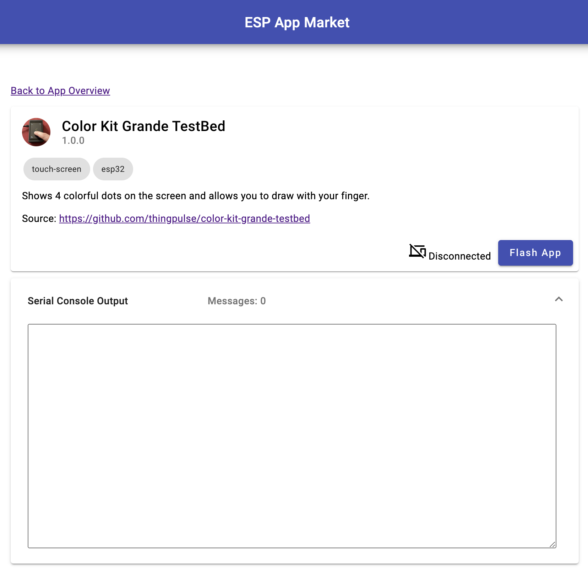](../img/guides/color-kit-grande/app-market-1.png) | Öffne die [Webanwendung zum Flashen](https://app-market.thingpulse.com/device/tp-color-kit-grande/app/tp-color-kit-grande-screen-test). |
| [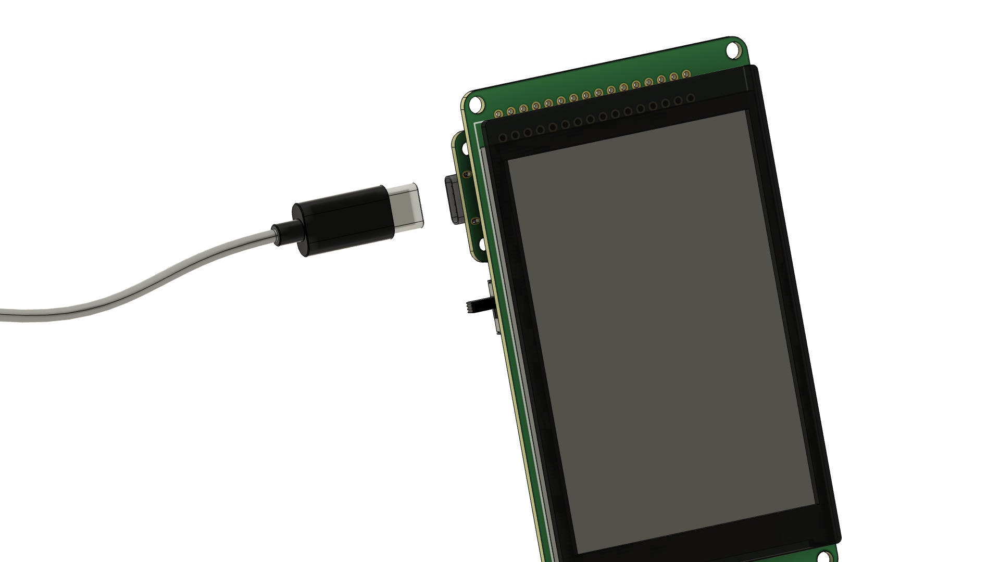](../img/guides/color-kit-grande/8_programm.png) | Verbinde dein Color Kit Grande über ein USB-C-Kabel mit deinem Computer. Stelle den Ein-/Ausschalter auf „Ein“. |
| [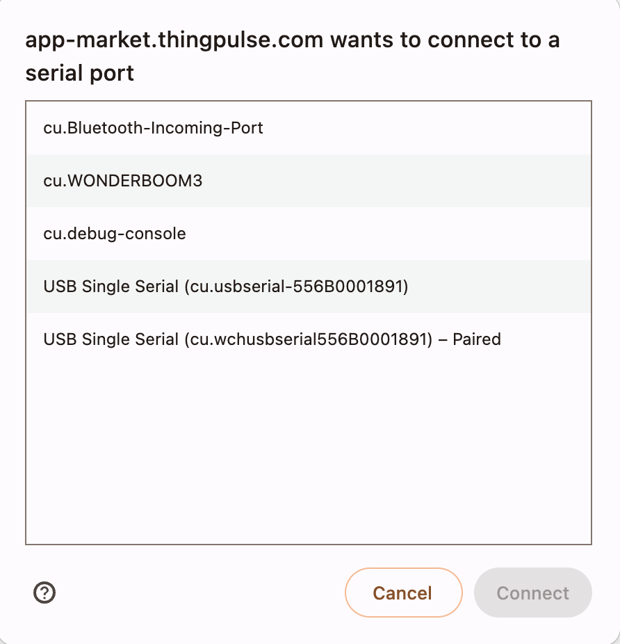](../img/guides/color-kit-grande/app-market-2.png) | Klicke auf „Flash App“ und wähle den Anschluss deines Geräts aus. Unter Mac OS X heisst das Gerät cu.wch*. Auf anderen Betriebssystemen kann der Name abweichen. |
| [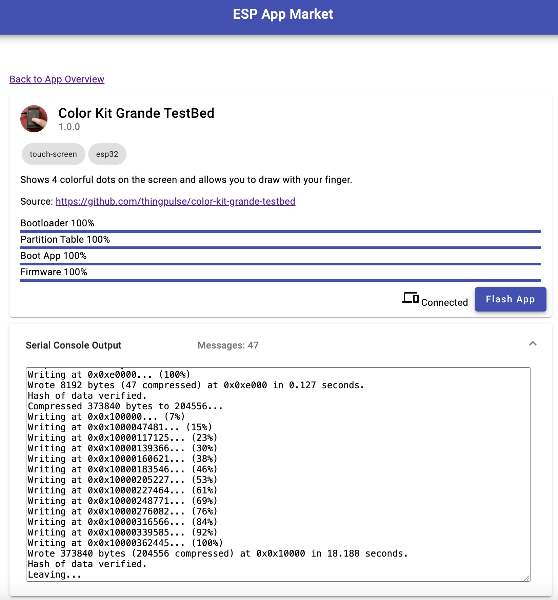](../img/guides/color-kit-grande/app-market-3.png) | Der Browser überträgt nun das Testprogramm auf das Gerät. Das sollte nur wenige Sekunden dauern. Am Ende sollten alle vier Fortschrittsbalken 100 % anzeigen. |
| [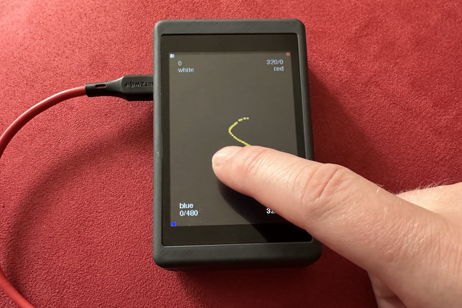](../img/guides/color-kit-grande/testbed.jpg) | Nach dem Flashen der Firmware solltest du vier farbige Kästchen und etwas Text sehen. Durch Berühren des Displays kannst du darauf zeichnen. |
| [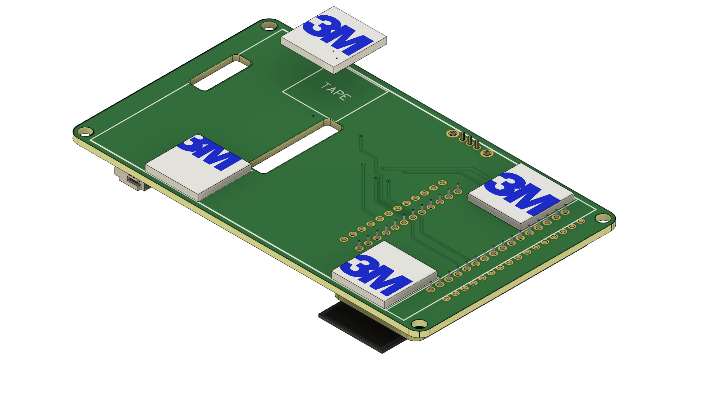](../img/guides/color-kit-grande/5_tapes.png) | Ziehe auf einer Seite der vier Schaumstoff-Klebepads die Schutzfolie ab und befestige die Pads auf der Vorderseite der Anschlussplatine an den mit „TAPE“ markierten Stellen. |
| [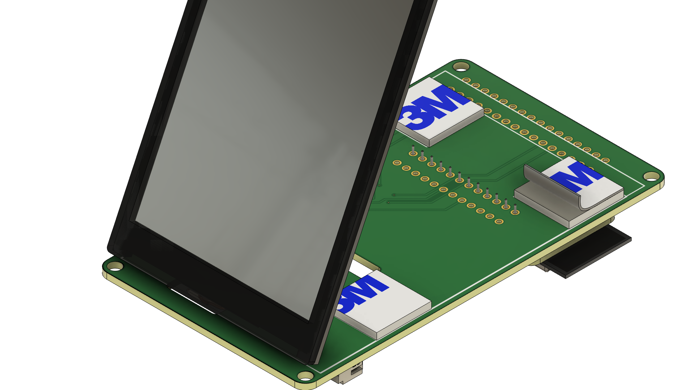](../img/guides/color-kit-grande/10_protective.png)  | Entferne die verbleibende Schutzfolie von den Schaumstoff-Klebepads. |
| [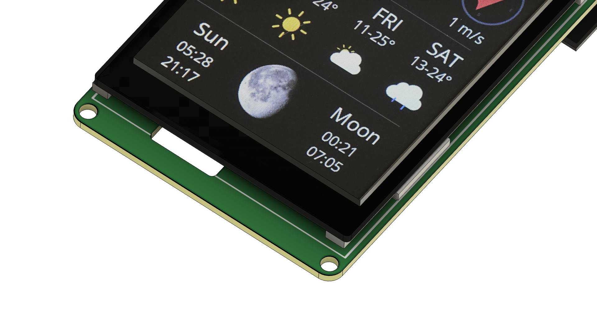](../img/guides/color-kit-grande/11_align.png)  | Befestige das Displaymodul so, dass es an den weissen Markierungen auf der Platine ausgerichtet ist. |

### FPC-Steckverbinder bedienen {#operating-the-fpc-connectors}

Die Steckverbinder für die beiden FPC-Kabel (Display und Touchmodul) sind ohne Erfahrung etwas schwierig zu bedienen.
Hinzu kommt, dass die beiden Steckverbindertypen unterschiedlich funktionieren.

- Der kleine Steckverbinder für das Touchmodul hat eine schwarze Verriegelung. Hebe sie vorsichtig an, bis sie im rechten Winkel (90°) zur Basis steht.
- Der grosse Steckverbinder für das Display hat einen Verriegelungsbügel, der über seine gesamte Länge verläuft.
Ziehe ihn parallel zur Platine von der Basis weg.
Verwende dazu *zwei Finger* und ziehe an den Vorsprüngen an beiden Enden des Bügels.

Die folgenden Bilder zeigen die offenen und geschlossenen Positionen.

| [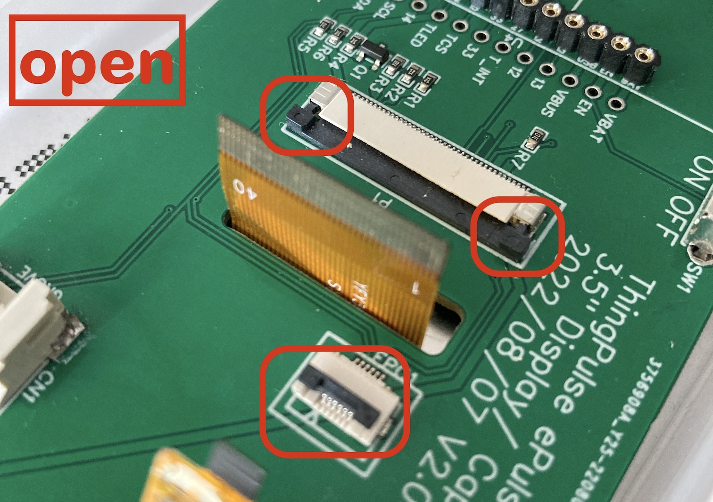](../img/guides/color-kit-grande/FPC-connectors-open-empty.jpg) | [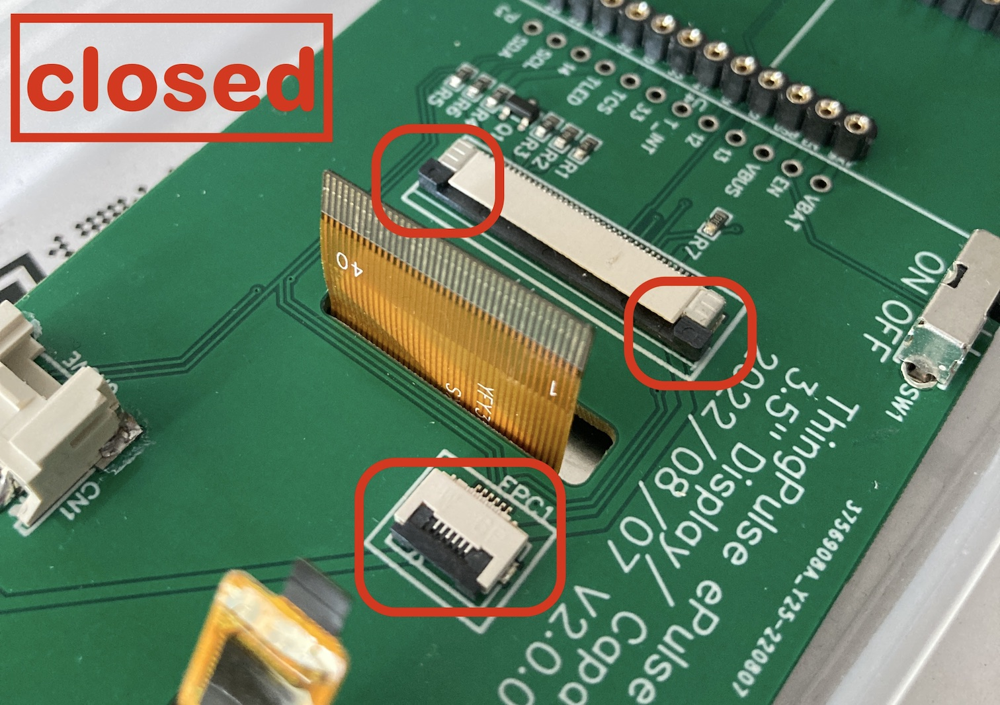](../img/guides/color-kit-grande/FPC-connectors-closed-empty.jpg) |
|-----------------------------------------------------------------------------------------------------------------------------------|---------------------------------------------------------------------------------------------------------------------------------------|
| [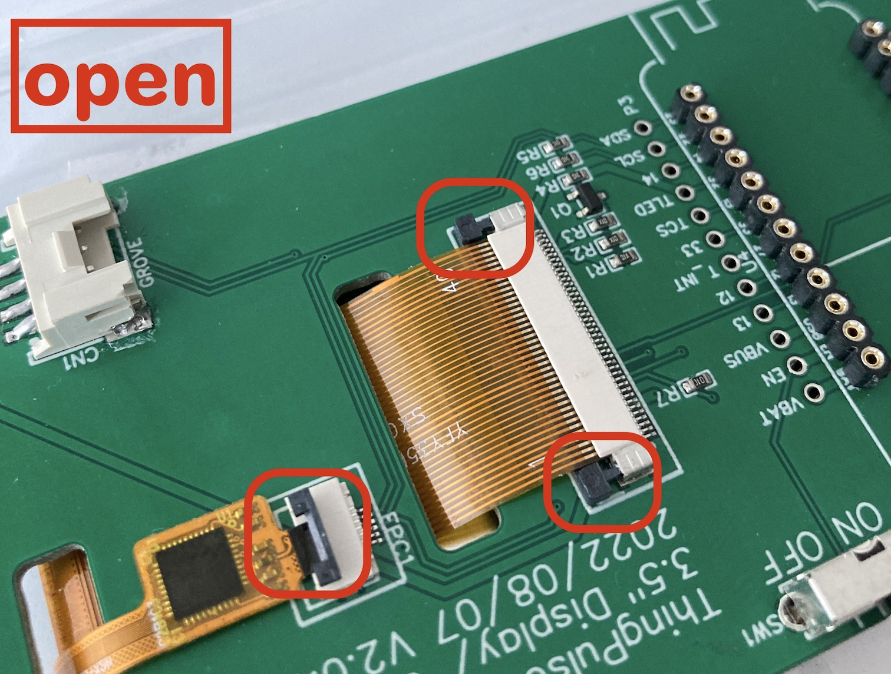](../img/guides/color-kit-grande/FPC-connectors-open.jpg)             | [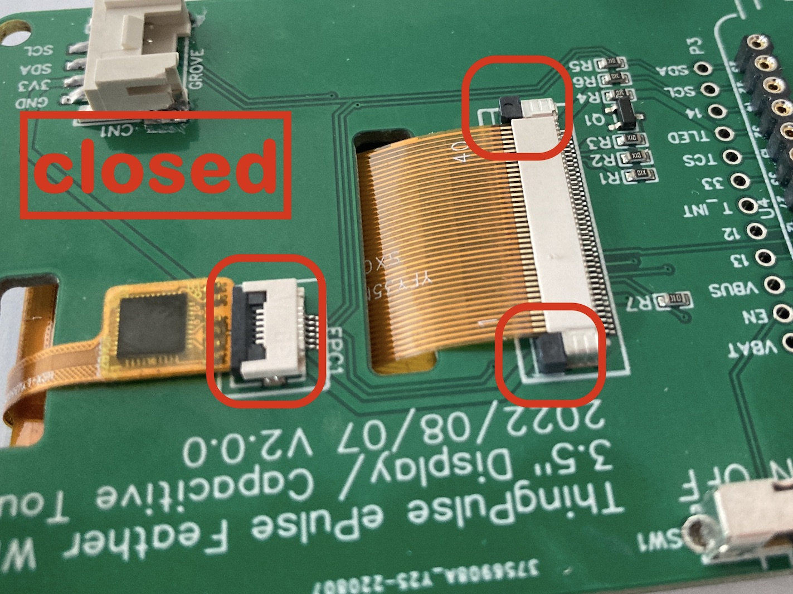](../img/guides/color-kit-grande/FPC-connectors-closed.jpg)             |

## Entwicklungsumgebung {#development-environment}

Vielen Dank an Edy von DevHackMod für diese Videoanleitung:

<iframe width="480" height="300" src="https://www.youtube.com/embed/CWgp0Joec6E?si=zkf5lTtlW1YP59dX" title="YouTube-Videoplayer" frameborder="0" allow="accelerometer; autoplay; clipboard-write; encrypted-media; gyroscope; picture-in-picture; web-share" allowfullscreen></iframe>

Wir verwenden **PlatformIO** (PIO) als Entwicklungsumgebung in **Visual Studio Code** (VS Code).
Falls du noch nie mit PlatformIO gearbeitet hast, installiere es gemäss der [Installationsanleitung](https://docs.platformio.org/en/latest/integration/ide/vscode.html#installation).

0. [Lade](https://code.visualstudio.com/) die offizielle Version von Microsoft Visual Studio Code herunter und installiere sie. PlatformIO IDE baut darauf auf.
1. Öffne die Erweiterungsverwaltung in VS Code.
2. Suche nach der offiziellen Erweiterung PlatformIO IDE.
3. Installiere PlatformIO IDE.

Sieh dir anschliessend die [Kurzanleitung von PlatformIO](https://docs.platformio.org/en/latest/integration/ide/vscode.html#quick-start) an:

[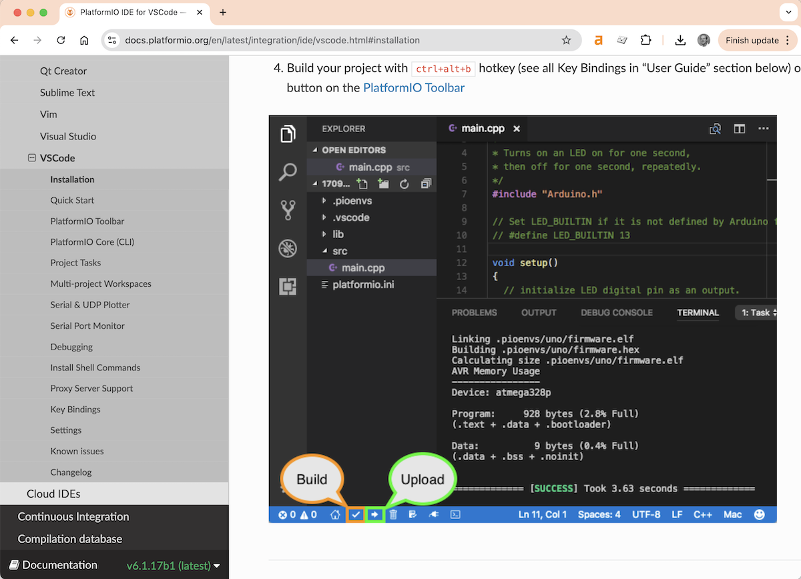](https://docs.platformio.org/en/latest/integration/ide/vscode.html#quick-start)

## Wetterstation als Beispielprojekt {#the-weather-station-sample-project}

Nachdem alle Lötarbeiten abgeschlossen sind, widmen wir uns dem Projekt Weather Station Touch.

### Quellcode herunterladen {#obtain-the-code}

Wie alle Open-Source-Projekte von ThingPulse ist auch das Wetterstationsbeispiel öffentlich auf GitHub verfügbar.
Du hast zwei Möglichkeiten, den Quellcode herunterzuladen:

- Klone das Repository mit Git: `git clone https://github.com/ThingPulse/esp32-weather-station-touch`
- Lade den Quellcode von https://github.com/ThingPulse/esp32-weather-station-touch/archive/master.zip herunter und entpacke ihn in einen Ordner auf deinem Computer.

### Projekt in Visual Studio Code öffnen {#open-project-in-visual-studio-code}

- Starte VS Code.
- Wähle ==File== > ==Open Folder...==.
- Suche den Ordner `esp32-weather-station-touch` aus dem vorherigen Schritt und wähle ihn aus.

### Konfiguration und Anpassung {#configuration-customization}

Öffne die Datei `src/settings.h` und passe die rund zehn Konfigurationsparameter im Abschnitt „User settings“ am Anfang der Datei an.
Alle Parameter sind direkt in der Datei dokumentiert.
Die Erläuterungen sollten dir bei der Konfiguration helfen.
Besonders wichtig ist der OpenWeatherMap-API-Schlüssel, den du eintragen musst ([Anleitung zum Erstellen eines Schlüssels](../how-tos/openweathermap-key.md)).

### Dateisystem auf das Gerät übertragen {#upload-the-file-system-to-device}

- Klicke auf das PlatformIO-Symbol in der linken Seitenleiste (Alien-Gesicht).
- Wähle die Aufgabe ==Platform== > ==Upload Filesystem Image==.

Nach erfolgreicher Übertragung musst du diesen Schritt nur einmal ausführen.
Beachte die Ausgabe in der sich öffnenden VS-Code-Konsole.
Falls dort Fehler gemeldet werden, beispielsweise weil keine Verbindung zur Platine möglich ist oder die Übertragung abbricht, wiederhole den Vorgang.

### Programm auf das Gerät übertragen {#upload-code-to-device}

- Wähle die Aufgabe ==General== > ==Upload and Monitor==.

Diesen Schritt führst du **jedes Mal aus, wenn du den Code oder die Konfiguration änderst**.

Alternativ kannst du die Schaltflächen in der unteren Statusleiste verwenden:

!!! note "Hinweis"

    Falls die Übertragung fehlschlägt, stelle sicher, dass die erforderlichen Treiber für den CH9102-USB-Seriell-Wandler installiert sind.
    Ausführliche Informationen und eine Anleitung findest du bei [Adafruit](https://learn.adafruit.com/how-to-install-drivers-for-wch-usb-to-serial-chips-ch9102f-ch9102).

### Fehlerbehebung {#trouble-shooting}

| Symptom | Lösungsvorschlag | Bild |
|---------|-----------------|------|
| Nach dem Übertragen von Dateisystem und Firmware flackert das Display, bleibt aber dunkel | Dieses Problem lässt sich häufig durch Nachlöten kalter Lötstellen beheben. Mit einem Multimeter kannst du die Verbindungen zwischen der ePulse-Feather-Platine und der grösseren Anschlussplatine Pin für Pin prüfen. Über den Masseanschluss (GND) ist eine zusätzliche Prüfung möglich: Prüfe, ob das Metallgehäuse des USB-C-Steckers elektrisch mit dem GND-Pin auf der grossen Platine verbunden ist. Besteht keine Verbindung, erhitze die Lötstelle erneut, damit der Pin richtig mit dem Lötpad verbunden wird. | [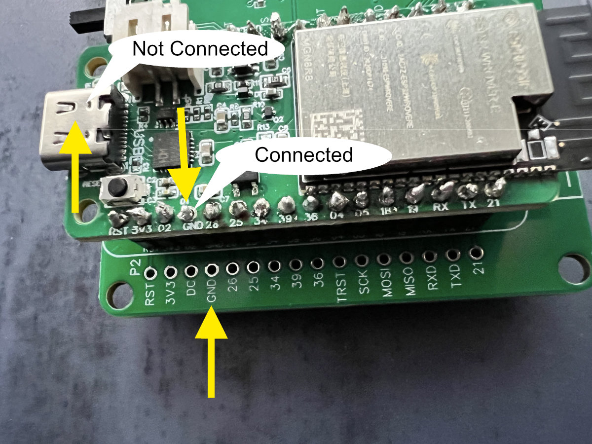](../img/guides/color-kit-grande/trouble1.jpg) |
| Das Display zeigt Text, aber keine Symbole | Wahrscheinlich wurde das Dateisystem nicht erfolgreich übertragen, aus dem die Symbole geladen werden. Stelle sicher, dass du den Schritt [Dateisystem auf das Gerät übertragen](#upload-the-file-system-to-device) ausgeführt hast. |  |
| Das Display bleibt weiss | Die wahrscheinlichste Ursache ist eine schlechte Lötstelle. Prüfe diese Pins auf kalte Lötstellen: <ul><li>TFT_DC (IO02)</li><li>TFT_RESET (IO04)</li><li>TFT_SCK (IO05)</li><li>TFT_MOSI (IO18)</li><li>TFT_MISO (IO19)</li><li>TFT_CS (IO15)</li></ul>Prüfe auch die folgenden Anschlüsse, die ebenfalls beteiligt sein können:<ul><li>TFT_LED (IO32)</li><li>3V3</li><li>GND</li></ul> | [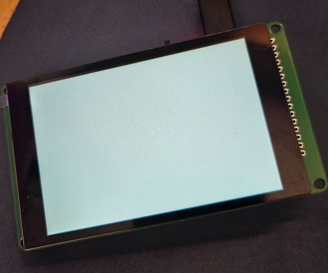](../img/guides/color-kit-grande/trouble3_ckg_white_screen.png) |

## Eigene Anwendung schreiben {#writing-your-own-application}

Verwende den Code unseres Beispielprojekts als Ausgangspunkt oder Referenz für deine eigene Anwendung.
Die Pinbelegung findest du insbesondere in der Konfiguration in `platformio.ini` und `src/settings.h`.

### Touch-Schnittstelle {#touch-interface}

Die Beispielanwendung nutzt die Touch-Schnittstelle derzeit nicht.
Der Code initialisiert sie jedoch, um die korrekte Verdrahtung sicherzustellen (`display.h#initTouchScreen`).
Ausserdem findest du am Ende von `loop()` einen auskommentierten Codeabschnitt, der zeigt, wie du die Berührungskoordinaten auslesen kannst.

## Hardware-Erweiterungen und Pinbelegung {#hardware-extensions-pin-assigment}

Wir haben die Anschlussplatine so entwickelt, dass sie sich erweitern lässt.

- An die aufgelötete Buchse kannst du [I2C-Grove-Module](https://wiki.seeedstudio.com/Grove_System/) anschliessen.
Die **Pins für SCL und SDA sind 22 bzw. 23**.
- Viele der herausgeführten Pins stehen für eigene Erweiterungen zur Verfügung.
**Folgende Pins sind frei**.
Details zu diesen Pins findest du im [Espressif-Datenblatt](https://www.espressif.com/sites/default/files/documentation/esp32-wrover-e_esp32-wrover-ie_datasheet_en.pdf#page=12).
    - Reihe P2: 26, 25, 34, 39, 36, 19, RX, TX, 21
    - Reihe P3: 13, 12, 33, 14
