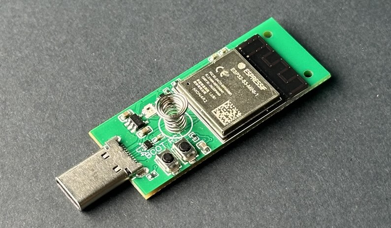
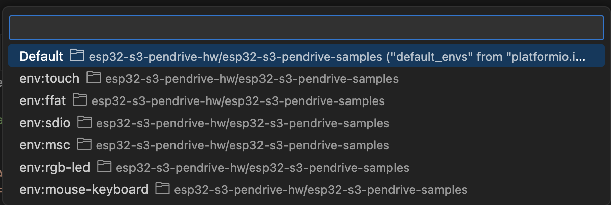
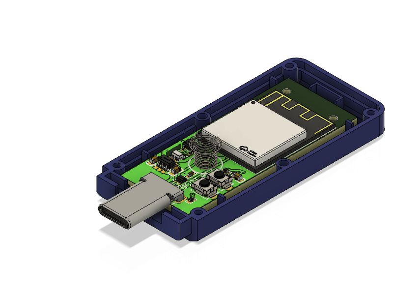

# ThingPulse Pendrive S3 {#thingpulse-pendrive-s3}

[ThingPulse Pendrive S3](https://thingpulse.com/product/esp32-s3-pendrive-s3-128mb/).

## Projekte {#projects}

* [Beispiele auf GitHub](https://github.com/ThingPulse/esp32-s3-pendrive-samples)
* [Super WiFi Duck](https://github.com/ThingPulse/SuperWifiDuck)

## Entwicklungsumgebung vorbereiten {#preparing-build-environment}

Installiere Visual Studio Code und PlatformIO gemäss dieser [Anleitung](https://platformio.org/install/ide?install=vscode).

## Beispielprojekte kompilieren und flashen {#building-flashing-sample-projects}

1. Lade die Beispielprojekte mit `git clone https://github.com/ThingPulse/esp32-s3-pendrive-samples` herunter.
2. Wähle ein Beispielprojekt über das Build-Ziel in der unteren Statusleiste aus: 
3. Klicke auf die Schaltfläche zum Kompilieren und Flashen in der unteren Statusleiste von VS Code.

Für manche Beispiele musst du das Gerät in den Bootloader-Modus versetzen:

1. Halte die Boot-Taste gedrückt.
2. Drücke kurz die Reset-Taste, während du die Boot-Taste weiter gedrückt hältst.
3. Lass die Boot-Taste los.

Nach dem Flashen der Firmware musst du möglicherweise die Reset-Taste drücken, um den Bootloader-Modus zu verlassen.

## SuperWiFiDuck kompilieren und flashen {#building-flashing-the-superwifi-duck-project}

1. Lade das SuperWiFiDuck-Projekt herunter: `git clone https://github.com/ThingPulse/SuperWifiDuck`
2. Klicke auf die Schaltfläche zum Kompilieren und Flashen in der unteren Statusleiste von VS Code.

Alternativ kannst du den Web-Flasher verwenden:

1. Stecke den Pendrive S3 in einen USB-Anschluss.
2. Öffne den [SuperWiFiDuck-Flasher](https://app-market.thingpulse.com/device/tp-pendrive-s3/app/tp-pendrive-s3-super-wifi-duck).
3. Klicke auf `Flash App` und prüfe in der seriellen Konsole, ob die Übertragung erfolgreich war.

Zur Verwendung von SuperWiFiDuck folgst du der Anleitung im [Repository](https://github.com/ThingPulse/SuperWifiDuck).

## CircuitPython flashen und programmieren {#flashing-programming-with-circuit-python}

Verwende den [Web-Flasher](https://app-market.thingpulse.com/device/tp-pendrive-s3/app/tp-pendrive-s3-circuit-python):

1. Stecke den Pendrive S3 in einen USB-Anschluss.
2. Öffne den [CircuitPython-Flasher für Pendrive S3](https://app-market.thingpulse.com/device/tp-pendrive-s3/app/tp-pendrive-s3-circuit-python).
3. Klicke auf `Flash App` und prüfe in der seriellen Konsole, ob die Übertragung erfolgreich war.
4. Falls das Laufwerk „CIRCUITPY“ nicht automatisch erscheint, drücke die Reset-Taste am Pendrive S3.
5. Folge dieser [Anleitung](https://learn.adafruit.com/welcome-to-circuitpython/overview).

## App Market {#app-market}

Der ThingPulse App Market erleichtert die Installation neuer Firmware. Du findest ihn unter https://app-market.thingpulse.com/device/tp-pendrive-s3/.

Wähle eine Anwendung aus der Liste und klicke auf `Flash App`.

## Gehäuse {#enclosure}

Das Pendrive-S3-Kit enthält ein Spritzgussgehäuse aus drei Teilen: Unterteil, Oberteil und Kappe. Damit sieht der Pendrive S3 wie ein gewöhnlicher USB-C-Speicherstick aus. Lege die Platine mit der Feder nach oben in das Unterteil – das ist das Teil mit den Löchern, nicht mit den Stiften. Setze dann das Oberteil auf und richte seine Stifte an den Löchern aus. Beachte: Die Teile sitzen sehr fest. Wenn du sie vollständig zusammengedrückt hast, lässt sich das Gehäuse möglicherweise nur schwer wieder öffnen.

## Links {#links}

[Dokumentation auf GitHub](https://github.com/ThingPulse/thingpulse-devices/tree/master/pendrive-s3)
