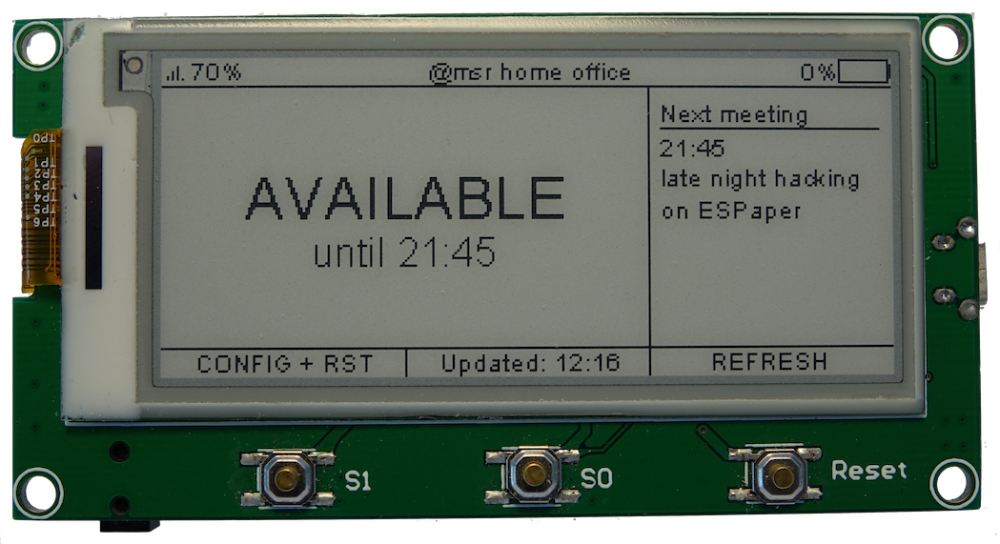
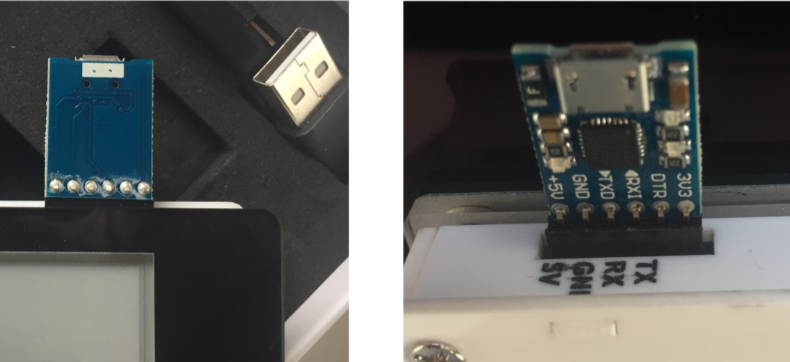
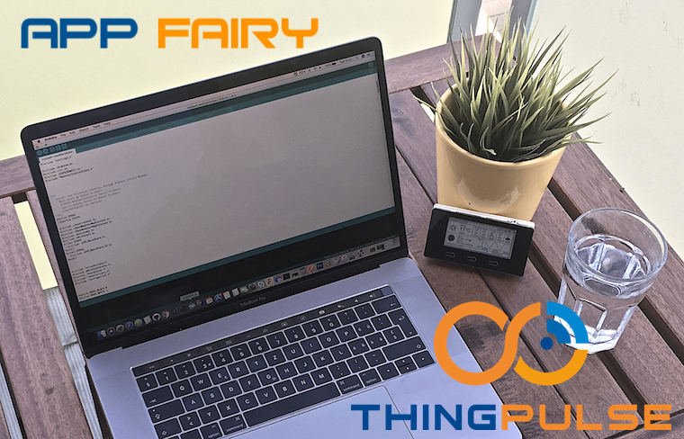
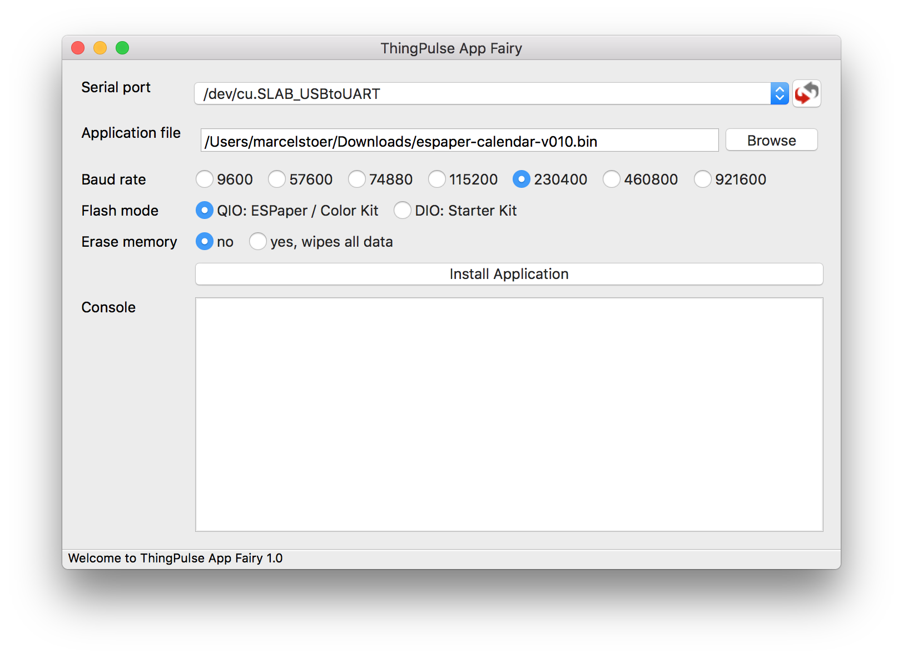
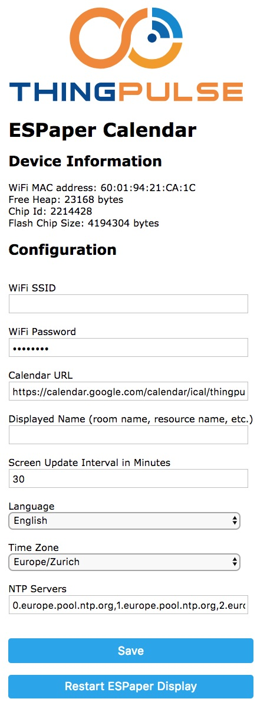

# ESPaper Calendar {#espaper-calendar}

So installierst und konfigurierst du die ThingPulse-App ESPaper Calendar auf einem ESPaper [Plus Kit](https://thingpulse.com/product/2-9-espaper-plus-kit/) oder [Lite Kit](https://thingpulse.com/product/2-9-espaper-lite-kit/).

---

!!! note "Hinweis"
    Lies den Abschnitt über unterstützte Kalender sorgfältig durch, bevor du fortfährst. Das kann dir viel Zeit und Ärger ersparen.

## Architektur und unterstützte Kalender {#architecture-and-supported-calendars}

ESPaper Calendar unterstützt Daten aus gültigen [iCalendar](https://en.wikipedia.org/wiki/ICalendar)-Quellen. Solche Dateien oder URLs enden normalerweise auf `.ical` oder `.ics`. Das ist jedoch eine Konvention und keine zwingende Voraussetzung.

### Betriebsbedingungen {#operating-environment}

Dein Gerät kann Kalenderdaten aus mehreren Gründen nicht direkt laden und verarbeiten. Geräte mit ESP8266, wie das ESPaper, sind vor allem durch die Rechenleistung und den verfügbaren Arbeitsspeicher (<40 KB) begrenzt. Da ESPaper-Geräte ohne dauerhaften Stromanschluss mit einem Akku betrieben werden sollen, muss ihr Energieverbrauch ausserdem möglichst niedrig bleiben.

Kalenderdateien können beliebig gross sein. Ihre Grösse hängt von der Anzahl der Termine und den zugehörigen Daten wie Beschreibungen ab. Kalender in Unternehmen sind häufig mehrere hundert Kilobyte gross und überschreiten damit den verfügbaren Arbeitsspeicher deutlich. Aufgrund des iCalendar-Formats und seiner Unterstützung für wiederkehrende Termine muss beim Auswerten ein grosser Teil der Daten im Speicher bleiben. Der Kalender lässt sich deshalb nicht einfach Zeile für Zeile lesen und bereits Verarbeitetes sofort verwerfen.

Zudem sollte das Gerät nur wenige Sekunden oder möglichst nur einige hundert Millisekunden lang funken, um die WLAN-Verbindung herzustellen und Daten zu übertragen. Andernfalls entlädt sich der Akku zu schnell.

### Architektur {#architecture}

Aus diesen Gründen übernimmt ein leistungsfähiger Server den grössten Teil der Kalenderverarbeitung. Er liest den Kalender ein, bereinigt die Daten, führt Zeit-, Datums- und Zeitzonenberechnungen durch und wertet Regeln für wiederkehrende Termine aus. So erhält das Gerät nur eine kleine Auswahl aufbereiteter Termine, die für den aktuellen Zeitraum relevant sind.

ThingPulse betreibt die dafür zuständige Anwendung auf seiner Hosting-Infrastruktur in einem Schweizer Rechenzentrum. Theoretisch hätten wir dadurch Zugriff auf deine Kalenderdaten. **Wir garantieren jedoch, dass unsere Anwendung deine Daten weder speichert noch protokolliert oder auf andere Weise aufzeichnet.** Das gilt sowohl für die Kalenderdaten als auch für die Kalender-URL.

Bitte [kontaktiere uns](https://thingpulse.com/about/contact/), wenn deine Datenschutzbedenken damit nicht ausreichend geklärt sind.

### Unterstützte Kalender {#supported-calendars}

Dein Kalender muss **öffentlich über das Internet erreichbar** sein und bei einem **der folgenden Anbieter** liegen:

- Google Calendar, URLs wie https://calendar.google.com/*
- Apple iCloud, URLs wie https://\*calendars.icloud.com/*
- Microsoft Outlook.com, URLs wie https://outlook.live.com/owa/*

Kalender dieser drei Anbieter wurden getestet und funktionieren. Bitte [melde dich bei uns](https://thingpulse.com/about/contact/), wenn dein Kalender bei einem anderen Anbieter liegt oder seine URL nicht zu einem der genannten Muster passt. Nach einigen grundlegenden Tests können wir deinen Kalender zur Liste der zugelassenen Kalender hinzufügen.

## Hardware einrichten {#hardware-setup}

### Voraussetzungen {#requirements}

Du benötigst ein ESPaper [Plus Kit](https://thingpulse.com/product/2-9-espaper-plus-kit/) oder [Lite Kit](https://thingpulse.com/product/2-9-espaper-lite-kit/). Weitere Voraussetzungen gibt es nicht.

### Treiber installieren {#install-drivers}
{!../includes/install-drivers.de.md!}

### Programmieradapter / USB-Seriell-Wandler anschliessen {#connect-the-programmer-usb-to-serial-converter}

Stecke den Programmieradapter so auf, dass seine elektronischen Bauteile nach unten bzw. hinten zeigen. Der Anschluss `+5V` muss wie auf dem Foto auf den `5V`-Pin des ESPaper gesteckt werden.

Der Programmieradapter liefert genug Strom, um das ESPaper während der Programmierung zu betreiben. Zum Laden des Akkus ist der USB-Anschluss jedoch effizienter als der Programmieradapter.

!!! note "Hinweis"
    Verbinde den Computer und den Programmieradapter mit einem USB-Kabel und schalte das ESPaper-Modul am Ein-/Ausschalter ein.

!!! danger "Achtung"
    Versorge das Gerät NICHT gleichzeitig über den USB-Anschluss und den Programmieradapter mit Strom.

## Software einrichten {#software-setup}

### ESPaper-Calendar-App herunterladen {#download-espaper-calendar-app}

[Lade die neueste Version der ESPaper-Calendar-App herunter](https://calendar.espaper.com/releases/thingpulse-espaper-calendar-v1-rc4.bin).

### ThingPulse App Fairy {#thingpulse-app-fairy}

App Fairy ist eine eigenständige Desktop-Anwendung, mit der du eine ThingPulse-Anwendung auf dein Gerät überträgst.

#### Herunterladen {#download}

Lade die neueste Version von ThingPulse App Fairy für Windows oder macOS von GitHub herunter: [https://github.com/ThingPulse/app-fairy/releases](https://github.com/ThingPulse/app-fairy/releases).

Für Linux gibt es noch keine fertigen ausführbaren Dateien. Du kannst die Python-Anwendung dort trotzdem verwenden, musst aber zuerst die [benötigten Abhängigkeiten installieren](https://github.com/ThingPulse/app-fairy#build-it-yourself).

#### ESPaper-Calendar-App übertragen {#transfer-espaper-calendar-app}

Damit das Gerät neue Software über den seriellen Adapter empfangen kann, muss es sich im Flash-Modus befinden:

- Halte die mittlere Taste GEDRÜCKT.
- Drücke kurz die rechte Taste und LASS SIE LOS.
- Lass die mittlere Taste los.

Starte App Fairy und gehe wie folgt vor:

1. Wähle den seriellen Anschluss aus, den das System deinem Gerät zugewiesen hat. Unter macOS heissen die Geräte `/dev/cu.xxx`. Unter Windows erscheint der Anschluss als `COM#`, wobei # für eine Zahl steht.
2. Wähle die zuvor heruntergeladene Datei der ESPaper-Calendar-App aus.
3. Stelle den Flash-Modus auf QIO.
4. Setze ==Erase memory== auf `yes`, wenn zuvor eine andere Anwendung, beispielsweise unsere Wetterstation, auf dem Gerät installiert war. Wähle `no`, wenn:
    - du eine neue Version von ESPaper Calendar installierst oder
    - das Gerät leer ist und keine Anwendung enthält.
5. Klicke auf die Installationsschaltfläche.

Setze das Gerät jetzt gemäss den Anweisungen in der App-Fairy-Konsole zurück.

### ESPaper-Calendar-App konfigurieren {#configure-espaper-calendar-app}

Nach der ersten Installation fehlen die WLAN- und Kalendereinstellungen, sofern du nicht lediglich eine vorhandene Version aktualisiert hast. Wenn das Gerät keine Verbindung zum eingestellten WLAN herstellen kann oder die Konfiguration fehlt, zeigt es an, wie du den Konfigurationsmodus aktivierst:

- Halte die linke Taste GEDRÜCKT.
- Drücke kurz die rechte Taste und LASS SIE LOS.
- Lass die linke Taste los.
- Warte einige Sekunden.

Auf dem Display erscheint nun die Anleitung zum Öffnen des Konfigurationsportals:

- Verbinde deinen Computer, dein Tablet oder dein Smartphone mit dem WLAN ==ESPaperConfig==. Dieses Netzwerk wird im Konfigurationsmodus vom Gerät selbst bereitgestellt.
- Öffne im Browser die Adresse ==192.168.4.1==.

Der Browser zeigt ein Formular ähnlich dem folgenden. Trage dort deine Einstellungen ein.

<h4>Optionen</h4>

Im Bereich „Device Information“ wird die MAC-Adresse deines Geräts angezeigt. Du benötigst sie möglicherweise, um das Gerät für den WLAN-Zugriff freizugeben.

<h5>Kalender-URL</h5>

Lies den [ersten Abschnitt](#architecture-and-supported-calendars) über Architektur und Kalender-URLs, falls du das noch nicht getan hast. Denke daran: Die URL muss öffentlich über das Internet erreichbar sein!

<h5>Ruheintervall</h5>

Dank der Eigenschaften des [E-Ink-/E-Paper-Displays](https://en.wikipedia.org/wiki/Electronic_paper) verbringt das Gerät die meiste Zeit im Ruhezustand mit sehr geringem Stromverbrauch. Es wacht nur auf, um das Display zu aktualisieren. Je länger das Ruheintervall, desto länger hält eine Akkuladung.

ESPaper Calendar verwendet einen Algorithmus, der das Gerät bei Bedarf vor Ablauf des Ruheintervalls aufweckt. Wenn das Gerät beispielsweise um 9:28 Uhr aktiv ist und erkennt, dass sich der Frei-/Belegt-Status deiner Ressource um 9:30 Uhr ändert, wartet es nicht das gesamte eingestellte Intervall ab. Es wacht um 9:30 Uhr auf und aktualisiert die Anzeige.

<h5>Zeitzone und Netzwerkzeit</h5>

Stelle unbedingt die richtige Zeitzone ein. Andernfalls sind die Datumsberechnungen falsch, unabhängig von den ursprünglichen Zeitstempeln im Kalender.

Bei jedem Aufwachen synchronisiert das Gerät seine interne Uhr kurz mit einem der aus der Zeitzone abgeleiteten NTP-Server. Lass die Serverliste möglichst unverändert, sofern dein Netzwerk den Zugriff nicht blockiert. Falls es den Zugriff blockiert, kannst du eigene Server als kommagetrennte Liste eintragen.

