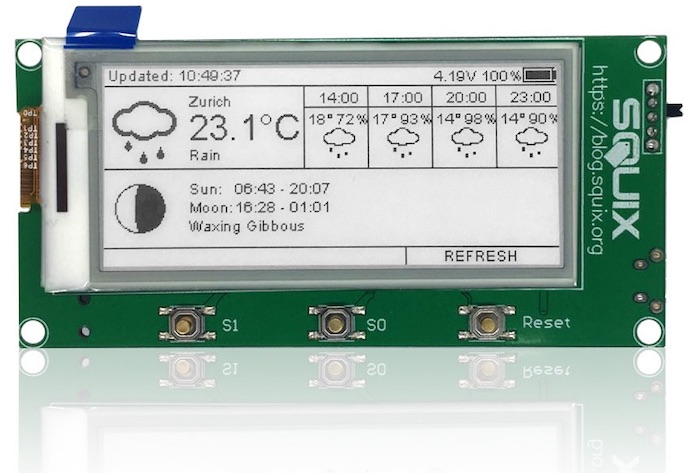

# 2.9″ ESPaper Lite Kit {#29-espaper-lite-kit}

So baust du das [ThingPulse ESPaper Lite Kit](https://thingpulse.com/product/2-9-espaper-lite-kit/) zusammen und programmierst es.

---

Das ThingPulse ESPaper Lite Kit ist die einfachere Ausführung des ESPaper Plus Kit. Es richtet sich an technisch erfahrene Anwender, die bereits mit dem Internet der Dinge vertraut sind. Deshalb gibt es keine separate Anleitung für das Lite Kit. Lies stattdessen die [Anleitung zum Plus Kit](espaper-plus-kit.md) und überspringe die Abschnitte, mit denen du bereits vertraut bist.
