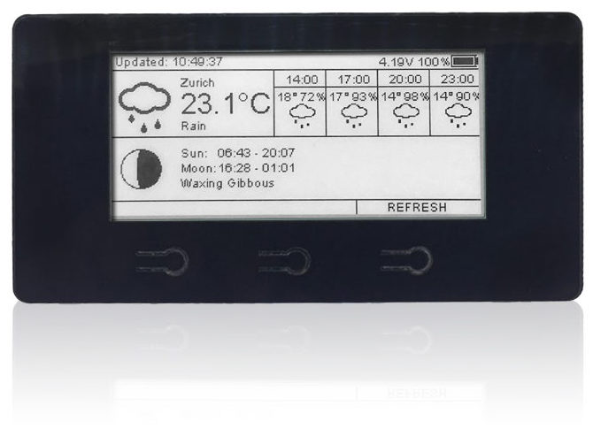
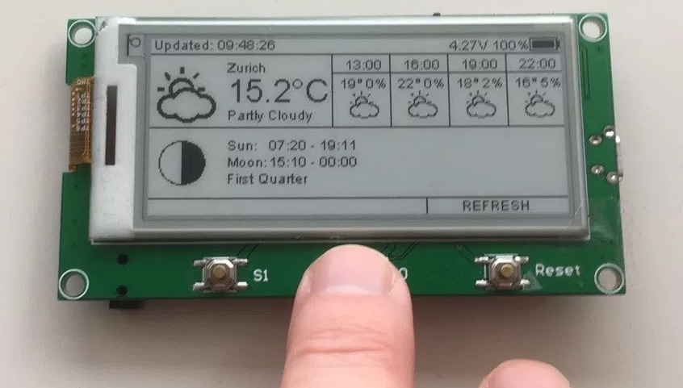

# 2.9″ ESPaper Plus Kit {#29-espaper-plus-kit}

So baust du das [ThingPulse ESPaper Plus Kit](https://thingpulse.com/product/2-9-espaper-plus-kit/) zusammen und programmierst es.

---

## Hardware {#hardware}

Damit das Gerät im normalen Betrieb möglichst wenig Energie verbraucht, haben wir den USB-Seriell-Wandler vom Displaymodul getrennt. Zum erneuten Programmieren benötigst du deshalb einen externen Adapter, der im Bausatz enthalten ist. Du kannst auch einen anderen USB-Seriell-Wandler verwenden, sofern er 3,3-V-Logikpegel unterstützt.

### Treiber installieren {#install-drivers}
{!../includes/install-drivers.de.md!}

## Software {#software}

### Arduino IDE für den ESP8266 vorbereiten {#prepare-arduino-ide-for-esp8266}
{!../includes/Arduino-IDE.de.md!}

#### ESP8266-Toolchain installieren {#install-the-esp8266-toolchain}
{!../includes/ESP8266-for-Arduino-IDE.de.md!}

#### Programmieradapter / USB-Seriell-Wandler anschliessen {#connect-the-programmer-usb-to-serial-converter}

Verbinde jetzt den im ESPaper Plus Kit enthaltenen USB-Seriell-Wandler mit dem ESPaper. Stecke den Programmieradapter so auf, dass seine elektronischen Bauteile nach unten bzw. hinten zeigen. Der Anschluss `+5V` muss wie auf dem folgenden Foto auf den `5V`-Pin des ESPaper gesteckt werden.

Der Programmieradapter liefert genug Strom, um das ESPaper während der Programmierung zu betreiben. Zum Laden des Akkus ist der USB-Anschluss jedoch effizienter als der Programmieradapter.

!!! note "Hinweis"
    Verbinde den Computer und den Programmieradapter mit einem USB-Kabel und schalte das ESPaper-Modul am Ein-/Ausschalter ein.

!!! danger "Achtung"
    Versorge das Gerät NICHT gleichzeitig über den USB-Anschluss und den Programmieradapter mit Strom.

#### Platine und seriellen Anschluss auswählen {#select-board-and-serial-port}
{!../includes/select-board-and-serial-in-Arduino-IDE.de.md!}

Öffne jetzt die serielle Konsole in der Arduino IDE und prüfe, ob beim Einschalten des ESPaper-Moduls, etwa über den Ein-/Ausschalter, eine Ausgabe erscheint. Die Zeichen können unleserlich sein. Wenn du Zeichen siehst, kann dein Computer mit dem Gerät kommunizieren.

#### Flash-Modus und Flash-Grösse auswählen {#select-flash-mode-and-flash-size}

Der in den ESPaper-Kits verwendete [ESP-WROOM-02-Chip](https://www.espressif.com/en/products/hardware/esp-wroom-02/overview) verfügt über 2 MB integrierten SPI-Flash-Speicher. Darin liegt das SPIFFS-Dateisystem, in dem die Anwendung später Dateien speichert.

- Wähle unter ==Tools== > ==Flash Mode== den Eintrag „QIO“.
- Wähle unter ==Tools== > ==Flash Size== den Eintrag „2M (1M SPIFFS)“.

Bei falschen Flash-Einstellungen kann die Übertragung oder der Start der Anwendung fehlschlagen.

#### Bibliotheken installieren {#install-libraries}

Das ThingPulse ESPaper verwendet mehrere zusätzliche Bibliotheken. Sie müssen in der Arduino IDE verfügbar sein, damit sie kompiliert und mit der Anwendung verknüpft werden können.

Öffne ==Sketch== > ==Include Library...== > ==Manage Libraries...==. Gib für jede Bibliothek den Namen in das Suchfeld ein. Ihre Informationen werden aus dem Internet geladen und darunter angezeigt. Wähle die neueste Version und installiere sie. Prüfe diesen Dialog gelegentlich, um die Bibliotheken aktuell zu halten. Stelle ausserdem sicher, dass jeweils nur eine Version jeder Bibliothek installiert ist.

- [Mini Grafx](https://github.com/ThingPulse/minigrafx) von Daniel Eichhorn
- [ESP8266 WeatherStation](https://github.com/ThingPulse/esp8266-weather-station) von Daniel Eichhorn
- [Json Streaming Parser](https://github.com/squix78/json-streaming-parser) von Daniel Eichhorn
- [simpleDSTadjust](https://github.com/neptune2/simpleDSTadjust) von neptune2

### OpenWeatherMap-API-Schlüssel erstellen {#create-openweathermap-api-key}

{!../includes/openweathermap-key.de.md!}

## ESPaper-Projekt {#espaper-project}

Nach den Vorbereitungen geht es endlich an das eigentliche ESPaper-Wetterstationsprojekt. Dieser letzte Teil ist erfreulich einfach.

### Quellcode herunterladen {#obtain-the-code}

Wie alle Open-Source-Projekte von ThingPulse ist auch die ESPaper-Wetterstation öffentlich auf GitHub verfügbar. Du hast zwei Möglichkeiten, den Quellcode herunterzuladen:

- Klone das Repository mit Git: `git clone https://github.com/ThingPulse/espaper-weatherstation`
- Lade den Quellcode von https://github.com/ThingPulse/espaper-weatherstation/archive/master.zip herunter und entpacke ihn in einen Ordner auf deinem Computer.

### Projekt in der Arduino IDE öffnen {#open-project-in-arduino-ide}

- Starte die Arduino IDE.
- Wähle ==File== > ==Open==.
- Suche die im vorherigen Schritt heruntergeladene Datei [`espaper-weatherstation.ino`](https://github.com/ThingPulse/espaper-weatherstation/blob/master/espaper-weatherstation.ino) und öffne sie.

### Konfiguration und Anpassung {#configuration-customization}

In einem der geöffneten Reiter findest du [`settings.h`](https://github.com/ThingPulse/espaper-weatherstation/blob/master/settings.h). Gehe die Datei durch und passe die rund zehn Konfigurationsparameter an. Sie sind direkt in der Datei dokumentiert. Besonders wichtig ist der OpenWeatherMap-API-Schlüssel, den du zuvor erstellt hast.

Ersetze `WIFI_SSID` durch den Namen deines WLANs und `WIFI_PASS` durch dessen Passwort. Werkzeuge wie WifiManager vermeiden zwar das Speichern der WLAN-Zugangsdaten in der Firmware, benötigen aber mehr Zeit für den Verbindungsaufbau. Dadurch verkürzt sich die Akkulaufzeit.

Kopiere den zuvor erstellten OpenWeatherMap-API-Schlüssel und weise ihn `OPEN_WEATHER_MAP_APP_ID` zu.

Passe `UTC_OFFSET` an deine Zeitzone an. Der Wert gibt an, wie viele Stunden deine Zeitzone vor oder hinter UTC/GMT liegt. Falls du die Sommerzeitregeln nicht kennst, kannst du sie [hier nachschlagen](https://en.wikipedia.org/wiki/Daylight_saving_time_by_country).

### ESPaper in den Programmiermodus versetzen {#put-espaper-into-programming-mode}

Bei der Entwicklung des ESPaper haben wir Energieeffizienz höher gewichtet als Bedienkomfort. Langfristig ist ein geringer Verbrauch ebenfalls bequem, weil du den Akku seltener laden musst. Das ESPaper-Modul besitzt deshalb keine Schaltung, die den integrierten ESP8266 beim Klick auf die Upload-Schaltfläche der Arduino IDE automatisch in den Programmiermodus versetzt. Du musst diesen Modus manuell aktivieren. Das folgende Bild zeigt ein [ESPaper Lite Kit](https://thingpulse.com/product/2-9-espaper-lite-kit/); die Vorgehensweise ist identisch:

1. Drücke die Taste ==S0==.
2. Halte sie gedrückt und drücke zusätzlich ==RESET==.
3. Lass ==RESET== los.
4. Lass ==S0== los.

### Programm auf das Gerät übertragen {#upload-code-to-device}

Übertrage zum Schluss das Programm mit allen Abhängigkeiten aus der Arduino IDE auf das Gerät. Verwende dazu STRG + U (⌘ + U unter macOS), ==Sketch== > ==Upload== oder das Symbol mit dem Rechtspfeil in der Werkzeugleiste.

Falls die Übertragung fehlschlägt, prüfe, ob im Menü „Tools“ ein Anschluss ausgewählt ist. Trenne das Modul vom Programmieradapter und verbinde es erneut. Prüfe die korrekte Verbindung und versetze das Modul nochmals in den Programmiermodus.
