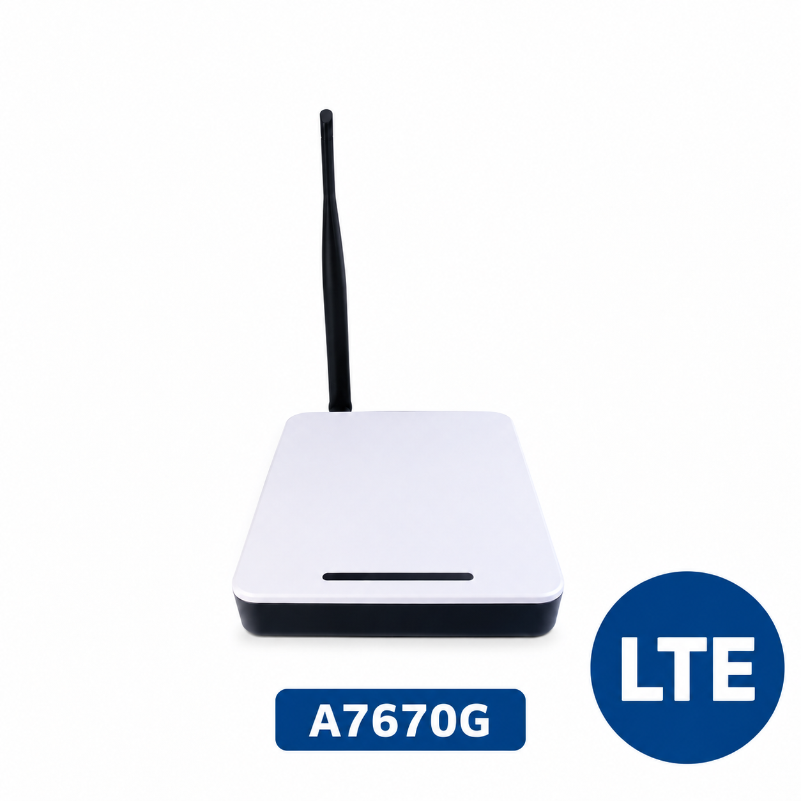

# ESPGateway Ethernet LTE {#espgateway-ethernet-lte}

!!! warning "Vorläufige Anleitung — Entwurf zur technischen Prüfung"
    Version 0.11, 9. November 2026. Technische Daten, Bedienung und regulatorische Angaben müssen für die Serienhardware und -firmware bestätigt werden. **OFFEN** kennzeichnet Informationen, die vor der Auslieferung mit einem verkauften Produkt ergänzt werden müssen. Dieser Entwurf bestätigt weder eine FCC-Zulassung noch die EU-Konformität.

> FCC-SDoC-Prüfumfang: Nur Produktidentifikation, Betrieb/Prüfkonfiguration und anwendbare FCC-Angaben sind Einreichungspunkte. Allgemeine offene Produktdetails sind keine SDoC-Anforderungen, sofern Intertek sie nicht ausdrücklich verlangt. Funkmodul-Integrationsbedingungen werden separat geprüft.

## Produktidentifikation {#product-identification}

Diese Anleitung gilt für das ThingPulse ESPGateway Ethernet LTE. Vergleiche vor der Installation das Modell und die Hardwareversion auf deinem Gerät mit dieser Anleitung.

| Angabe | Informationen zum Serienprodukt |
| --- | --- |
| Produktname | ESPGateway Ethernet LTE |
| Produktbezeichnung auf der Verpackung | ESPGateway Ethernet LTE |
| GTIN-13 / EAN auf der Verpackung | `7649998893091` — Produktkennung, keine individuelle Geräteseriennummer |
| SKU | `7649998893091` — die GTIN wird als SKU verwendet; es gibt keine separate SKU |
| Hardwareherkunft laut Verpackung | China (`Hardware Made in China`) |
| Platinenbeschriftung | `THINGPULSE` — `ESP32 Ethernet Gateway with SIM760x and A7670x support` |
| Geräteseriennummer / Produktionschargennummer | Nicht vergeben |
| Datumsaufdruck der Platine | `2026/08/30` — bestätigte Hardwareversionskennung des an Intertek gelieferten Geräts |
| Hardware und mitgelieferte Firmware | Hardwareversion `2026/08/30`; ausschliesslich Selbsttest-Firmware; **OFFEN** — Version der Selbsttest-Firmware |
| Hersteller (juristische Person und vollständige Postadresse) | ThingPulse GmbH, c/o Daniel Eichhorn, Bachtelweg 4, 8052 Zurich, Switzerland |
| US-Verantwortlicher, falls erforderlich | **OFFEN** — US-Unternehmen, Adresse, Telefon oder Internetkontakt |
| Produktsupport | [ThingPulse-Support](../support.md) |
| Anleitung | <https://docs.thingpulse.com/guides/espgateway-ethernet-lte/> |

## Bestimmungsgemässe Verwendung und Lieferumfang {#intended-use}

Das ESPGateway Ethernet LTE ist ein programmierbares Gateway zur Kommunikation mit WLAN- oder Bluetooth-Low-Energy-(BLE)-Geräten über das ESP32-Modul und zur Übertragung ihrer Daten über LTE an ein Backend. Es richtet sich an Nutzer, die eigene Anwendungsfirmware entwickeln und installieren können.

**Das Gerät wird ausschliesslich mit Selbsttest-Firmware ausgeliefert. Für deine Anwendung musst du eigene Firmware schreiben und installieren.** Die mitgelieferte Firmware ist kein betriebsfertiges Sensor-Gateway und keine MQTT-Anwendung.

Deine Anwendung könnte beispielsweise Temperatur und Luftfeuchtigkeit eines BLE-Sensors auslesen und die Messwerte über LTE an einen MQTT-Broker senden. Dies ist ein Beispiel für die vorgesehene Nutzung, keine Funktion der ausgelieferten Selbsttest-Firmware.

Für Innenräume vorgesehen; Aufstellung auf Tisch oder Regal oder Wandmontage über die Befestigungslöcher im Gehäuse.

**OFFEN:** dokumentierte Nutzungsgrenzen, genauer Selbsttestumfang und dabei verwendete Funkmodi. Eine Eignung für Notfallkommunikation oder sicherheitskritische Anwendungen wurde nicht festgestellt.

Zum Lieferumfang gehören Gehäuse, Gateway-Platine, LTE-Modul, interne LTE-Antenne und externe 2,4-GHz-WLAN-Antenne. USB-Netzteil und USB-Kabel sind nicht enthalten und müssen separat bereitgestellt werden. Der Produktionsauftrag vom November sieht den werkseitigen Einbau von LTE-Modul und LTE-Antenne vor.

Die Stromversorgung erfolgt ausschliesslich über USB-C. Batteriebetrieb und Stromversorgung über Ethernet (PoE) werden nicht unterstützt.

**OFFEN — weitere Angaben zur Packliste:** Antennenteilenummern, SIM-Anforderungen und gedruckte Sicherheits-/Kurzanleitung. Das Zubehör muss der bewerteten Konfiguration entsprechen.

## Technische Daten {#technical-specifications}

Die Bauteilbezeichnungen stammen aus Schaltplanrevision 1.0.3 vom 2026-08-30, ausser der LTE-Baugruppe: Diese folgt der von ThingPulse bestätigten Lieferantenauswahl. Die Platinenbeschriftung nennt die Unterstützung zweier Modemfamilien; sie identifiziert nicht das bestückte Modem. Die LTE-Bezeichnung im Schaltplan muss mit der ausgewählten Baugruppe in der Serien-BOM abgeglichen werden; die Modulbeschriftung muss zum Prüfmuster passen.

| Parameter | Bekannte Angaben und offene Bestätigungen |
| --- | --- |
| Stromversorgung | 5 V DC, 2 A ausschliesslich über USB-C; kein Batterie- oder PoE-Betrieb. |
| Externes Netzteil und Kabel | Nicht enthalten; USB-Netzteil mit 5 V DC und mindestens 2 A Ausgangsstrom verwenden. **OFFEN** — Sicherheitsmerkmale und zulässige Kabelgrenzen |
| Ethernet | RJ45 (J1, HR911105A), LAN8720A-CP-TR-Controller (U1). Keine Stromversorgung über PoE; **OFFEN** — unterstützte Übertragungsraten. |
| LTE-Baugruppe | [AND-Global BK-A7670G](https://www.and-global.com/list_23/662.html), laut Angebot mit SIMCom A7670G-LLSE (LTE Cat 1). Fotografierte Baugruppe: SIMCom A7670G, P/N S2-10AZT-Z33CL, Trägerplatine BKP-7670 V3; FCC-ID-Aufdruck 2AJYU-8BAE003. **OFFEN** — LLSE-Lieferantenangabe mit bestückter Teilenummer abgleichen, Abdeckung der Serienvariante und Prüfung der Zulassungsunterlagen. Laut Nutzer entsprechen die fotografierten Module und Antennen dem Intertek-Prüfmuster. |
| WLAN-/Bluetooth-Modul | ESP32-WROVER-IE fotografiert; FCC-ID-Aufdruck 2AC7Z-ESP32WROVERE. Schaltplan: ESP32-WROVER-IE-N16R8 (U3). **OFFEN** — vollständiger Bestellcode/Zuordnung zum Serien- und Prüfmuster, Prüfung der Zulassung und aktivierte Firmwaremodi. |
| USB-UART-Brücke | CH9102F (U5), mit den USB-C-Datenleitungen verbunden |
| Anzeigen und Bedienelemente | Vier WS2812E-V5-LEDs (LED1–LED4); Farben, Muster und Bedeutungen der LEDs werden vom Firmwareentwickler festgelegt. Netzschalter SW1 und ein Taster an GPIO4. Der Taster hat in der ausgelieferten Selbsttest-Firmware keine Funktion. |
| SIM | Nano-SIM; bei getrennter Stromversorgung die Gehäuseschrauben entfernen, um den internen Steckplatz zu erreichen. **OFFEN** — Kartenausrichtung, Bedienung des Halters und Mobilfunkanbieter-Anforderungen |
| Betriebs-/Lagerbedingungen | Einsatz in Innenräumen. **OFFEN** — Betriebs-/Lagertemperatur des vollständigen Gateways, Feuchtigkeit, Höhe und Schutzart |
| Abmessungen und Montage | Aufstellung auf Tisch/Regal oder Wandmontage über die Befestigungslöcher im Gehäuse. **OFFEN** — Gehäuseabmessungen, Befestigungsmaterial, Ausrichtung und Abstände |
| Erweiterungsschnittstellen | Zwei 10-polige Stiftleisten mit 2,54 mm Raster (X1/X3) dargestellt; **OFFEN** — Zugänglichkeit im Gehäuse, elektrische Grenzen und unterstütztes Zubehör. |

### Frequenzbänder und Antennen {#radio-bands}

Der Lieferant bezeichnet den Modemtyp als A7670G-LLSE. Das fotografierte Modul trägt jedoch nur A7670G und P/N S2-10AZT-Z33CL; die Zuordnung zur LLSE-Variante ist noch offen. Die folgende Tabelle ist bis dahin keine bestätigte Bandliste des fotografierten Geräts. Die folgenden **Modulfähigkeiten** stammen aus dem [SIMCom-Datenblatt A7670G-LLSE, Version 2021.11](https://datasheet.lcsc.com/datasheet/pdf/a6ff746802142b3caed58b61817fe57c.pdf?productCode=C21264512); sie erklären nicht die zugelassenen Betriebsbänder des Gateways.

| Mobilfunkmodus | Vom Modul unterstützte Bänder / nominelle Bandbezeichnungen |
| --- | --- |
| LTE-FDD | B1, B2, B3, B4, B5, B7, B8, B20, B28, B66 |
| LTE-TDD | B34, B38, B39, B40, B41 |
| GSM / GPRS / EDGE | 850, 900, 1800, 1900 MHz |

LTE Cat 1 unterstützt auf Modulebene bis zu **10 Mbit/s im Downlink / 5 Mbit/s im Uplink**. Der tatsächliche Gateway-Durchsatz hängt von Hostschnittstelle, Firmware, Netz und Empfangsbedingungen ab. Bestätige die LLSE-Beschriftung des Serienmoduls, bevor du diese Bandliste auf eine andere A7670G-Revision überträgst. «Global» garantiert weder Netzverfügbarkeit noch Zulassung in jedem Land.

Das Gateway verwendet eine interne Mobilfunk-Folienantenne und eine externe 2,4-GHz-WLAN-Antenne. Antennenteilenummern, Gewinn je Band, Anschlüsse und Installationsbedingungen bleiben **OFFEN**.

| Angaben für die Freigabe | Status |
| --- | --- |
| Aktivierte Mobilfunkbänder und -modi | **OFFEN** — Serienfirmware-/Netzkonfiguration mit obiger Modulliste abgleichen; GSM/GPRS/EDGE bei Aktivierung in die Bewertung aufnehmen |
| Frequenzbereiche und maximale HF-Ausgangsleistung | **OFFEN** — Sende-/Empfangsbereiche und maximale Leistung je aktiviertem Band/Modus anhand der passenden Modulunterlagen und abschliessenden Bewertung ergänzen; leitungsgebundene Leistung oder EIRP sowie relevante Toleranzen angeben |
| WLAN und Bluetooth | **OFFEN** — aktivierte Modi, Frequenzen und maximale Leistungen des ESP32-Funks |
| Regionale Beschränkungen und gleichzeitiger Sendebetrieb | **OFFEN** — zulässige Länder, Funkkombinationen und Installationsbeschränkungen bestimmen |
| HF-Exposition und Abstand zwischen Antennen und Personen | **OFFEN** — abschliessende Bewertung und Zulassungsbedingungen verwenden; kein pauschaler Mindestabstand angegeben |

Das LLSE-Datenblatt nennt keine HF-Ausgangsleistung. Es wurde kein Wert einer anderen A7670G-Hardwarerevision übernommen. Auch Versorgungsspannungs- und Temperaturgrenzen des Moduls sind keine Nenndaten des fertigen Gateways; die festgelegten USB-C-Eingangsnenndaten sind 5 V DC, 2 A; die Betriebsgrenzen im Gehäuse müssen noch bestätigt werden.

## Sicherheit und Installation {#safety}

Die folgenden Sicherheitshinweise sind ein Vorschlag zur Prüfung anhand der abschliessenden Produktrisikobeurteilung.

- Lies die vollständige Anleitung, bevor du die Stromversorgung anschliesst. Verwende nur die vorgegebene Stromversorgung, Kabel und freigegebenen Antennen.
- Trenne die Stromversorgung, bevor du SIM, Antenne oder Erweiterungen einsetzt, anschliesst oder entfernst, sofern die endgültige Anleitung dies nicht ausdrücklich im eingeschalteten Zustand erlaubt.
- Halte das Gerät trocken und fern von übermässiger Hitze. Betreibe es nur innerhalb der festgelegten Umgebungsbedingungen. Halte Lüftungsöffnungen frei.
- Verwende keine beschädigten Geräte, Kabel oder Netzteile. Trenne bei Rauch, ungewöhnlichem Geruch oder sichtbaren Schäden die Stromversorgung und kontaktiere den Support.
- Beachte Funkbeschränkungen in Krankenhäusern, Flugzeugen und explosionsgefährdeten Umgebungen.
- Beachte die freigegebene Antennenposition und die vorgeschriebenen Abstände. Ersetze Antennen nicht durch andere Typen und ändere Funkeinstellungen nicht über die dokumentierten Grenzen hinaus.
- Trenne das Gerät vor der Reinigung vom Strom und verwende ein trockenes Tuch. Halte Kleinteile von Kindern fern.

**Vor Freigabe OFFEN:** Produktspezifische elektrische, thermische, mechanische, ESD- und HF-Sicherheitshinweise ergänzen; zugängliche Anschlüsse, Montage, Trennung der Stromversorgung und Öffnen des Gehäuses durch Nutzer klären. Batteriehinweise nur ergänzen, wenn eine Batterie vorhanden ist oder unterstützt wird.

## Erste Inbetriebnahme {#setup}

**Vorläufiger Ablauf — vor Verwendung am Serienmuster prüfen.**

1. Prüfe Modell, Lieferumfang und erforderliche Stromversorgung.
2. Trenne die USB-Stromversorgung, entferne die Gehäuseschrauben und öffne das Gehäuse, um den Nano-SIM-Steckplatz zu erreichen. Setze die Nano-SIM ein, schliesse das Gehäuse und befestige die Schrauben wieder, bevor du die Stromversorgung anschliesst. Verbinde die mitgelieferte externe WLAN-Antenne mit dem zugehörigen Anschluss. Die LTE-Folienantenne ist werkseitig im Gehäuse eingebaut. **OFFEN:** Anschlussbild, SIM-Ausrichtung und Öffnen/Verriegeln des Kartenhalters.
3. Verbinde Ethernet, falls der dokumentierte Selbsttest oder deine Anwendung dies erfordert. **OFFEN:** Kabelanforderungen und PoE-Beschränkungen.
4. Stelle Gerät und Antennen unter Einhaltung der oben angegebenen Montage- und HF-Abstände auf.
5. Befolge die [Anleitung zum Flashen und Selbsttest im Browser](#self-test).
6. Entwickle ESP32-Anwendungsfirmware, die mit deinen WLAN-/BLE-Geräten kommuniziert und Daten über die LTE-Baugruppe überträgt. **OFFEN:** dokumentierte Entwicklungsumgebung, Boardkonfiguration, Pinzuordnung und Programmierverfahren.
7. Installiere deine Anwendungsfirmware gemäss dokumentiertem Programmierverfahren. **OFFEN:** genaue Befehle/Werkzeuge, Flash-Einstellungen und Wiederherstellungsdatei der Selbsttest-Firmware.
8. Konfiguriere Mobilfunkanbieter/APN, Backend-Endpunkt und Authentifizierung in deiner Anwendung. Lege bei MQTT Broker, Topics und Zugangsdaten fest und prüfe den Empfang der Sensordaten. Diese Einstellungen hängen von deiner Anwendung ab; eine werkseitige Konfigurationsoberfläche ist nicht dokumentiert.

## Flashen und Selbsttest im Browser {#self-test}

Beim Flashen ersetzt die Selbsttest-Firmware die aktuelle Anwendungsfirmware. Bewahre vorher eine Kopie deiner Anwendung auf.

1. Schliesse die mitgelieferte externe WLAN-Antenne an. Verbinde das Gateway für die Ethernet-Prüfung mit einem Ethernet-Netzwerk mit DHCP. Setze für den optionalen Mobilfunk-Datentest bei getrennter Stromversorgung eine aktive Daten-SIM ein und schliesse das Gehäuse wieder. Die LTE-Antenne ist intern.
2. Verbinde das Gateway über ein USB-Datenkabel mit dem Computer und stelle die vorgegebene Versorgung mit 5 V DC / 2 A sicher. Ein reines Ladekabel überträgt keine Flash- oder Testbefehle. **OFFEN:** USB-/Stromversorgungsanordnung und unterstützten Browser für die endgültige Anleitung prüfen.
3. Öffne den [ThingPulse ESPGateway Ethernet LTE Flasher](https://iot-flasher.thingpulse.com/device/espgateway-ethernet-lte) und befolge die Verbindungs- und Flash-Anweisungen.
4. Löse nach dem Flashen den Selbsttest auf der Seite aus. Er startet nicht automatisch beim Einschalten. Lies die Erfolgs-/Fehlerergebnisse auf der Seite ab.
5. Der übliche Test dauert nach dem beobachteten Ablauf wenige Sekunden. Netzregistrierung oder Zeitüberschreitungen können den Mobilfunktest deutlich verlängern. Jeder Durchlauf endet und wartet auf eine neue Anforderung; keine automatische Wiederholung.

### Prüfumfang

Diese Beschreibung bezieht sich auf den geprüften Quellcode der Testsuite `espgateway-ethernet-a7670g/6` (Protokoll 2). **OFFEN:** Abgleich mit der vom Browser verteilten Firmware und den auf der Seite angebotenen Testmodi.

| Test | Umfang |
| --- | --- |
| Hardware | ESP32-Speicher-/Chipinformationen, Modemkommunikation, Identität und Status |
| Ethernet | Initialisierung, Verbindung, IP-Adresse, ausgehandelte Geschwindigkeit und Duplex; kein dauerhafter Anwendungsdatenverkehr |
| Optionaler Mobilfunk-Datentest | SIM-Bereitschaft, LTE-Registrierung, Paketdatenanbindung und echte HTTP-GET-Anfrage über das Modem; Erfolg erfordert HTTP 204 ohne Antwortinhalt |
| WLAN / BLE | Kein ausdrücklicher WLAN-Verbindungs-/Datentest und kein BLE-Test; WLAN-Initialisierung und MAC-Adresse belegen keine Funkverbindung |

Der Standard-Hardwaretest belegt **keinen** LTE-Internetzugang. Der optionale Mobilfunktest benötigt den APN des SIM-Anbieters und eine Test-URL mit HTTP-204-Antwort. `Test Set: cellular` zusammen mit `Cellular Internet Request: OK` kennzeichnet eine erfolgreiche Mobilfunkanfrage. Ein erfolgreicher Durchlauf beendet den HTTP-Dienst und deaktiviert den Test-Datenkontext.

Bewahre Ergebnisse zusammen mit der Hardwareversion auf. Dieser Quellcode gibt Testsuite, Build-Datum/-Zeit und Firmware-ELF-SHA256 zur Identifikation aus. Veröffentliche keine SIM-Kennungen oder anderen privaten Angaben aus dem Bericht.

## Fehlerbehebung {#troubleshooting}

| Symptom | Erste Prüfung |
| --- | --- |
| Gerät startet nicht | Prüfe vorgegebene Stromversorgung, Kabel und Anschluss; trenne die Versorgung bei Schäden. |
| Anwendung überträgt keine Sensordaten | Die ausgelieferte Firmware führt nur den Selbsttest aus. Prüfe, ob deine eigene Anwendung installiert ist und Sensorabfrage sowie Backend-Übertragung implementiert. |
| Ethernet-Verbindung fehlt | Prüfe Kabel und Netzwerkanschluss, danach die Netzwerkeinstellungen der Firmware. |
| LTE-Verbindung fehlt | Prüfe SIM und externen Antennenanschluss bei getrennter Stromversorgung; prüfe Abonnement, Netzabdeckung und APN. Kontaktiere bei vermuteten Fehlern der internen LTE-Antenne den Support. |
| Wiederholte Neustarts oder Verbindungsabbrüche | Prüfe Eignung der Stromversorgung und Umgebungsbedingungen; kontaktiere bei anhaltenden Problemen den Support. |

Die LED-Bedeutungen sind anwendungsspezifisch; beachte die Dokumentation deines Firmwareentwicklers. Starte den Selbsttest über die oben verlinkte ThingPulse-Seite; die Erfolgs-/Fehlerergebnisse erscheinen dort. **OFFEN:** Wiederherstellungsanleitung ergänzen. Nenne dem Support Modell, Hardware-/Firmwareversion und Fehlerbeschreibung. Veröffentliche keine SIM-Zugangsdaten oder Netzwerkpasswörter.

## Regulatorische Informationen {#regulatory}

### Vereinigte Staaten {#united-states}

**OFFEN — dieser Entwurf enthält keine Konformitätszusage.** Endgültige FCC-Kennzeichnung für Gerät/Module, anwendbaren Part-15-Betriebshinweis, Änderungshinweis, Störschutzhinweis für die geprüfte Klasse A oder B, gegebenenfalls US-Verantwortlichen und freigegebene HF-Expositions-/Installationshinweise ergänzen. Die Bewertung muss auch die LTE-Zulassung für lizenzierte Funkdienste und gleichzeitigen Sendebetrieb abdecken.

## Dokumentversion {#document-revision}

| Version | Datum | Umfang |
| --- | --- | --- |
| 0.9 | 2026-10-12 | Vorläufige Anleitung mit Produktidentifikation, Hardware- und Funkangaben, bestimmungsgemässer Verwendung, nutzerentwickelter Firmware und Sicherheit; weitere Seriendaten und regulatorische Prüfung offen |
