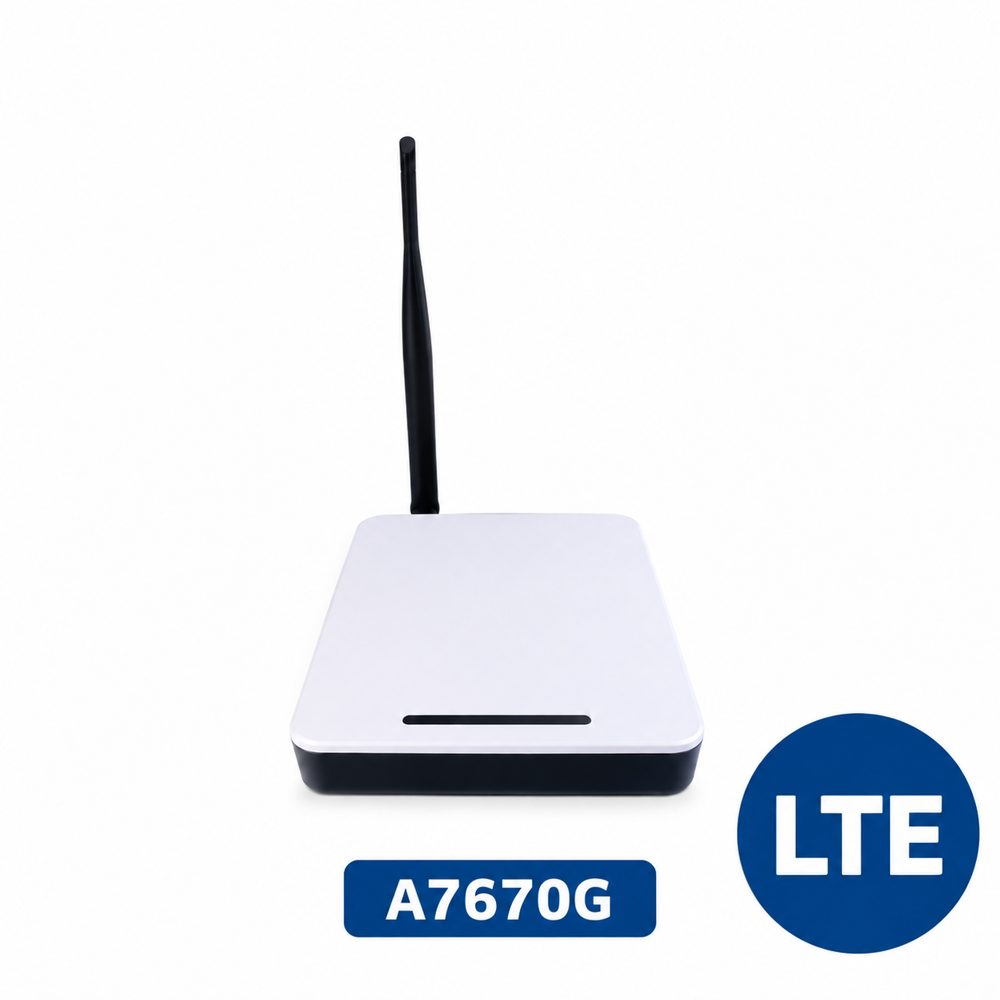

# ESPGateway Ethernet LTE {#espgateway-ethernet-lte}

!!! warning "Pre-release manual — draft for technical review"
    Revision 0.9, 12 October 2026. Product specifications, operating instructions and regulatory statements are awaiting confirmation for the production hardware and firmware. **PENDING** identifies information that must be completed before this manual accompanies a sold product. This draft does not establish FCC authorization or EU conformity.

## Product identification {#product-identification}

This manual covers the ThingPulse ESPGateway Ethernet LTE. Match the model and hardware revision on your device to this manual before installation.

| Item | Production information |
| --- | --- |
| Product name | ESPGateway Ethernet LTE |
| Product designation on box | ESPGateway Ethernet LTE |
| GTIN-13 / EAN on box | `7649998893091` — product identifier, not an individual device serial number |
| SKU | `7649998893091` — the GTIN is used as the SKU; no separate SKU is assigned |
| Hardware origin stated on box | China (`Hardware Made in China`) |
| PCB marking | `THINGPULSE` — `ESP32 Ethernet Gateway with SIM760x and A7670x support` |
| PCB date marking | `2026/08/30` — meaning as hardware revision/date identifier to be confirmed |
| Hardware and supplied firmware versions | Self-test firmware only; **PENDING** — production hardware revision and self-test firmware version |
| Manufacturer (legal entity and full postal address) | ThingPulse GmbH, c/o Daniel Eichhorn, Bachtelweg 4, 8052 Zurich, Switzerland |
| EU importer / responsible economic operator, where applicable | **PENDING** — name and postal contact details |
| US responsible party, where applicable | **PENDING** — US legal entity, address, telephone or internet contact |
| Product support | [ThingPulse support](../support.md) |
| Manual | <https://docs.thingpulse.com/guides/espgateway-ethernet-lte/> |

## Intended use and package contents {#intended-use}

The ESPGateway Ethernet LTE is a programmable gateway for communicating with Wi-Fi or Bluetooth Low Energy (BLE) devices through its ESP32 module and uploading their data over LTE to a backend. It is intended for users who can develop and install their own application firmware.

**The device ships with self-test firmware only. You must write and install your own firmware to implement your application.** The supplied firmware is not a ready-to-use sensor gateway or MQTT application.

For example, your application could read temperature and humidity from a BLE sensor and publish those readings over LTE to an MQTT broker. This is an intended application example, not a function provided by the shipped self-test firmware.

**PENDING:** intended installation environment, documented use limitations, exact self-test coverage and radio modes exercised by the shipped self-test. No suitability for emergency communications or safety-critical applications has been established.

The device is supplied with an enclosure, an external 2.4 GHz Wi-Fi antenna and an internal foil LTE antenna. Power is supplied through a USB-C connector. The box lists one ESPGateway Ethernet and one A7670G (Global) LTE module. This contents description does not specify whether the LTE assembly is preinstalled; installation status and user setup steps remain to be confirmed.

**PENDING — remaining packing-list details:** antenna part numbers, cables, whether a USB power supply is included or required separately, SIM requirements and printed safety/quick-start insert. Accessories must match the configuration assessed for this model.

## Technical specifications {#technical-specifications}

Component designations come from schematic revision 1.0.3, dated 2026-08-30, except the LTE assembly, which follows the supplier selection confirmed by ThingPulse. The PCB marking describes support for two modem families; it does not identify the fitted modem. Reconcile the schematic LTE designation with the selected assembly in the production BOM; module markings must match the certification sample.

| Parameter | Known information and remaining confirmation |
| --- | --- |
| Power input | USB-C; **PENDING** — final rated input voltage/range and current. The connector alone does not establish a power rating. |
| External power supply and cable | **PENDING** — required output rating, safety characteristics and approved cable limits |
| Ethernet | RJ45 (J1, HR911105A), LAN8720A-CP-TR controller (U1). No PoE power-input circuit is shown; **PENDING** — production confirmation and supported rates. |
| LTE assembly | [AND-Global BK-A7670G](https://www.and-global.com/list_23/662.html), listed with SIMCom A7670G-LLSE (LTE Cat 1). **PENDING** — board revision, fitted module marking and approval documents. |
| Wi-Fi / Bluetooth module | ESP32-WROVER-IE-N16R8 (U3); **PENDING** — production part confirmation and enabled firmware modes. |
| USB-to-UART bridge | CH9102F (U5), connected to the USB-C data lines |
| Indicators and controls | Four WS2812E-V5 LEDs (LED1–LED4); LED colours, patterns and meanings are defined by the firmware implementer. Power switch SW1 and a button wired to GPIO4; **PENDING** — button function in shipped self-test firmware. |
| SIM | **PENDING** — type, orientation, insertion/removal procedure and carrier requirements |
| Operating / storage environment | **PENDING** — temperature, humidity, altitude, indoor/outdoor use and ingress protection |
| Dimensions and mounting | **PENDING** — enclosure dimensions, orientation and clearances |
| Expansion interfaces | Two 10-pin, 2.54 mm headers (X1/X3) shown; **PENDING** — enclosure accessibility, electrical limits and supported accessories. |

### Radio bands and antennas {#radio-bands}

The supplier identifies the fitted modem type as A7670G-LLSE. The following are **module capabilities**, based on [SIMCom’s A7670G-LLSE datasheet, version 2021.11](https://datasheet.lcsc.com/datasheet/pdf/a6ff746802142b3caed58b61817fe57c.pdf?productCode=C21264512), not a declaration of the gateway’s approved operating bands.

| Cellular mode | Module-supported bands / nominal band designations |
| --- | --- |
| LTE-FDD | B1, B2, B3, B4, B5, B7, B8, B20, B28, B66 |
| LTE-TDD | B34, B38, B39, B40, B41 |
| GSM / GPRS / EDGE | 850, 900, 1800, 1900 MHz |

LTE Cat 1 supports module-level rates up to **10 Mbps downlink / 5 Mbps uplink**. Actual gateway throughput depends on the host interface, firmware, network and signal conditions. Confirm the LLSE marking on the production module before applying this band list to a different A7670G revision. “Global” does not guarantee service or authorization in every country.

The gateway uses an internal foil cellular antenna and an external 2.4 GHz Wi-Fi antenna. Antenna part numbers, gain by band, connectors and installation conditions remain **PENDING**.

| Release information | Status |
| --- | --- |
| Enabled cellular bands and modes | **PENDING** — confirm production firmware/network configuration against the module list above; include GSM/GPRS/EDGE in the assessment if enabled |
| Frequency ranges and maximum RF output power | **PENDING** — provide transmit/receive ranges and maximum power per enabled band/mode from the applicable module documentation and final assessment; state conducted power or EIRP and include relevant tolerances |
| Wi-Fi and Bluetooth | **PENDING** — enabled modes, frequencies and maximum powers for the ESP32 radio |
| Regional restrictions and simultaneous transmission | **PENDING** — establish permitted countries, radio combinations and installation restrictions |
| RF exposure and antenna-to-person separation | **PENDING** — use final assessment and authorization conditions; no generic separation distance is specified |

The LLSE datasheet does not specify RF output power. No value from a different A7670G hardware revision has been substituted. Module supply-voltage and temperature limits are also not finished-gateway ratings; the USB-C input rating and enclosure operating limits remain to be confirmed.

## Safety and installation {#safety}

The following safety text is proposed for review against the final product risk assessment.

- Read the completed instructions before connecting power. Use only the specified power source, cables and approved antennas.
- Disconnect power before installing or removing a SIM, antenna or expansion accessory, unless the final instructions explicitly permit that operation while powered.
- Keep the device dry and away from excessive heat. Do not operate outside the specified environmental limits. Keep ventilation openings clear.
- Do not use a damaged device, cable or power supply. Disconnect power if there is smoke, an unusual smell or visible damage, and contact support.
- Observe restrictions on radio equipment in hospitals, aircraft and potentially explosive environments.
- Install antennas according to the approved placement and separation instructions. Do not substitute antennas or change radio settings beyond the documented limits.
- Disconnect power before cleaning; use a dry cloth. Keep small parts away from children.

**PENDING before release:** add product-specific electrical, thermal, mechanical, ESD and RF exposure precautions; confirm accessible ports, mounting, power disconnection and whether users may open the enclosure. Add battery instructions only if a battery is fitted or supported.

## First-time setup {#setup}

**Draft sequence — validate on the production sample before use.**

1. Check the model, package contents and required power rating.
2. With power disconnected, install the required SIM and connect the supplied external Wi-Fi antenna to its designated connector. The LTE foil antenna is internal; it is not an external antenna connection step. **PENDING:** connector diagram, SIM access/orientation and confirmation of factory-installed LTE antenna placement.
3. Connect Ethernet if required by the documented self-test or your application. **PENDING:** cable requirements and PoE restrictions.
4. Position the device and antennas using the mounting clearances and RF separation specified above.
5. Connect the specified power supply to USB-C and follow the self-test instructions. **PENDING:** self-test procedure, startup time and self-test-specific pass/fail indications.
6. Develop application firmware for the ESP32 that communicates with your Wi-Fi/BLE devices and transfers data through the LTE assembly. **PENDING:** documented development environment, board configuration, pin assignments and programming procedure.
7. Install your application firmware using the documented programming procedure. **PENDING:** exact commands/tools, flashing settings and self-test recovery image.
8. In your application, configure the carrier/APN, backend endpoint and authentication. For an MQTT application, configure broker, topics and credentials, then verify that sensor readings arrive. These settings are application-defined; no factory configuration interface is documented.

## Firmware, security and reset {#firmware}

ThingPulse supplies self-test firmware. Users develop, install and maintain the firmware for their own application, including Wi-Fi/BLE communication, LTE connectivity and backend integration. A ready-made application, automatic gateway behavior or a configuration web interface is not included in the stated delivery scope.

Application developers should implement credential protection, authenticated backend connections, suitable transport encryption, error handling and a maintainable update/recovery process. Stored or transmitted data, reset behavior and data deletion depend on the application; document these for its users.

**PENDING from ThingPulse:** self-test source/download and version, programming and recovery instructions, boot/button behavior, self-test data/network behavior, vulnerability-reporting contact and support scope/period for the supplied components and self-test firmware. A factory-reset function must not be assumed.

Use the documented antennas, regional settings and radio limits in application firmware. Confirm with Intertek which user-programmable settings and Wi-Fi/BLE/LTE combinations the assessment covers; supplying self-test firmware does not by itself establish coverage for every user application.

## Troubleshooting {#troubleshooting}

| Symptom | Initial check |
| --- | --- |
| Device does not start | Check the specified supply, cable and connector; disconnect if anything is damaged. |
| Application does not upload sensor data | The shipped firmware performs self-test only. Confirm your own application has been installed and implements sensor reading and backend transfer. |
| Ethernet connection fails | Check the cable and network port, then the firmware network settings. |
| LTE connection fails | With power disconnected, check SIM installation and the external antenna connection; check subscription, coverage and APN. Contact support for suspected internal LTE antenna faults. |
| Repeated restart or loss of connection | Check power supply suitability and environmental limits; contact support if the problem persists. |

LED meanings are application-specific; consult the documentation supplied by your firmware implementer. **PENDING:** document the shipped self-test’s pass/fail indications and recovery instructions. When contacting support, provide model, hardware/firmware revision and fault description. Do not post SIM credentials or network passwords publicly.

## Regulatory information {#regulatory}

### United States {#united-states}

**PENDING — no compliance claim in this draft.** Insert the final host/module FCC identification, applicable Part 15 operating statement, changes/modifications notice, Class A or Class B interference notice as determined by testing, US responsible-party information where required, and approved RF exposure/installation text. LTE licensed-service authorization and simultaneous transmission must also be covered by the assessment.

### European Union {#european-union}

**PENDING — no declaration issued.** Insert the signed EU declaration of conformity or the simplified declaration and working URL of the full signed declaration. Identify applicable usage restrictions, approved frequency bands and maximum transmit powers. Provide the required destination-country language versions with the product.

### Disposal {#disposal}

Collect electrical and electronic equipment separately from household waste. Use an appropriate local collection or take-back service. **PENDING:** provide the manufacturer's applicable take-back information and confirm the final WEEE marking.

## Document revision {#document-revision}

| Revision | Date | Scope |
| --- | --- | --- |
| 0.9 | 2026-10-12 | Pre-release manual covering product identification, hardware and radio information, intended use, user-developed firmware and safety; remaining production details and regulatory review pending |
