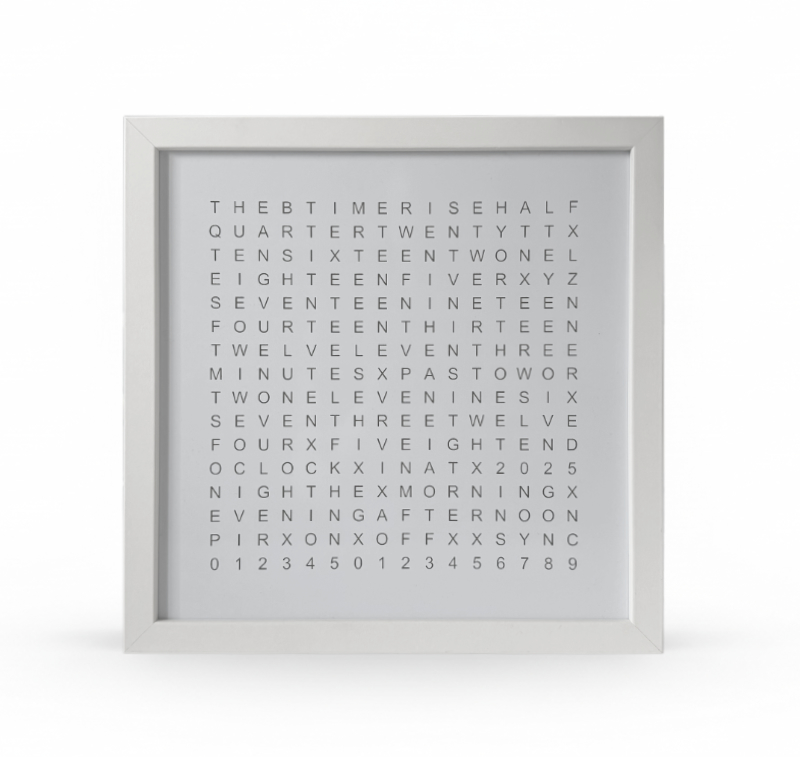
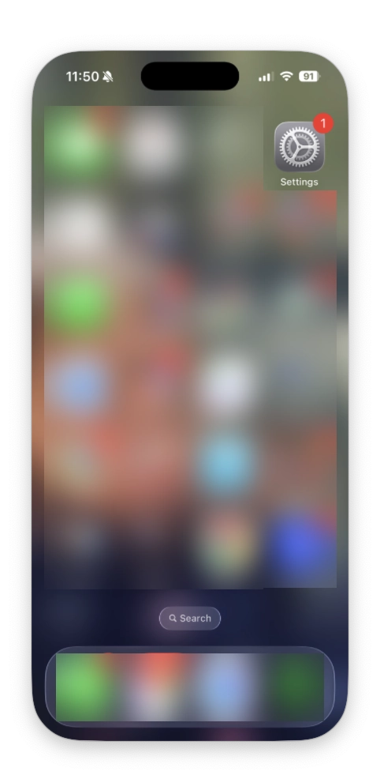
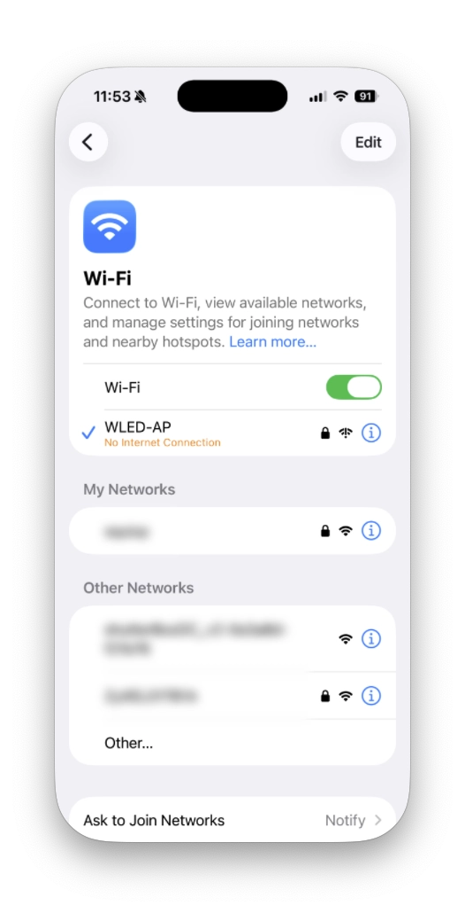
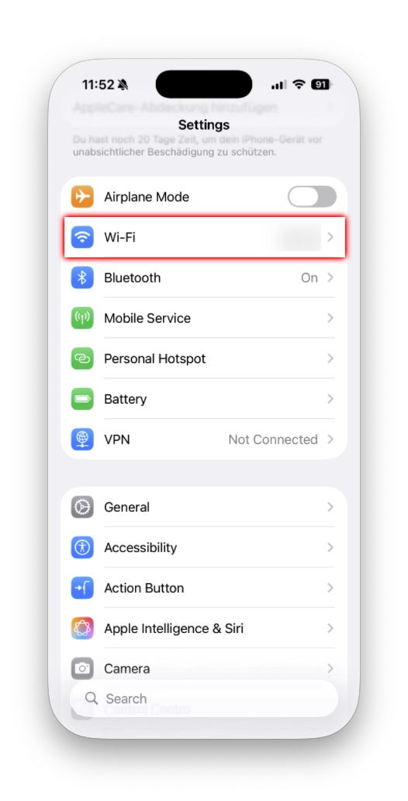
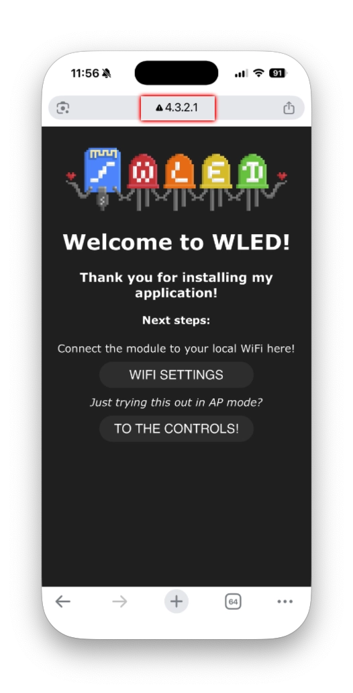
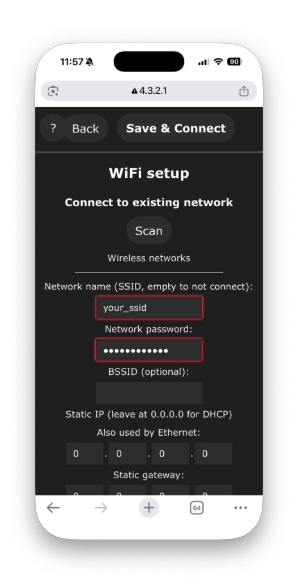

# Icon256 – Wortuhr {#icon256-word-clock}

So richtest du die [ThingPulse Icon256 – Word Clock](https://thingpulse.com/product/icon256-word-clock/) ein und konfigurierst sie.

---

Die Icon256 – Word Clock wird mit einer angepassten Version von [WLED](https://kno.wled.ge/) ausgeliefert, einer leistungsfähigen Firmware mit vielen Funktionen zur Steuerung adressierbarer LED-Streifen. Mit dieser Anleitung nimmst du deine Wortuhr in wenigen Minuten in Betrieb.

## Schnellstart {#quick-start}

### Einschalten {#power-on}

Verbinde die Icon256 – Word Clock mit einer USB-C-Stromquelle (5 V, mindestens 1 A empfohlen). Die Wortuhr schaltet sich automatisch ein und zeigt eine Standardanimation.

### Mit dem WLAN verbinden {#connect-to-wifi}

Beim ersten Einschalten erstellt die Icon256 einen eigenen WLAN-Zugangspunkt zur einfachen Einrichtung. Gehe wie folgt vor:

1. **Schnellverbindung per QR-Code:** Scanne diesen QR-Code mit deinem Smartphone, um dich automatisch mit dem Zugangspunkt zu verbinden:

   

   *Falls der QR-Code nicht funktioniert:* Suche das WLAN `WLED-AP` (oder einen ähnlichen Namen, eventuell mit der Chip-ID des Geräts) und verbinde dich mit dem Passwort `wled1234`.

2. **Bebilderte Anleitung:** Klicke auf eines der Bilder unten, um die Einrichtungsschritte in einer Bildergalerie anzuzeigen. Mit den Pfeiltasten oder den angezeigten Pfeilen wechselst du zwischen den Schritten.

{ data-title="Schritt 1: Einstellungen öffnen" data-description="Dein Gerät sollte automatisch die Anmeldeseite öffnen. Falls nicht, rufe http://4.3.2.1 auf." }

{ data-title="Schritt 2: WLAN-Einrichtung" data-description="Klicke auf WIFI SETUP, um die Netzwerkeinstellungen zu öffnen." }

{ data-title="Schritt 3: WLAN konfigurieren" data-description="Wähle dein WLAN, gib das Passwort ein und klicke auf Save & Connect." }

{ data-title="Schritt 4: Verbunden" data-description="Die Icon256 startet neu und verbindet sich mit deinem Netzwerk." }

{ data-title="Schritt 5: WLAN auswählen" data-description="Verbinde dein Smartphone wieder mit deinem normalen WLAN." }

!!! tip "Tipp"
    Notiere dir die auf der Konfigurationsseite angezeigte IP-Adresse. Wenn du mit demselben WLAN verbunden bist, kannst du die WLED-Oberfläche jederzeit über diese Adresse im Browser aufrufen.

### WLED-App installieren {#install-the-wled-app}

Für eine komfortable Bedienung am Smartphone installierst du die offizielle WLED-App:

**Für iOS:**

1. Öffne den [App Store](https://apps.apple.com/ch/app/wled-native/id6446207239).
2. Suche nach „WLED“ von Christophe Ganier.
3. Lade die App herunter und installiere sie.
4. Öffne die App. Sie erkennt deine Icon256 automatisch, wenn beide mit demselben WLAN verbunden sind.

**Für Android:**

1. Öffne den [Google Play Store](https://play.google.com/store/apps/details?id=ca.cgagnier.wlednativeandroid).
2. Suche nach „WLED“ von Christian Schwinne.
3. Lade die App herunter und installiere sie.
4. Öffne die App. Sie erkennt deine Icon256 automatisch im Netzwerk.

!!! note "Hinweis"
    Stelle sicher, dass dein Smartphone mit demselben WLAN verbunden ist wie deine Icon256 – Word Clock.

### Wortuhr-Effekt auswählen {#select-the-word-clock-effect}

Die Icon256 enthält einen vorkonfigurierten Wortuhr-Effekt. So aktivierst du ihn:

#### Über die Weboberfläche: {#using-the-web-interface}

1. Öffne einen Browser und gib die IP-Adresse deiner Icon256 ein.
2. Klicke auf der Hauptseite auf den Reiter **Effects** (FX-Symbol).
3. Scrolle durch die Effektliste und wähle **„Word Clock“**.
4. Das Display wechselt sofort in den Wortuhr-Modus und zeigt die aktuelle Uhrzeit an.

#### Über die WLED-App: {#using-the-wled-app}

1. Öffne die WLED-App.
2. Tippe in der Liste der erkannten Geräte auf deine Icon256.
3. Tippe auf **Effects** (Stern-/Funkelsymbol).
4. Scrolle nach unten und wähle **„Word Clock“**.
5. Die Uhrzeit wird jetzt auf deiner Icon256 in Worten angezeigt.

### Zeitzone einstellen {#set-the-time-zone}

Damit die Wortuhr die richtige Uhrzeit anzeigt, musst du deine Zeitzone konfigurieren:

#### Über die Weboberfläche: {#using-the-web-interface_1}

1. Klicke in der WLED-Weboberfläche auf **Config** (Zahnradsymbol).
2. Wähle **Time & Macros**.
3. Im Abschnitt **Time setup**:
    - Aktiviere **„Get time from NTP server“**.
    - **NTP Server:** Verwende den Standardwert (`0.wled.pool.ntp.org`) oder trage deinen bevorzugten NTP-Server ein.
    - **Timezone:** Gib den Zeitzonenversatz in Sekunden ein oder verwende das UTC-Versatzformat.
        - Beispiel für PST (UTC−8): `-28800`, oder wähle die Zeitzone aus der Liste.
        - Beispiel für CET (UTC+1): `3600`.
        - Beispiel für EST (UTC−5): `-18000`.
    - **UTC offset:** Alternativ kannst du den Versatz gegenüber UTC in Stunden und Minuten einstellen.
4. Klicke unten auf **Save**.
5. Die Icon256 synchronisiert sich mit dem NTP-Server und zeigt die richtige Ortszeit an.

#### Über die WLED-App: {#using-the-wled-app_1}

1. Tippe in der WLED-App auf das Gerät.
2. Tippe auf das Symbol **Settings** (drei Punkte oder Zahnrad).
3. Wähle **Time & Macros**.
4. Konfiguriere dieselben Einstellungen wie oben beschrieben.
5. Tippe auf **Save**.

!!! tip "Beispiele für Zeitzonen"
    - **Pacific Time (PST/PDT):** UTC-Versatz = −8 Stunden (−28800 Sekunden)
    - **Mountain Time (MST/MDT):** UTC-Versatz = −7 Stunden (−25200 Sekunden)
    - **Central Time (CST/CDT):** UTC-Versatz = −6 Stunden (−21600 Sekunden)
    - **Eastern Time (EST/EDT):** UTC-Versatz = −5 Stunden (−18000 Sekunden)
    - **Mitteleuropäische Zeit (CET/CEST):** UTC-Versatz = +1 Stunde (3600 Sekunden)
    - **Britische Zeit (GMT/BST):** UTC-Versatz = 0 Stunden (0 Sekunden)

### Helligkeit anpassen {#adjust-brightness}

Passe die Helligkeit an deine Umgebung an:

- **Weboberfläche:** Verwende den Helligkeitsregler oben auf der Hauptseite.
- **WLED-App:** Verwende den Helligkeitsregler in der Hauptansicht.
- **Taste am Gerät** (falls deine Icon256 eine besitzt): Kurz drücken zum Ein-/Ausschalten, lange drücken zum Durchlaufen der Helligkeitsstufen.

## Erweiterte Funktionen {#advanced-features}

### Anpassungsmöglichkeiten {#customization-options}

Der Wortuhr-Effekt bietet mehrere Einstellungen:

1. **Farbauswahl:** Ändere die Farbe der angezeigten Wörter.
    - Tippe auf das Farbpalettensymbol.
    - Wähle eine Farbe oder erstelle eine eigene.
2. **Hintergrundfarbe:** Bei manchen Wortuhr-Varianten kannst du eine Hintergrundfarbe für die nicht leuchtenden Wörter festlegen.
3. **Effektintensität und Geschwindigkeit:** Passe diese Regler an, um die Übergangseffekte beim Wechsel der Uhrzeit zu verändern.

### Voreinstellungen {#presets}

Speichere deine bevorzugten Konfigurationen als Presets:

1. Stelle den Wortuhr-Effekt mit den gewünschten Farben und Optionen ein.
2. Klicke auf **Presets** (Lesezeichensymbol).
3. Klicke auf **Save to ID** und wähle einen freien Speicherplatz.
4. Vergib einen aussagekräftigen Namen, beispielsweise „Blaue Wortuhr“.
5. Danach kannst du deine Presets jederzeit mit einem Klick aufrufen.

### Automatische Zeitsteuerung {#automatic-scheduling}

Du kannst die Wortuhr automatisch ein- und ausschalten lassen:

1. Öffne **Config** > **Time & Macros**.
2. Scrolle zu **Time-controlled presets**.
3. Richte bis zu 10 zeitgesteuerte Aktionen ein.
    - Wähle Uhrzeiten und Wochentage.
    - Wähle die auszulösenden Presets oder Aktionen, beispielsweise nachts ausschalten und morgens einschalten.

### Drahtlose Aktualisierungen (OTA) {#over-the-air-ota-updates}

Halte deine WLED-Firmware aktuell:

1. Öffne **Config** > **Security & Updates**.
2. Klicke auf **Manual OTA Update**.
3. Das System prüft auf Aktualisierungen und ermöglicht die Installation der neuesten Version.

!!! warning "Warnung"
    Schalte das Gerät während einer Aktualisierung nicht aus. Sorge für eine stabile Stromversorgung.

## Fehlerbehebung {#troubleshooting}

### Die Wortuhr zeigt die falsche Uhrzeit {#word-clock-not-showing-correct-time}

- Prüfe, ob der Zeitzonenversatz korrekt ist.
- Stelle sicher, dass die Icon256 über das Internet den NTP-Server erreichen kann.
- Versuche eine manuelle Synchronisierung: Öffne Config > Time & Macros und klicke auf die Synchronisierungsschaltfläche.

### Keine WLAN-Verbindung möglich {#cannot-connect-to-wifi}

- Prüfe, ob du das richtige WLAN-Passwort eingegeben hast.
- Stelle sicher, dass dein WLAN das 2,4-GHz-Band verwendet. Der ESP32 unterstützt keine 5-GHz-Netzwerke.
- Stelle die Icon256 näher an deinen WLAN-Router.
- Versuche, die WLAN-Einstellungen zurückzusetzen, indem du das Gerät ausschaltest, 10 Sekunden wartest und es wieder einschaltest.

### Die App findet das Gerät nicht {#device-not-discovered-in-app}

- Prüfe, ob Smartphone und Icon256 mit demselben WLAN verbunden sind.
- Prüfe die Routereinstellungen. Manche Router trennen WLAN-Geräte voneinander (AP-Isolation).
- Versuche, das Gerät in der WLED-App manuell über seine IP-Adresse hinzuzufügen.

### Auf Werkseinstellungen zurücksetzen {#reset-to-factory-settings}

So setzt du deine Icon256 vollständig zurück:

1. Öffne **Config** > **Security & Updates**.
2. Klicke auf **Factory Reset**.
3. Bestätige den Vorgang.
4. Das Gerät startet mit den Standardeinstellungen neu.

## Support {#support}

Wenn du Hilfe mit der Icon256 – Word Clock benötigst, wende dich unter [https://support.thingpulse.com/](https://support.thingpulse.com/) an ThingPulse und die Community.

## Weitere Informationen {#additional-resources}

- [Offizielle WLED-Dokumentation](https://kno.wled.ge/)
- [WLED-Repository auf GitHub](https://github.com/Aircoookie/WLED)
- [ThingPulse-Supportportal](https://support.thingpulse.com/)
