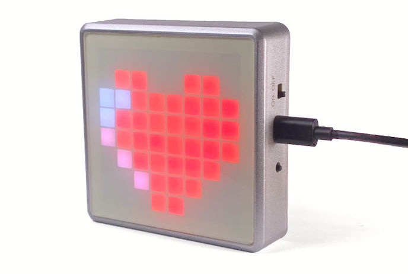
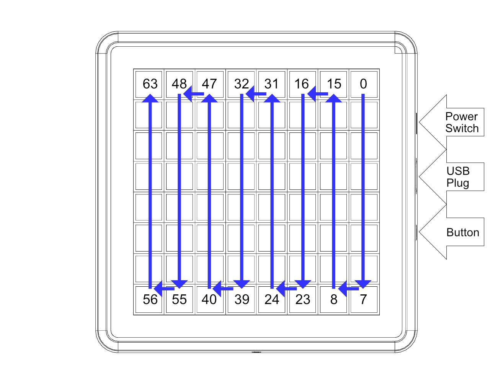
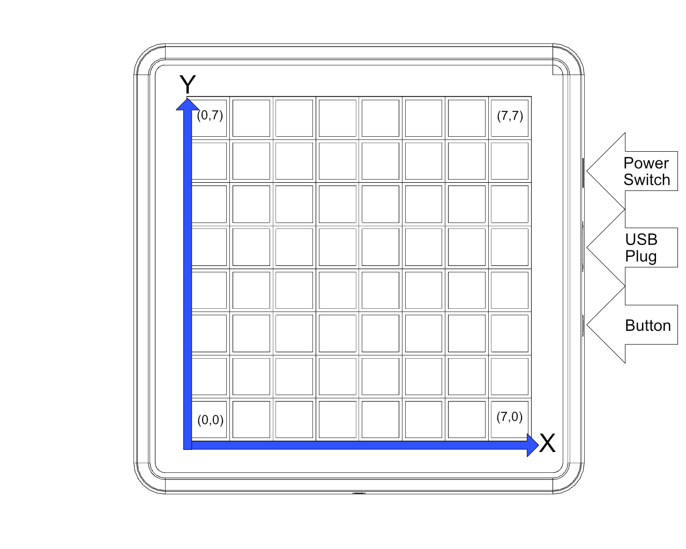

# Icon64 – ESP32 mit RGB-LEDs und Audio {#icon64-esp32-with-rbg-led-audio}

So konfigurierst und erweiterst du den [ThingPulse Icon64](https://thingpulse.com/product/icon64/).



Du kannst [fertige Apps installieren](#installing-apps-on-the-icon64) oder [das Gerät selbst programmieren](#programming-the-icon64). Eine Liste der Anwendungen von ThingPulse findest du unter [Icon64-Projekte](#icon64-projects).

## Vorinstallierte Firmware verwenden {#using-the-stock-firmware}

Der Icon64 wird mit vorinstallierter Firmware geliefert. Sie macht ihn zu einem Bluetooth-Lautsprecher mit integriertem 8-Band-Spektrumanalysator.

Verbinde das Gerät zunächst mit einer USB-Stromquelle und schalte es am seitlichen Ein-/Ausschalter ein. Das Display zeigt ein pulsierendes Herz wie oben abgebildet. Öffne jetzt die Bluetooth-Einstellungen auf deinem Smartphone oder Computer, verbinde dich mit „ThingPulse-Icon64“ und spiele Musik ab. Das folgende Video zeigt den gesamten Vorgang:

<iframe width="1280" height="560" src="https://www.youtube.com/embed/1UpbtE98OBA" frameborder="0" allow="accelerometer; autoplay; encrypted-media; gyroscope; picture-in-picture" allowfullscreen></iframe>

## Apps auf dem Icon64 installieren {#installing-apps-on-the-icon64}

ThingPulse bietet mit [App Fairy](https://github.com/ThingPulse/app-fairy) eine Anwendung für deinen Computer an, über die du ähnlich wie in einem App Store Apps auf dem Icon64 installieren kannst. App Fairy besteht aus einer einzelnen ausführbaren Datei für macOS oder Windows und benötigt keine Installation: herunterladen und starten genügt. Voraussetzung ist lediglich ein installierter USB-Seriell-Treiber für die Kommunikation zwischen Computer und Gerät.


- Installiere die Treiber wie [weiter unten beschrieben](#install-drivers).
- Lade die neueste App-Fairy-Version für dein Betriebssystem von [https://github.com/ThingPulse/app-fairy/releases](https://github.com/ThingPulse/app-fairy/releases) herunter.
- Verbinde den Icon64 mit einem USB-*Datenkabel* mit deinem Computer.
- Schalte den Icon64 ein.
- Starte App Fairy.
- Wähle eine Anwendung aus.
- Gib die Konfigurationswerte ein.
- Klicke auf „Install Application“.

!!! tip "Tipp"
    Neue Apps und Aktualisierungen vorhandener Apps werden beim nächsten Start von App Fairy automatisch geladen. Du musst App Fairy dafür nicht aktualisieren.

## Icon64 programmieren {#programming-the-icon64}

Die folgenden Abschnitte beschreiben, wie du Anwendungen für den Icon64 kompilierst und installierst. Als Beispiel verwenden wir die vorinstallierte Firmware. Die Vorgehensweise ist für andere Anwendungen identisch.

Eine Liste der von ThingPulse bereitgestellten Apps findest du unter [Icon64-Projekte](#icon64-projects).

### Treiber installieren {#install-drivers}
{!../includes/install-drivers.de.md!}

### PlatformIO IDE installieren {#install-platformio-ide}

Alle ThingPulse-Icon64-Beispielprojekte werden mit PlatformIO erstellt. Wenn du sie unverändert verwenden möchtest, benötigst du deshalb eine lokale PlatformIO-Installation.

{!../includes/platformio.de.md!}

### Original-Firmware herunterladen {#get-the-stock-firmware}

Nachdem der Treiber installiert ist und Visual Studio Code mit der PlatformIO-Erweiterung läuft, kannst du die Original-Firmware kompilieren und installieren.

Lade das Firmware-Repository mit Git herunter:

```sh
$ git clone  https://github.com/ThingPulse/esp32-icon64-a2dp
```

Alternativ kannst du die ZIP-Datei von dieser URL herunterladen und entpacken.

Öffne anschliessend den Ordner `esp32-icon64-a2dp` in Visual Studio Code.

### Original-Firmware übertragen {#upload-the-stock-firmware}

Verbinde den Icon64 über ein USB-Datenkabel mit deinem Computer und schalte ihn ein, indem du den Ein-/Ausschalter auf „ON“ stellst.

Öffne `platformio.ini`. Prüfe vor der Übertragung die folgenden zwei Zeilen und passe sie bei Bedarf an:

```
upload_port = /dev/cu.SLAB_USBtoUART
monitor_port = /dev/cu.SLAB_USBtoUART
```

Sie geben den seriellen USB-Anschluss an, über den der Icon64 mit deinem Computer verbunden ist. Das Beispiel oben funktioniert so unter macOS. Unter Windows kann der Anschluss etwa COMX heissen, wobei X eine Zahl zwischen 1 und 9 ist. Wie du den passenden Anschluss ermittelst, erfährst du in der [PlatformIO-Dokumentation](https://docs.platformio.org/en/latest/projectconf/section_env_upload.html).

Suche jetzt unten links in Visual Studio Code nach dem Pfeilsymbol:


Klicke darauf, um alle Bibliotheken herunterzuladen, den Code zu kompilieren und die Binärdatei auf das Gerät zu übertragen. Beim ersten Mal kann das etwas länger dauern, weil PlatformIO zusätzlich die ESP32-Toolchain und alle benötigten Bibliotheken herunterladen muss.

Bei erfolgreicher Übertragung sieht die Ausgabe ungefähr so aus:

``` 
Writing at 0x000a4000... (100 %)
Wrote 1051168 bytes (619238 compressed) at 0x00010000 in 10.9 seconds (effective 768.2 kbit/s)...
Hash of data verified.

Leaving...
Hard resetting via RTS pin...
=========================== [SUCCESS] Took 18.40 seconds ===============================
```

## Technische Daten {#hardware-specification}

Bevor du eigene Projekte entwickelst, mache dich mit den Hardwarekomponenten vertraut. Für Hardware-Erweiterungen hilft dir der [Schaltplan der Platine](/specs/Icon64-specification-v1.0.3.pdf).

Für die Entwicklung mit dem Icon64 solltest du die folgenden Komponenten kennen.

### RGB-LEDs {#rgb-leds}

Der Icon64 enthält 64 RGB-LEDs des Typs WS2812B im 3030-Gehäuse. Sie lassen sich über GPIO32 einzeln ansteuern.

Die LED-Indizes sind in der folgenden Abbildung dargestellt:



Die folgende Funktion wandelt x/y-Koordinaten im Bereich {0..7}/{0..7}, wie unten dargestellt, in einen LED-Index im Bereich {0..63} aus der Abbildung oben um.

```c
uint8_t getLedIndex(uint8_t x, uint8_t y) {
  if (x % 2 == 1) {
    return 63 - (y + x * 8);
  } else {
    return 63 - (7 - y + x * 8);
  }
}
```



Zur Ansteuerung der LEDs empfehlen wir eine dieser Bibliotheken: [roboticsbrno/SmartLeds](https://github.com/RoboticsBrno/SmartLeds) oder [fastled/FastLED](https://github.com/fastled/FastLED).

Dieses Beispiel zeigt die Verwendung von FastLED:

``` c
#include <Arduino.h>
#include <FastLED.h>

// LED Settings
#define NUM_LEDS          64
#define DATA_PIN          32 

// Define the led chain
CRGB leds[NUM_LEDS];
uint8_t counter = 0;

void setup() {
    Serial.begin(115200);                                    
    FastLED.addLeds<WS2812B, DATA_PIN, GRB>(leds, NUM_LEDS);
}

void loop() {
  FastLED.clear();
  // Activate one pixel after the other 
  // and cycle through the color wheel in HSV
  leds[counter % 64] = CHSV(counter, 255, 100);
  counter = (counter + 1) % 256;
  FastLED.show();
  delay(100);
}
```

### Audio {#audio}

Der ESP32 ist über [I²S](https://en.wikipedia.org/wiki/I%C2%B2S) mit einem [MAX98357a](https://datasheets.maximintegrated.com/en/ds/MAX98357A-MAX98357B.pdf) verbunden. Der I²S-Bus benötigt drei Pins: DOUT, BCLK und LRC. Über den Mode-Pin wird die Audioausgabe aktiviert, indem GPIO33 auf HIGH gesetzt wird.

| MAX98357a | ESP32 |
|-----------|-------|
| DOUT | GPIO25 |
| BCLK | GPIO26 |
| LRC | GPIO22 |
| MODE PIN | GPIO33 |

!!! important "Wichtig"
    Der Lautsprecher bleibt stumm, solange GPIO33 nicht auf HIGH gesetzt ist.

Wir verwenden die folgenden beiden Audiobibliotheken selbst und können sie empfehlen:

- [schreibfaul1/ESP32-audioI2S](https://github.com/schreibfaul1/ESP32-audioI2S), verwendet in unserer [Zahnfee-App](#tooth-fairy)
- [earlephilhower/ESP8266Audio](https://github.com/earlephilhower/ESP8266Audio), verwendet in unserer [Original-Firmware](#bluetooth-speaker)

### Taster {#tactile-switch}

Der Icon64 besitzt einen Taster zur Bedienung des Geräts. Seinen Zustand kannst du an GPIO39 auslesen. GPIO39 ist mit einem 470-Ω-Pull-up-Widerstand verbunden.

Die Bibliothek [evert-arias/EasyButton](https://github.com/evert-arias/EasyButton) unterstützt einfache, lange und wiederholte Tastendrücke sowie weitere Ereignisse. Du kannst Callback-Funktionen mit bestimmten Tastenereignissen verknüpfen und damit beim Eintreten eines Ereignisses gezielt Code ausführen.

## Icon64-Projekte {#icon64-projects}

### Bluetooth-Lautsprecher {#bluetooth-speaker}

Der [Bluetooth-Lautsprecher](https://github.com/ThingPulse/esp32-icon64-a2dp) ist die vorinstallierte Firmware des Icon64. Mit den LEDs zeigt er die Ausgabe des integrierten 8-Band-Spektrumanalysators an.

### Zahnfee {#tooth-fairy}

Die [Zahnfee](https://github.com/ThingPulse/esp32-icon64-toothfairy) macht das Zähneputzen für dich und/oder deine Kinder unterhaltsamer: mit einem farbenfrohen Countdown und Webradio.

### CO₂-Monitor {#co2-monitor}

Die Anwendung [CO₂-Monitor](https://github.com/ThingPulse/esp32-icon64-co2) benötigt einen CO₂-Sensor vom Typ MH-Z19C oder Sensirion SCD4x, der auf die Platine gesteckt oder gelötet wird. Sie zeigt die aktuelle CO₂-Konzentration der Umgebung an und warnt akustisch, sobald die festgelegten Warn- oder Alarmgrenzen erreicht werden.

### Wortuhr {#word-clock}

Die [Wortuhr](https://github.com/ThingPulse/icon64-word-clock) zeigt die aktuelle Zeit mithilfe einer Schablone hinter der Frontplatte an. In einem [Video](https://youtu.be/p8oyx-fEvpg) zeigen wir, wie du einen serienmässigen Icon64 in eine Wortuhr umbaust.
