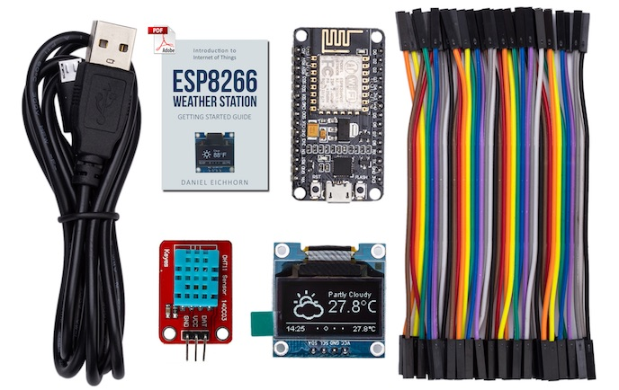

# ESP8266 IoT Starter Kit {#esp8266-iot-starter-kit}

So baust du das [ThingPulse ESP8266 IoT Starter Kit](https://thingpulse.com/product/esp8266-iot-electronics-starter-kit-weatherstation-planespotter-worldclock/) zusammen und programmierst es.

---

Die Anleitung stellen wir derzeit als [PDF mit über 60 Seiten](https://blog.squix.org/weatherstation-guide) bereit.

