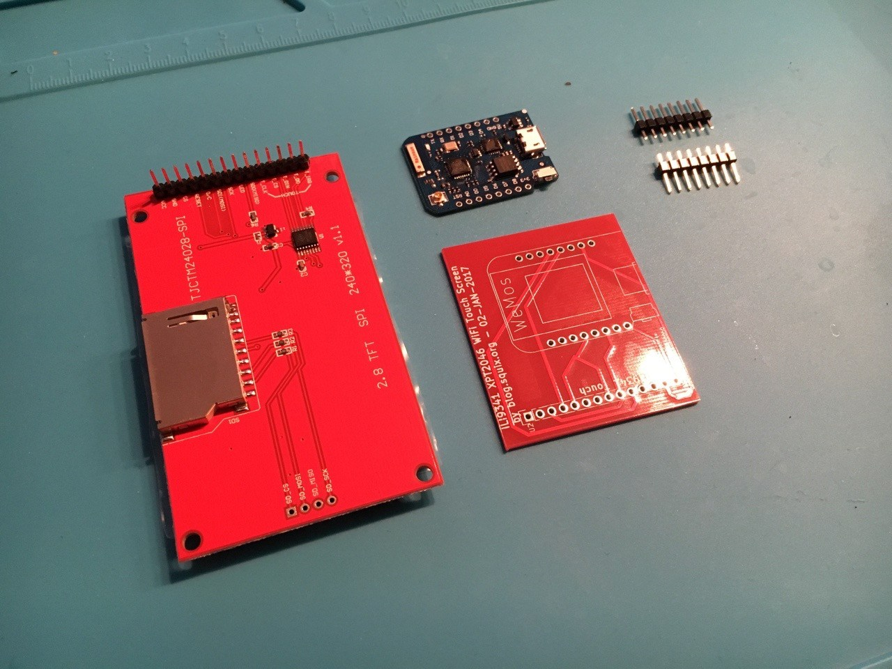
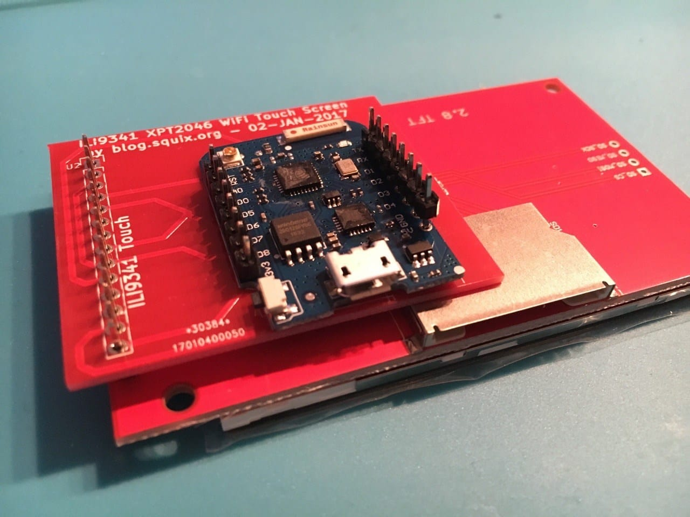
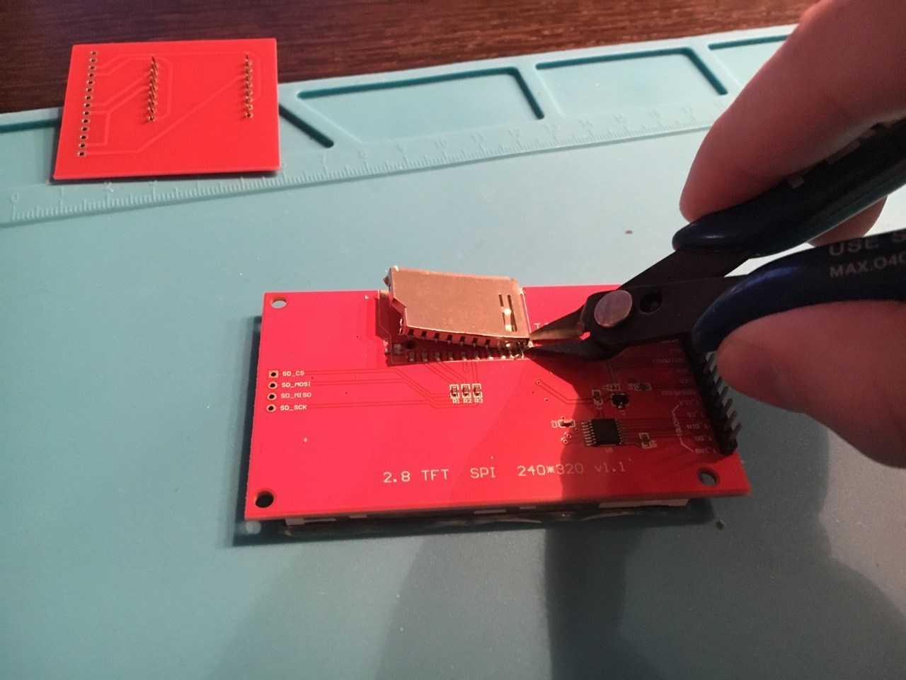
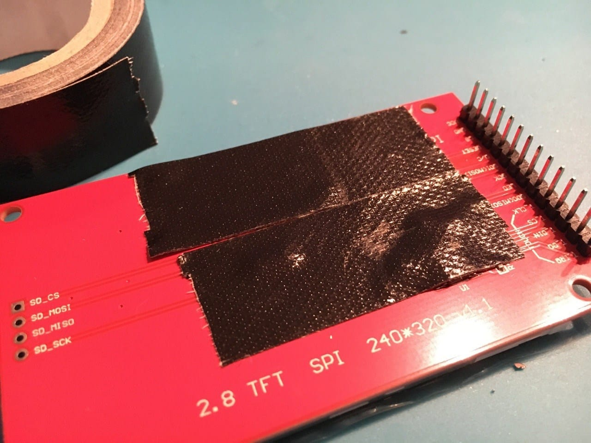
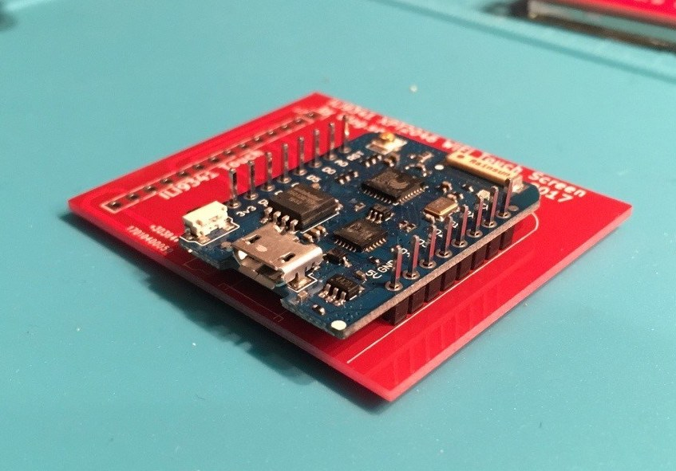
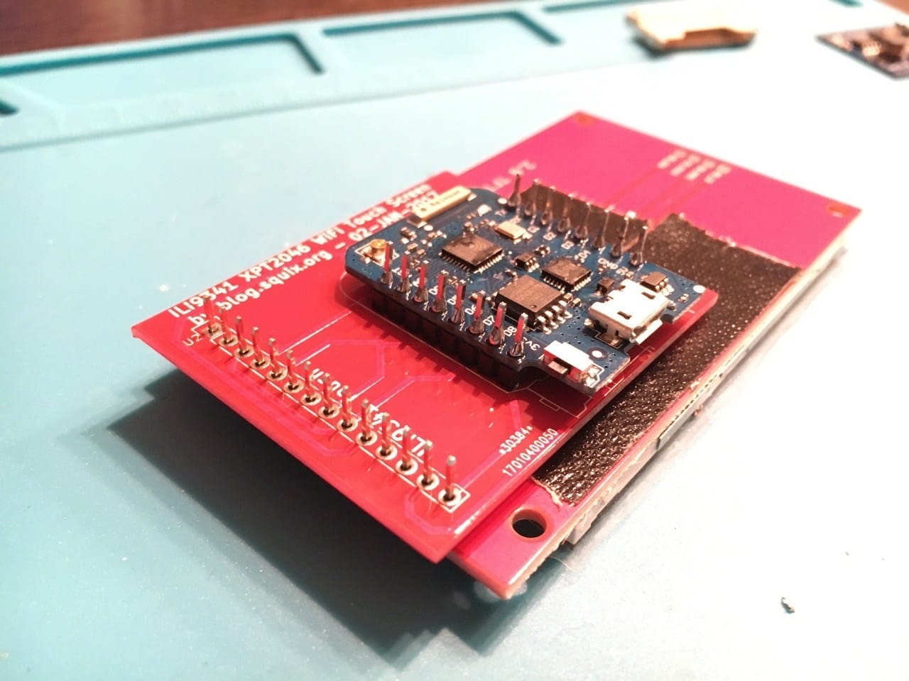
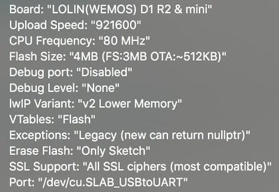
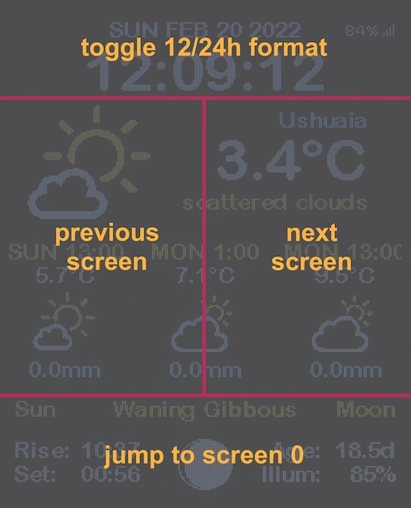

# WiFi Color Display Kit {#wifi-color-display-kit}

So baust du das [ThingPulse ESP8266 WiFi Color Display Kit](https://thingpulse.com/product/esp8266-wifi-color-display-kit-2-4/) zusammen und programmierst es.

---

!!! note "Hinweis"

    Lies diese Anleitung sorgfältig durch, *bevor* du mit dem Löten beginnst. Stelle insbesondere sicher, dass du alle Bauteile und Werkzeuge bereithältst.

Zusätzlich zu den Bauteilen im Bausatz benötigst du:

- einen [Lötkolben](https://thingpulse.com/go/soldering-iron/)
- Lötzinn
- Isolierband oder Gewebeklebeband
- einen [Seitenschneider](https://thingpulse.com/go/cutting-pliers/) oder Entlötlitze zum Entfernen des SD-Kartenhalters

Wenn du bei dieser Anleitung Hilfe benötigst, kannst du dich unter https://support.thingpulse.com/ an ThingPulse und die Community wenden.

## Vorbereitung {#preparation}

### Bauteile prüfen {#material-inspection}

Der Bausatz besteht aus dem Displaymodul (links), der Anschlussplatine (unten rechts), dem WeMos D1 mini (oben in der Mitte) und zwei Stiftleisten.

### Zusammenbau ohne Löten ausprobieren {#dry-run-assembly}

Stecke die Teile zunächst wie unten gezeigt ohne Löten zusammen und richte sie passend aus.

Du *kannst* die Stiftleisten wie im Bild in den D1 mini stecken. Wenn du sie jedoch umdrehst und mit dem längeren Ende von unten durch den D1 mini steckst, kannst du später oben eine Erweiterungsplatine aufsetzen; weiter unten ist ein Bild dazu. Wenn du diese Möglichkeit nicht benötigst und die Stiftleisten wie abgebildet einsetzen möchtest, musst du sie *zuerst* an den D1 mini löten. Anschliessend lötest du den D1 mini mit den Stiftleisten an die Anschlussplatine. Bei umgedrehten Stiftleisten ist die Reihenfolge umgekehrt.

### Displaymodul vorbereiten {#prepare-display-module}

*DIESER SCHRITT IST OPTIONAL*

Für einen möglichst flachen Aufbau kannst du das Displaymodul etwas anpassen: Entferne den SD-Kartenhalter. Je nach Erfahrung beim Entlöten kannst du dafür Entlötlitze verwenden oder den Halter mit einem spitzen Seitenschneider abschneiden.

### Kurzschlüsse verhindern {#short-circuit-prevention}

Klebe den Bereich unterhalb der Anschlussplatine ab, damit der D1 mini nicht versehentlich einen Kurzschluss mit der Displayplatine verursacht.

## Löten {#soldering}

### Anschlussplatine und D1 mini verbinden {#connect-pcb-and-d1-mini}

Die beiden möglichen Ausrichtungen der Stiftleisten zwischen Anschlussplatine und D1 mini wurden oben beschrieben. Für den unten gezeigten Aufbau empfehlen wir folgende Schritte:

- Stecke die Teile wie abgebildet zusammen.
- Halte den Aufbau zwischen den Fingern und drehe ihn um.
- Löte die Stifte von hinten an die Anschlussplatine.
- Drehe den Aufbau wieder um und löte den D1 mini von oben fest.

### Anschlussplatine mit dem Display verbinden {#connect-pcb-to-display}

Löte zum Abschluss des Hardwareaufbaus die Anschlussplatine wie unten gezeigt an das Display.

Dieses Zeitraffervideo zeigt alle oben beschriebenen Schritte. Beachte, dass Anschlussplatine und Display hier mit etwas mehr Abstand verbunden werden.

<iframe width="688" height="387" src="https://www.youtube.com/embed/7fbGS4MjoMk?rel=0" frameborder="0"
allow="autoplay; encrypted-media" allowfullscreen></iframe>

## Entwicklungsumgebung einrichten {#development-environment-setup}

### Treiber installieren {#install-drivers}
{!../includes/install-drivers.de.md!}

### Arduino IDE für den ESP8266 vorbereiten {#prepare-arduino-ide-for-esp8266}
{!../includes/Arduino-IDE.de.md!}

#### ESP8266-Toolchain installieren {#install-the-esp8266-toolchain}
{!../includes/ESP8266-for-Arduino-IDE.de.md!}

#### Platine und seriellen Anschluss auswählen {#select-board-and-serial-port}
{!../includes/select-board-and-serial-in-Arduino-IDE.de.md!}

#### Flash-Modus und Flash-Grösse auswählen {#select-flash-mode-and-flash-size}

Der im Bausatz enthaltene WeMos D1 mini verfügt über 4 MB integrierten SPI-Flash-Speicher. Davon werden 3 MB für ein [SPIFFS-Dateisystem](https://github.com/pellepl/spiffs) reserviert. Wenn du in der IDE die richtige Platine auswählst, sollten Flash-Modus und Flash-Grösse automatisch eingestellt werden. Prüfe diese Einstellung:

- Wähle unter ==Tools== > ==Flash Size== den Eintrag „4MB (FS:3MB OTA:~512KB)“.

In älteren Versionen der ESP8266-Toolchain (ESP8266 Arduino Core) hiess dieser Eintrag „4M (3M SPIFFS)“ oder ähnlich.

Bei falschen Flash-Einstellungen kann die Übertragung oder der Start der Anwendung fehlschlagen. Das Menü unter ==Tools== sollte so aussehen:

#### Bibliotheken installieren {#install-libraries}

Die ThingPulse Weather Station Color verwendet mehrere zusätzliche Bibliotheken. Sie müssen in der Arduino IDE verfügbar sein, damit sie kompiliert und mit der Anwendung verknüpft werden können.

Öffne ==Sketch== > ==Include Library...== > ==Manage Libraries...==. Gib für jede Bibliothek ihren Namen in das Suchfeld ein. Ihre Informationen werden aus dem Internet geladen und darunter angezeigt. Wähle die neueste Version und installiere sie. Prüfe diesen Dialog gelegentlich, um die Bibliotheken aktuell zu halten. Stelle sicher, dass jeweils nur eine Version jeder Bibliothek installiert ist.

- [Mini Grafx](https://github.com/ThingPulse/minigrafx) von ThingPulse
- [ESP8266 WeatherStation](https://github.com/ThingPulse/esp8266-weather-station) von ThingPulse
- [Json Streaming Parser](https://github.com/squix78/json-streaming-parser) von Daniel Eichhorn
- [XPT2046 Touchscreen](https://www.arduinolibraries.info/libraries/xpt2046_touchscreen) >=1.4 von Paul Stoffregen

## OpenWeatherMap-API-Schlüssel erstellen {#create-openweathermap-api-key}

{!../includes/openweathermap-key.de.md!}

## Projekt Weather Station Color {#weather-station-color-project}

Nach den Vorbereitungen geht es endlich an das eigentliche Projekt Weather Station Color. Dieser letzte Teil ist erfreulich einfach.

**Quellcode herunterladen**

Wie alle Open-Source-Projekte von ThingPulse ist auch das WiFi-Color-Kit-Projekt öffentlich auf GitHub verfügbar. Du hast zwei Möglichkeiten:

- Klone das Repository mit Git: `git clone https://github.com/ThingPulse/esp8266-weather-station-color`
- Lade den Quellcode von https://github.com/ThingPulse/esp8266-weather-station-color/archive/master.zip herunter und entpacke ihn in einen Ordner namens ==esp8266-weather-station-color== auf deinem Computer. Entferne dazu „-master“ aus dem Ordnernamen.

**Projekt in der Arduino IDE öffnen**

- Starte die Arduino IDE.
- Wähle ==File== > ==Open==.
- Suche die im vorherigen Schritt heruntergeladene Datei [`esp8266-weather-station-color.ino`](https://github.com/ThingPulse/esp8266-weather-station-color/blob/master/esp8266-weather-station-color.ino) und öffne sie.

**Konfiguration und Anpassung**

In einem der geöffneten Reiter findest du [`settings.h`](https://github.com/ThingPulse/esp8266-weather-station-color/blob/master/settings.h). Gehe die Datei durch und passe die rund zehn Konfigurationsparameter an. Sie sind direkt in der Datei dokumentiert. Besonders wichtig ist der OpenWeatherMap-API-Schlüssel, den du zuvor erstellt hast.

**Programm auf das Gerät übertragen**

Übertrage zum Schluss das Programm mit allen Abhängigkeiten aus der Arduino IDE auf das Gerät. Verwende dazu STRG + U (⌘ + U unter macOS), ==Sketch== > ==Upload== oder das Symbol mit dem Rechtspfeil in der Werkzeugleiste.

## Bedienung {#operation}

### Touch-Kalibrierung {#touch-calibration}

Halte nach einem Neustart den ersten Bildschirm gedrückt, um eine erneute Kalibrierung des Touchscreens auszulösen.

### Navigation {#navigation}

Durch Antippen eines der vier Bereiche änderst du die Anzeige:

- Oben (Datum und Uhrzeit): zwischen 12- und 24-Stunden-Format wechseln.
- Mitte links: einen Bildschirm nach links wechseln.
- Mitte rechts: einen Bildschirm nach rechts wechseln.
- Unten (Sonnen-/Mondinformationen): zu Seite 0 springen.

